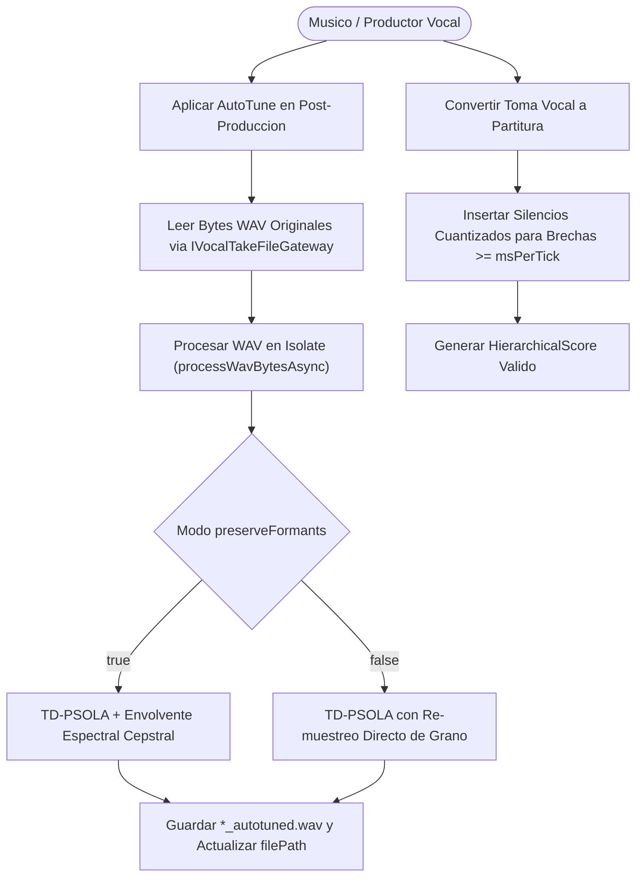
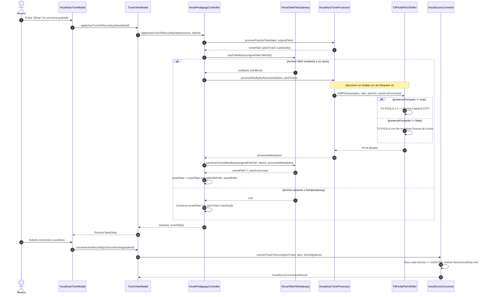

# Caso de Uso 162: Post-Produccion Real de Vocal AutoTune WAV, Preservacion de Formantes e Insercion de Silencios

## Metadatos del Documento
- **ID del Documento:** `DOC-USECASE-2026-162`
- **Titulo Oficial:** Procesamiento Real de Archivos WAV en Post-Produccion Vocal AutoTune, Preservacion de Formantes TD-PSOLA e Insercion de Silencios Cuantizados
- **Estado:** Approved
- **Fecha de Creacion:** 2026-11-22
- **Ultima Modificacion:** 2026-11-22
- **Fase Asociada:** Fase 4 / US-4.5 Hardening Vocal Suite
- **Autor / Revisor Principal:** Tunner Core Team
- **Issue Relacionado:** `#152`

---

## 1. Resumen Ejecutivo
Este caso de uso formaliza el pipeline completo de post-produccion de Vocal AutoTune sobre grabaciones WAV reales en disco y su conversion fiel a partituras jerarquicas con silencios musicales cuantizados. Hasta ahora, `applyAutoTuneToRecordingTake` solo actualizaba las muestras de metadatos en memoria (`pitchTrack`) sin transformar el audio WAV fisico, `TdPsolaPitchShifter` ignoraba la bandera `preserveFormants` y acotaba el tono a `50..1500 Hz`, y `VocalScoreConverter.convertTrackToScore` compactaba las notas omitiendo las brechas de silencio entre segmentos.

Mediante esta especificacion:
1. `VocalPedagogyController.applyAutoTuneToRecordingTake` lee los bytes del WAV original a traves de un puerto puro de dominio (`IVocalTakeFileGateway`), ejecuta `VocalAutoTuneProcessor.processWavBytesAsync` en un Isolate secundario, persiste el resultado como `*_autotuned.wav` y asigna la nueva ruta a `tunedTake.filePath`.
2. `TdPsolaPitchShifter.shiftPitch` amplia el rango soportado a `27.5..4186.0 Hz` (A0 a C8) e implementa una bifurcacion DSP real entre preservacion de envolvente espectral/formantes mediante liftering cepstral (`preserveFormants == true`) y re-muestreo directo de grano en dominio temporal (`preserveFormants == false`).
3. `VocalScoreConverter.convertTrackToScore` inserta silencios cuantizados `HierarchicalNote.rest` para toda brecha temporal `seg.startMs - lastEndMs >= msPerTick`, respetando los limites de compas.

---

## 2. Diagramas del Caso de Uso

### 2.1 Diagrama Formal de Caso de Uso (Mermaid)

### 2.2 Diagrama de Secuencia y Flujo Detallado (Mermaid)

---

## 3. Especificacion Funcional

### 3.1 Precondiciones
1. Existe una sesion multitrack activa con al menos una toma vocal (`PracticeTakeEntity`) que contiene `pitchTrack` y opcionalmente un archivo WAV PCM de 16 bits en disco.
2. El procesador `VocalAutoTuneProcessor` cuenta con una configuracion valida (`AutoTuneConfigEntity`), incluyendo escala, velocidad de retorno y bandera `formantPreservation`.
3. `IVocalTakeFileGateway` se encuentra inyectado (implementacion `LocalVocalTakeFileGateway` en produccion o `NoOpVocalTakeFileGateway` en pruebas sin I/O).

### 3.2 Postcondiciones
1. Si existe archivo WAV fisico legible en `originalTake.filePath`, se genera un nuevo archivo `*_autotuned.wav` en disco con las ventanas sonoras afinadas mediante TD-PSOLA dentro de un Isolate, y `tunedTake.filePath` apunta exactamente a dicha ruta.
2. `TdPsolaPitchShifter.shiftPitch` procesa frecuencias fundamentales desde `27.5 Hz` (A0) hasta `4186.0 Hz` (C8) y produce espectros claramente diferenciados segun `preserveFormants`.
3. La partitura generada por `VocalScoreConverter.convertTrackToScore` preserva los silencios iniciales e intermedios mayores o iguales a una semicorchea (`msPerTick`) mediante `HierarchicalNote.rest`, manteniendo `isValidScore == true`.

### 3.3 Flujo Principal
1. El usuario selecciona una toma grabada en `VocalAutoTuneModal` y ejecuta la accion "Afinar".
2. `VocalPedagogyController.applyAutoTuneToRecordingTake` genera `tunedTake` con el `pitchTrack` cuantizado.
3. Lee `rawBytes` desde `originalTake.filePath` via `IVocalTakeFileGateway`.
4. Ejecuta `await _autoTuneProcessor.processWavBytesAsync(wavBytes: rawBytes, pitchTrack: originalTake.pitchTrack)` en segundo plano.
5. Persiste los bytes retornados en disco como `*_autotuned.wav` a traves de `IVocalTakeFileGateway` y actualiza `tunedTake.filePath`.
6. Durante la resintesis por segmento, `TdPsolaPitchShifter` ajusta `effectivePitch` en `27.5..4186.0 Hz`, aplicando conservacion de envolvente cepstral cuando `preserveFormants == true` o re-muestreo directo de grano cuando `preserveFormants == false`.
7. Al convertir la toma a partitura en `VocalScoreConverter.convertTrackToScore`, por cada segmento valido se evalua `gapMs = seg.startMs - lastEndMs`; si `gapMs >= msPerTick`, se emiten tantos `HierarchicalNote.rest` cuantizados como ticks correspondan, dividiendo automaticamente en limites de compas antes de insertar la nota.

### 3.4 Flujos Alternativos y Condiciones de Error
- **Toma inexistente (`takeId` invalido):** `applyAutoTuneToRecordingTake` retorna `null` sin alterar la sesion.
- **Archivo WAV ausente, ruta vacia o entorno No-Op:** `readTakeBytes` retorna `null`; el controlador registra advertencia estructurada via `IStudioLogger` si la ruta no estaba vacia y retorna `tunedTake` con `pitchTrack` cuantizado sin lanzar excepciones.
- **Error de lectura/escritura en disco o encabezado WAV invalido:** Se captura de forma controlada, se registra en `IStudioLogger` y se evita corrupcion de estado en UI.
- **Buffer menor a 48 muestras o menor a 2 periodos (`len < p0 * 2`):** `TdPsolaPitchShifter.shiftPitch` retorna copia segura de `inputSamples` sin desbordamientos ni valores `NaN`.
- **Brecha temporal que cruza varios compases:** `VocalScoreConverter` divide la duracion de `HierarchicalNote.rest` entre los compases sucesivos para garantizar que ningun compas exceda `timeSignature.totalTicks`.
