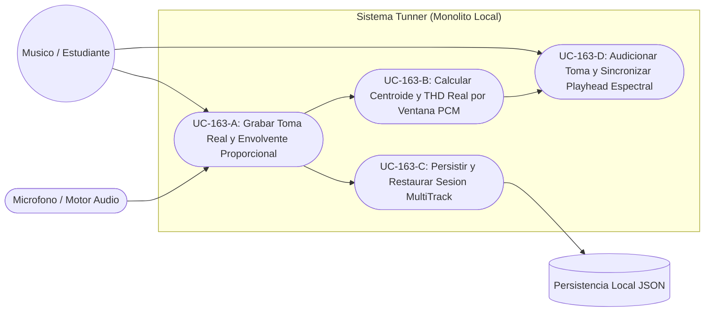
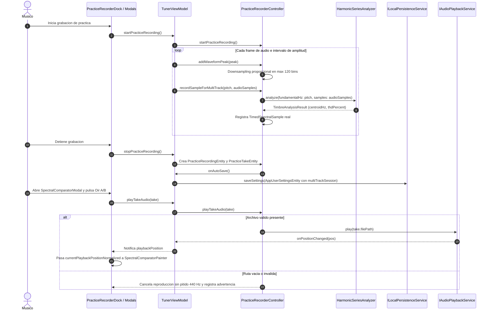

# Caso de Uso 163: Grabadora sin Tomas Falsas, Analisis Timbrico Real FFT/DFT, Persistencia MultiTrack y Playhead Espectral

## Metadatos del Documento

- **ID del Caso de Uso:** `UC-163-PRACTICE-RECORDER-REAL-TIMBRE-PERSISTENCE`
- **Nombre Canonico:** Grabar, analizar timbricamente y persistir sesiones multipista reales con playhead espectral sincronizado
- **Fase Asociada:** Fase 4 / Saneamiento Acustico Integral (US-4.6)
- **Actor Principal:** Musico / Estudiante
- **Actores Secundarios:** Hardware Microfono, `PitchDetectorService`, `HarmonicSeriesAnalyzer`, `ILocalPersistenceService`, `IAudioPlaybackService`
- **Estado:** Approved
- **Fecha de Creacion:** 2026-11-22
- **Ultima Modificacion:** 2026-11-22

---

## 1. Descripcion Breve y Propósito

Este caso de uso garantiza que el subsistema de grabacion de practica (`PracticeRecorderController`), su reproductor de auto-escucha (`PracticeRecordingPlayerModal`) y el comparador espectral multipista (`SpectralComparatorModal`) operen exclusivamente sobre senales fisicas reales y archivos de audio reales.

Elimina de raiz las tomas falsas presembradas (`take_1`, `take_2`, `rec_acoustic_demo_a440`, `rec_club_groove_124bpm`), la reproduccion ficticia de tonos sintetizados de 440 Hz ante rutas de archivo vacias, las constantes timbricas inventadas (`spectralCentroidHz: pitch * 2.6`, `thdPercent: 3.2`), las 40 barras sinteticas del visualizador de forma de onda cuando no hay picos y el truncamiento destructivo de `_currentWaveformPeaks` a los ultimos 60 puntos. Asimismo, incorpora persistencia completa de `MultiTrackSessionEntity` dentro de `AppUserSettingsEntity` y sincroniza el playhead vectorial en `SpectralComparatorModal`.

---

## 2. Diagrama de Caso de Uso (Mermaid)

---

## 3. Precondiciones y Postcondiciones

### 3.1 Precondiciones
1. El controlador `PracticeRecorderController` ha sido inicializado sin tomas falsas presembradas (`multiTrackSession.takes` vacio si no existe sesion persistida previa).
2. El motor de deteccion de tono emite ventanas PCM normalizadas reales mediante `onAudioWindowCaptured` durante la captura activa.
3. El servicio de persistencia local `ILocalPersistenceService` esta disponible para guardar y restaurar `AppUserSettingsEntity`.

### 3.2 Postcondiciones
1. Cada muestra espectral registrada en `_currentSpectralTrack` proviene de `HarmonicSeriesAnalyzer.analyze(...)` ejecutado sobre una ventana PCM real (con ventana de Hann y DFT dirigida).
2. `waveformPeaks` cubre proporcionalmente el 100% de la duracion de la grabacion mediante downsampling proporcional (bucket max-pooling) sin descartar los primeros compases.
3. Si una toma carece de ruta de archivo valida, `playActiveRecording` y `playTakeAudio` rechazan la reproduccion de forma segura sin sintetizar pitidos de 440 Hz.
4. `MultiTrackSessionEntity` (tomas, pistas de pitch, pistas espectrales, ganancia, mute/solo y seleccion A/B) queda serializada y restaurada en `AppUserSettingsEntity`.
5. `SpectralComparatorModal` transmite `currentPlaybackPositionNormalized` en `[0.0, 1.0]` a `SpectralComparatorPainter` en tiempo real durante la audicion.
6. `_WaveformPainter` no dibuja barras sinteticas cuando `peaks.isEmpty`, mostrando exclusivamente una linea base neutra de amplitud cero y la aguja de reproduccion.

---

## 4. Diagrama de Flujo y Secuencia (Mermaid)

---

## 5. Flujo Principal de Eventos (Happy Path)

1. **Paso 1:** El musico inicia la aplicacion; `PracticeRecorderController` inicializa una `MultiTrackSessionEntity` vacia (cero tomas falsas) y restaura unicamente datos reales si existen en `AppUserSettingsEntity`.
2. **Paso 2:** El musico pulsa grabar en `PracticeRecorderDock`. Cada pico de amplitud se acumula en el buffer bruto y se reduce proporcionalmente a lo largo de toda la duracion en `_currentWaveformPeaks`.
3. **Paso 3:** Cuando `PitchDetectorService` detecta frecuencia fundamental y entrega la ventana PCM en `onAudioWindowCaptured`, `TunerViewModel` reenvia las muestras a `recordSampleForMultiTrack`.
4. **Paso 4:** `PracticeRecorderController` invoca `HarmonicSeriesAnalyzer.analyze(...)` para extraer `spectralCentroidHz`, `totalHarmonicDistortionPercent` y RMS real de la ventana, almacenando `TimedSpectralSample`.
5. **Paso 5:** Al detener la grabacion, se crea la toma real (`PracticeRecordingEntity` y `PracticeTakeEntity`) con su forma de onda proporcional completa y se autoguarda en `AppUserSettingsEntity.multiTrackSession`.
6. **Paso 6:** Al abrir `SpectralComparatorModal` y audicionar una toma con archivo valido, los eventos de posicion de reproduccion actualizan el playhead vertical en `SpectralComparatorPainter` mediante `currentPlaybackPositionNormalized`.

---

## 6. Flujos Alternativos y Excepciones

### Flujo Alternativo A1: Grabacion sin muestras PCM suficientes
- Si `recordSampleForMultiTrack` es invocado sin ventana PCM valida (`audioSamples == null` o `audioSamples.length < 64`), `HarmonicSeriesAnalyzer.analyze` retorna `TimbreAnalysisResult.empty` (`harmonics.isEmpty == true`). El controlador omite la insercion de muestras espectrales ficticias y registra exclusivamente la muestra de pitch.

### Flujo Alternativo A2: Reproduccion de toma sin picos de forma de onda
- Si se abre `PracticeRecordingPlayerModal` para una toma cuya lista `waveformPeaks` esta vacia, `_WaveformPainter` no fabrica 40 barras armonicas sinteticas; traza la linea base horizontal de amplitud cero junto al indicador de reproduccion y la etiqueta informativa correspondiente.

### Flujo Alternativo A3: Persistencia heredada o corrupta en disco
- Si el archivo JSON persistido proviene de una version previa sin el campo `multiTrackSession`, `AppUserSettingsEntity.fromMap` deja `multiTrackSession = null` sin fallar y mantiene la sesion vacia limpia. Si `multiTrackSession` esta corrupto, captura la excepcion, reporta via `onCorruptEntry` y preserva el resto de configuraciones del usuario.

### Flujo de Excepcion E1: Toma sin archivo de audio valido al reproducir
- Si `filePath.trim().isEmpty` o si `IAudioPlaybackService.play` lanza una excepcion de E/S, `PracticeRecorderController` mantiene `_isPlayingAudio = false`, registra una advertencia en `StudioDebugLogger`, no ejecuta `_audioSynthesizer.playNoteTone(...)` (cero pitido de 440 Hz) y notifica a la UI para mantener el estado coherente.

---

## 7. Criterios de Calidad y No Negociables Asociados

- **Cero Simulaciones:** Cero tomas falsas presembradas, cero formulas lineales `pitch * 2.6`, cero THD fijo `3.2`, cero barras falsas en `_WaveformPainter` y cero pitidos sinteticos de 440 Hz.
- **Clean Architecture:** `AppUserSettingsEntity` y `MultiTrackSessionEntity` permanecen 100% en Dart puro sin dependencias de Flutter UI ni `dart:io`.
- **Memoria Acotada:** El downsampling proporcional mantiene un tamano constante de visualizacion (`maxWaveformPeaks = 120`) y decima de forma acotada el acumulador bruto si supera sesiones extremadamente largas.
- **Tolerancia y Precision:** El calculo de centroide espectral y THD utiliza ventana de Hann simetrica sobre ventanas reales de captura.
