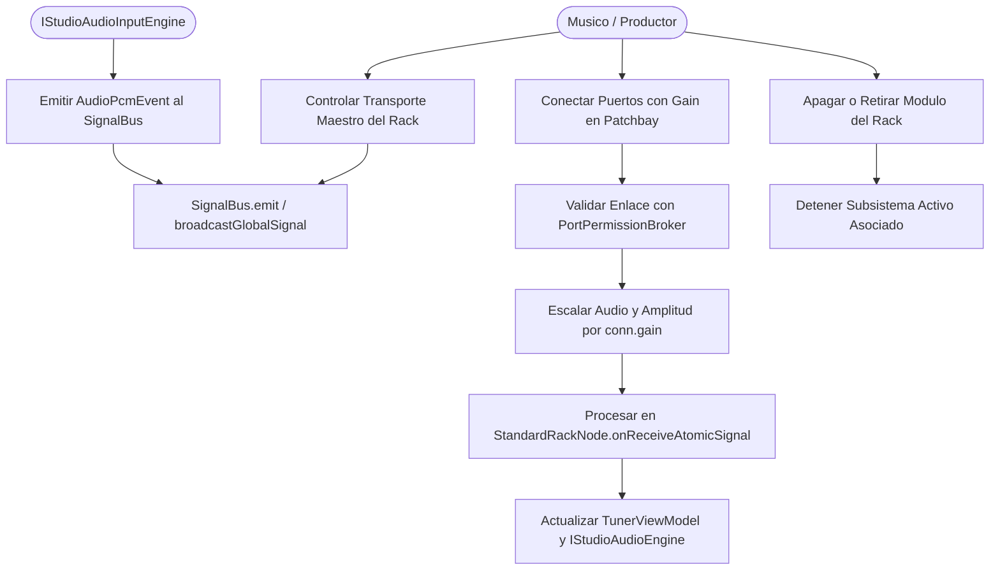
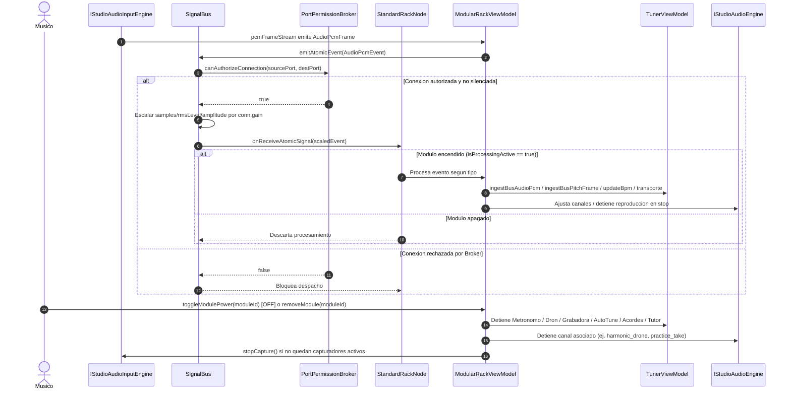

# Caso de Uso 164: SignalBus Activo en StandardRackNode, Apagado Real de Modulos, Gain y PortPermissionBroker

## Metadatos del Documento
- **ID del Documento:** `DOC-USECASE-2026-164`
- **Titulo Oficial:** Procesamiento Activo en StandardRackNode.onReceiveAtomicSignal, Apagado Real de Modulos, Aplicacion de ModuleConnection.gain y PortPermissionBroker
- **Estado:** Approved
- **Fecha de Creacion:** 2026-11-22
- **Ultima Modificacion:** 2026-11-22
- **Fase Asociada:** Fase 5 / EPIC-05 US-5.1 Rack Modular Activo
- **Autor / Revisor Principal:** Tunner Core Team
- **Issue Relacionado:** `#154`

---

## 1. Resumen Ejecutivo
Este caso de uso formaliza la activacion real del enrutamiento de senales en el Rack Modular de Estudio (`ModularRackViewModel` y `SignalBus`), cerrando la brecha existente donde `StandardRackNode.onReceiveAtomicSignal` se limitaba a guardar `lastReceivedEvent`, el apagado o retiro de un modulo dejaba activos los motores de audio en segundo plano, y `SignalBus.emit` ignoraba tanto el factor de ganancia `ModuleConnection.gain` como las politicas de autorizacion de `PortPermissionBroker.canAuthorizeConnection`.

Con esta especificacion:
1. Cada `StandardRackNode` despacha acciones reales segun el tipo de evento atomico recibido (`TransportControlEvent`, `TuningCalibrationEvent`, `ClockTickEvent`, `PitchDetectionEvent`, `AudioPcmEvent`) hacia `TunerViewModel`, `IStudioAudioEngine` e `IStudioAudioInputEngine`.
2. `ModularRackViewModel` suscribe los flujos de captura (`audioInputEngine.pcmFrameStream`) y estado de `TunerViewModel` hacia el `SignalBus` con proteccion anti-bucles.
3. Al apagar (`toggleModulePower`) o retirar (`removeModule`) un modulo, se detiene el subsistema correspondiente si no queda otra instancia activa de ese tipo.
4. `SignalBus.emit` valida cada enlace mediante `PortPermissionBroker.canAuthorizeConnection` y escala los eventos de audio/amplitud por `conn.gain`.

---

## 2. Diagramas del Caso de Uso

### 2.1 Diagrama Formal de Caso de Uso (Mermaid)

### 2.2 Diagrama de Secuencia y Flujo Detallado (Mermaid)

---

## 3. Especificacion Funcional

### 3.1 Precondiciones
1. `ModularRackViewModel` ha inicializado su `SignalBus` y registrado los `StandardRackNode` correspondientes a `activeModules`.
2. Las dependencias de dominio/presentacion (`IStudioAudioEngine`, `IStudioAudioInputEngine`, `TunerViewModel`) estan inyectadas o enlazadas mediante `bindTunerViewModel`.
3. Las conexiones registradas en `SignalBus` declaran `PortId` de salida/entrada, `scope` (`pointToPoint` o `broadcast`) y `gain` en `[0.0, 2.0]`.

### 3.2 Postcondiciones
1. Todo evento `TransportControlEvent`, `TuningCalibrationEvent`, `ClockTickEvent`, `PitchDetectionEvent` y `AudioPcmEvent` recibido por un `StandardRackNode` activo ejecuta la accion correspondiente sobre los motores y el estado de telemetria del rack.
2. El apagado o eliminacion de un modulo detiene de inmediato el subsistema fisico/logico asociado si no existe otro modulo encendido del mismo `RackModuleType`.
3. Ningun evento de audio o amplitud cruza una conexion sin validacion previa de `PortPermissionBroker.canAuthorizeConnection` y sin aplicar `conn.gain`.

### 3.3 Flujo Principal
1. `ModularRackViewModel` enlaza `audioInputEngine.pcmFrameStream` y cambios relevantes de `TunerViewModel` hacia `SignalBus`.
2. Al emitirse un evento en `SignalBus.emit`, el bus verifica `conn.isEnabled`, `!conn.isMuted` y `_permissionBroker.canAuthorizeConnection(conn.sourcePort, destPort)`.
3. Si el evento transporta audio o amplitud (`AudioPcmEvent`, `PitchDetectionEvent` o `List<double>`), `SignalBus` crea una copia escalada por `conn.gain` respetando los limites normalizados (`[-1.0, 1.0]` para muestras PCM, `[0.0, 1.0]` para `rmsLevel`, `[0.0, 2.0]` para `amplitude`).
4. `StandardRackNode.onReceiveAtomicSignal` procesa el evento bajo un bloqueo anti-reentrada (`_runWithoutBusFeedback`) actualizando `TunerViewModel`, `audioEngine` y `audioInputEngine`.
5. Cuando el usuario apaga un modulo con `toggleModulePower` o lo retira con `removeModule`, `ModularRackViewModel` detiene el subsistema activo correspondiente.

### 3.4 Flujos Alternativos y Condiciones de Error
- **Conexion invalida o auto-conexion (`ownerModuleId` igual):** `PortPermissionBroker.canAuthorizeConnection` retorna `false`; `addConnection` rechaza con `ArgumentError` y `emit` omite el despacho sin lanzar excepciones en tiempo de ejecucion.
- **Modulo apagado (`isPoweredOn == false`):** `isProcessingActive` retorna `false`; `StandardRackNode.onReceiveAtomicSignal` retorna de inmediato sin alterar los motores.
- **Motores opcionales ausentes (`null` en pruebas aisladas):** `ModularRackViewModel` actualiza su telemetria interna sin fallar por referencias nulas.
- **Multiples instancias del mismo tipo de modulo:** Si existe otra instancia encendida del mismo `RackModuleType`, el subsistema compartido permanece activo hasta apagar o retirar la ultima instancia activa.
