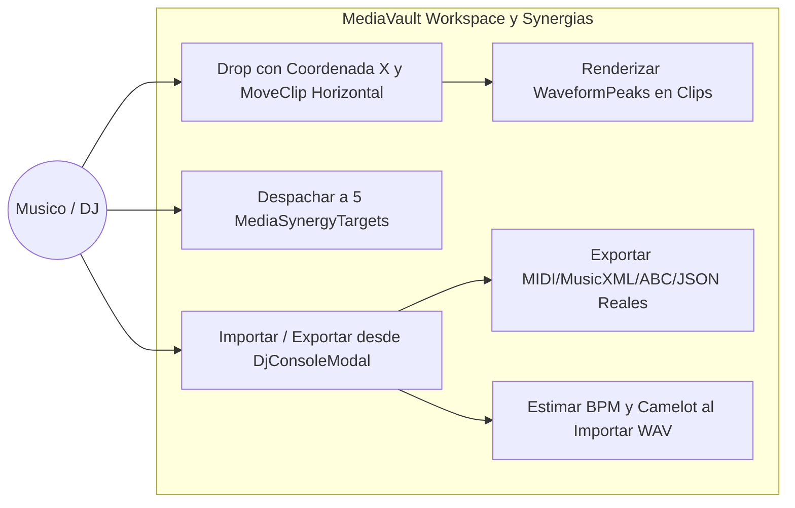
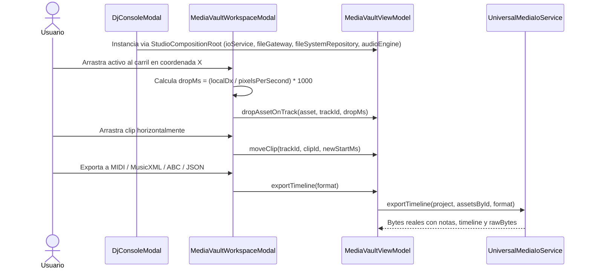

# UC-167: Cableado Completo de MediaVault en DjConsoleModal, Drop/Drag en Timeline, Waveforms y Exportacion Real

## 1. Informacion General

| Campo | Valor |
| :--- | :--- |
| **ID** | UC-167 |
| **Historia de Usuario** | US-5.4 (EPIC-05) |
| **Actores** | Musico / DJ (Usuario), `DjConsoleModal`, `MainAppShell`, `MediaVaultWorkspaceModal`, `UniversalMediaIoService` |
| **Precondiciones** | El usuario abre la Boveda Multimedia desde `DjConsoleModal` o `MainAppShell`, o importa/exporta activos en `UniversalMediaIoService`. |
| **Postcondiciones** | Importar/Exportar funcionan desde DJ Console; los 5 `MediaSynergyTarget` estan conectados; el drop calcula `dropMs` desde `details.offset`; el arrastre horizontal invoca `moveClip`; cada clip dibuja su `waveformPeaks`; MIDI/MusicXML/ABC/JSON exportan notas y timeline reales; WAV estima BPM y Camelot reales. |

---

## 2. Diagrama de Casos de Uso

---

## 3. Diagrama de Secuencia

---

## 4. Flujo Principal

1. `DjConsoleModal` crea `_mediaVaultViewModel` usando `StudioCompositionRoot.createMediaVaultViewModel()` (con fallback a `UniversalMediaIoService` y `NoOp` en tests aislados) y conecta `onDispatchToTool` para los 5 `MediaSynergyTarget`s.
2. `MainAppShell` conecta `onDispatchToTool` en `_mediaVaultViewModel` para los 5 `MediaSynergyTarget`s (Decks DJ A/B, Sampler Pad, Score Editor y Mixer Channel).
3. En `MediaVaultWorkspaceModal._buildTimelineTrackLane`, `onAcceptWithDetails` traduce `details.offset` a `dropMs` segun `pixelsPerSecond` y el ancho de la cabecera de pista (`155 px`).
4. Cada clip en la pista se envuelve en `GestureDetector(onHorizontalDragUpdate / onHorizontalDragEnd)` conectado a `vm.moveClip`, pinta `asset.waveformPeaks` de fondo mediante un `CustomPainter`, y el menu contextual incluye `track_sampler_sfx`.
5. `UniversalMediaIoService` exporta notas reales (decodificando partituras/MIDI o sintetizando eventos desde clips del timeline) mediante `CanonicalMidiExporter`, `CanonicalMusicXmlExporter` y `CanonicalAbcExporter`; serializa/restaura `timeline` y `rawBytesBase64` en `.tunner.json`; y estima BPM (`BpmBeatTrackerEngine`) y clave Camelot (`DjHarmonicCamelotEngine`) al importar WAV.

---

## 5. Flujos Alternativos y de Error

- **FA-1 (Drop fuera de la zona de timeline o coordenada negativa):** Si `localDx < 0`, `dropMs` se acota a `0`.
- **FA-2 (Timeline sin partituras previas al exportar MIDI/MusicXML/ABC):** Si un clip es de audio o no tiene partitura parseable en `rawBytes`, se generan eventos musicales cuantizados segun su `startMs`, `durationMs` y clave Camelot para no producir archivos vacios ni silencios hardcodeados.
- **FA-3 (WAV muy corto para estimacion BPM):** Si el audio WAV tiene menos muestras de las necesarias para `BpmBeatTrackerEngine`, se mantiene un fallback seguro `120.0` sin lanzar excepciones.
