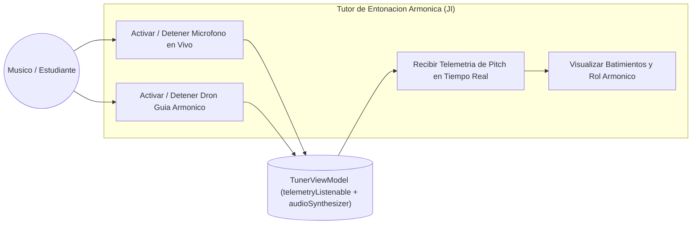
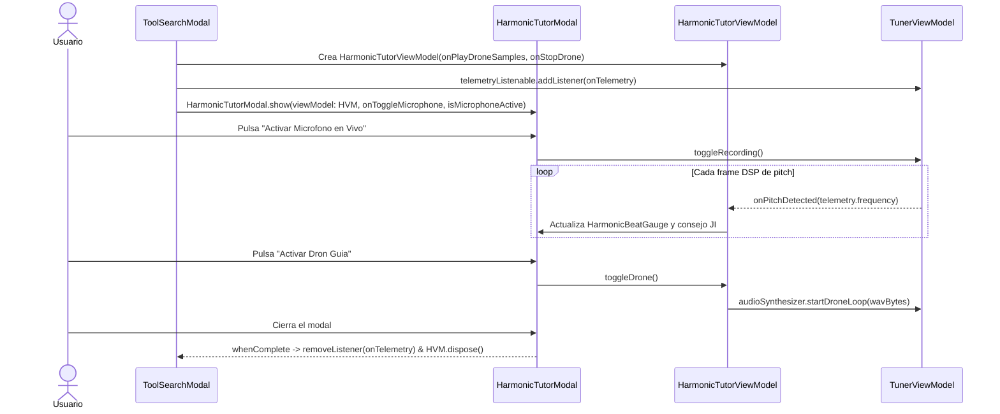

# UC-168: Eliminacion de Simulacion en HarmonicTutorModal y Conexion en Tiempo Real al Microfono y Dron (UC-67)

## 1. Informacion General

| Campo | Valor |
| :--- | :--- |
| **ID** | UC-168 |
| **Historia de Usuario** | US-6.1 (EPIC-06) |
| **Actores** | Musico / Estudiante (Usuario), `HarmonicTutorModal`, `HarmonicTutorViewModel`, `ToolSearchModal`, `TunerViewModel` |
| **Precondiciones** | El usuario abre el Tutor de Entonacion Armonica desde `ToolSearchModal` (o directamente con `HarmonicTutorModal.show`). |
| **Postcondiciones** | No existen botones de simulacion en produccion; la captura de microfono en vivo alimenta `onPitchDetected(telemetry.frequency)` mediante `TunerViewModel.telemetryListenable`; el dron guia sintetiza audio real a traves de `TunerViewModel.audioSynthesizer`. |

---

## 2. Diagrama de Casos de Uso

---

## 3. Diagrama de Secuencia

---

## 4. Flujo Principal

1. Al seleccionar `'open_harmonic_tutor'` en `ToolSearchModal`, se instancia `HarmonicTutorViewModel` conectado a `TunerViewModel.audioSynthesizer` (`startDroneLoop` / `stopDroneLoop` usando `WavPcmCodec`).
2. `ToolSearchModal` suscribe un listener a `TunerViewModel.telemetryListenable` que reenvia cada `telemetry.frequency > 0` a `HarmonicTutorViewModel.onPitchDetected`, y lo desuscribe al cerrar el modal.
3. En `HarmonicTutorModal`, la tarjeta `'SIMULACION DE PRÁCTICA AUDITIVA'` se elimina por completo y se reemplaza por `'CAPTURA ACÚSTICA EN VIVO (MICRÓFONO)'`, mostrando el estado del microfono, la frecuencia detectada y el boton para alternar la captura real.

---

## 5. Flujos Alternativos y de Error

- **FA-1 (Sin microfono activo o frecuencia 0 Hz):** Mientras `telemetry.frequency <= 0`, `onPitchDetected` ignora la lectura y el gauge conserva el analisis de referencia sin producir valores NaN.
- **FA-2 (Cierre del modal con dron activo):** Al cerrar `HarmonicTutorModal`, el `whenComplete` ejecuta `tutorVm.dispose()`, deteniendo el dron guia (`onStopDrone`) y removiendo el listener de telemetria.
- **FA-3 (Uso aislado de `HarmonicTutorModal` sin `onToggleMicrophone`):** Si el modal se renderiza en pruebas aisladas sin callback de microfono, el boton muestra estado en espera sin lanzar excepciones.
