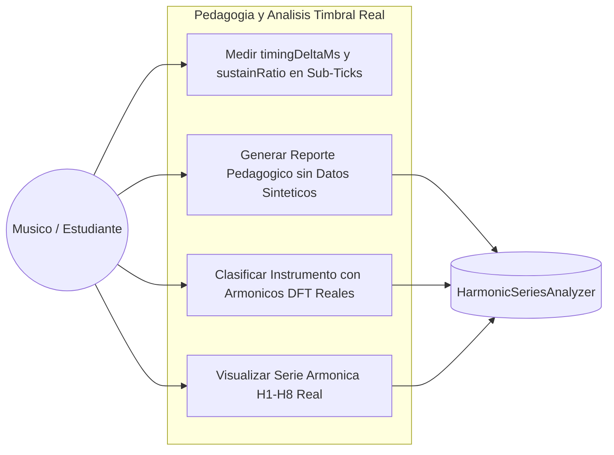
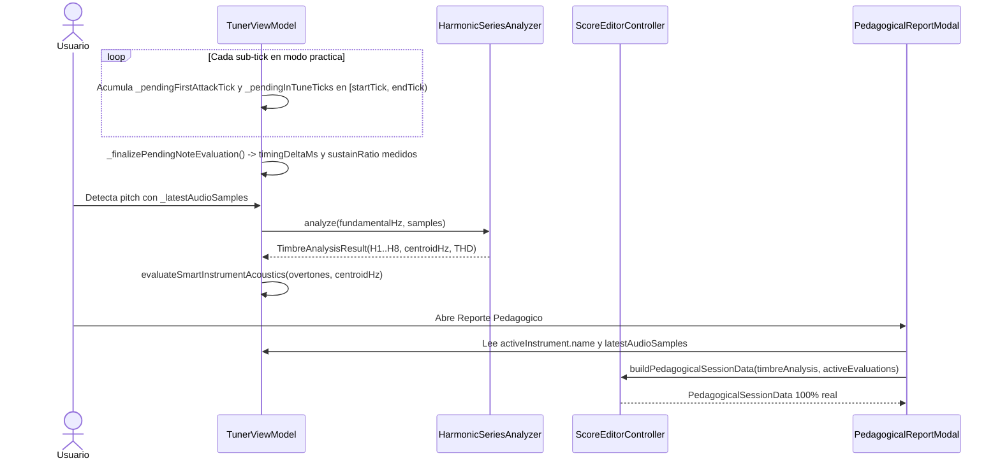

# UC-169: Evaluacion Medida de Timing/Sustain, Reportes Sin Datos Sinteticos y Clasificador Armonico Real

## 1. Informacion General

| Campo | Valor |
| :--- | :--- |
| **ID** | UC-169 |
| **Historia de Usuario** | US-6.2 (EPIC-06) |
| **Actores** | Musico / Estudiante (Usuario), `TunerViewModel`, `PracticeEvaluator`, `HarmonicSeriesAnalyzer`, `ScoreEditorController`, `PedagogicalReportModal`, `PolyphonicLiveVoicingWidget` |
| **Precondiciones** | El usuario ejecuta una sesion de practica guiada, solicita un reporte pedagogico o inspecciona el espectro polifonico con microfono activo. |
| **Postcondiciones** | `timingDeltaMs` y `sustainRatio` se miden sobre la ventana `[startTick, endTick)` de cada nota; los reportes pedagogicos reflejan datos reales sin constantes sinteticas; `SmartInstrumentDetector` y `PolyphonicLiveVoicingWidget` consumen armonicos H1-H8, centroide y THD reales de `HarmonicSeriesAnalyzer`. |

---

## 2. Diagrama de Casos de Uso

---

## 3. Diagrama de Secuencia

---

## 4. Flujo Principal

1. Durante el modo práctica en `TunerViewModel._updateExpectedNoteForTick`, cada nota esperada acumula el primer sub-tick con ataque valido (`_pendingFirstAttackTick`) y el conteo de sub-ticks afinados (`_pendingInTuneTicks`). Al cambiar de nota o detener la sesion, se calcula `timingDeltaMs` y `sustainRatio` reales para `PracticeEvaluator`.
2. `TunerViewModel._evaluateSmartInstrumentFromPitch` analiza `_latestAudioSamples` mediante `HarmonicSeriesAnalyzer` y pasa las amplitudes H1–H8 y el centroide espectral reales a `evaluateSmartInstrumentAcoustics`.
3. `ScoreEditorController.buildPedagogicalSessionData` elimina valores sinteticos (como `89.2%`, `120` notas, curva `math.sin`, `820.0 Hz`, `11.8%` THD), calculando metricas desde `sessionHistory`, `activeEvaluations`, `multiTrackSession` y `TimbreAnalysisResult` real.
4. `PedagogicalReportModal` inicializa el campo de instrumento con `TunerViewModel.activeInstrument.name`, y `PolyphonicLiveVoicingWidget` renderiza barras H1–H8 con alturas proporcionales a `HarmonicSeriesAnalyzer`.

---

## 5. Flujos Alternativos y de Error

- **FA-1 (Sin muestras de audio recientes):** Si `_latestAudioSamples` es nulo o insuficiente (< 64 muestras), `_evaluateSmartInstrumentFromPitch` no inventa armonicos ni clasifica falsamente, y `PolyphonicLiveVoicingWidget` muestra barras en nivel base minimo.
- **FA-2 (Reporte sin sesion previa):** Si no hay reportes, evaluaciones ni tomas grabadas, `buildPedagogicalSessionData` reporta `0` notas evaluadas, `0.0%` de precision y `timedPitchSamples: []` sin fabricar curvas senoidales.
