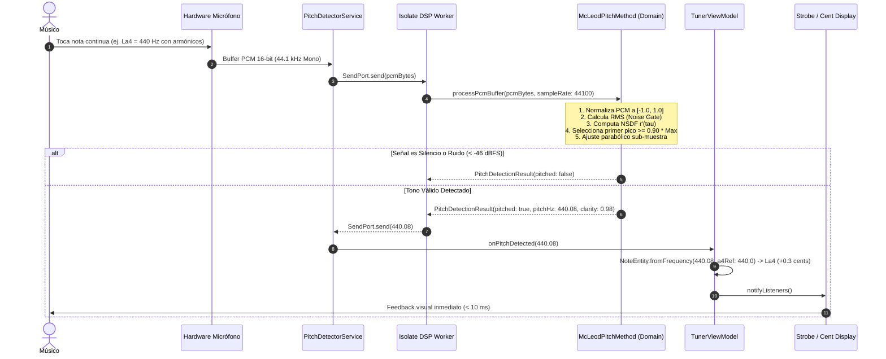

# Caso de Uso 16: Detección Acústica de Tono mediante McLeod Pitch Method (MPM)

Este documento define el caso de uso canónico para la estimación acústica de la frecuencia fundamental en **Tunner** utilizando el algoritmo **McLeod Pitch Method (MPM)** con función de diferencia cuadrada normalizada (NSDF) e interpolación parabólica cuadrática.

---

## Metadatos

- **ID:** `UC-16`
- **Nombre:** Detección de Frecuencia Fundamental con McLeod Pitch Method (MPM)
- **Actor Principal:** Músico / Estudiante ejecutando su instrumento o cantando frente al micrófono.
- **Actores Secundarios:** Hardware de Entrada de Audio (Micrófono PCM), Isolate DSP Worker, ViewModel del Afinador, Visualizador Estroboscópico.

---

## 1. Diagrama de Caso de Uso

```mermaid
flowchart TD
    User(["Músico / Instrumentista"])
    Mic["Micrófono Hardware (PCM 16-bit)"]
    IsolateWorker["Isolate DSP Worker (MPM)"]
    TunerVM["TunerViewModel"]
    StrobeUI["Afinador Estroboscópico y Pentagrama"]

    User -->|Emite sonido continuo| Mic
    Mic -->|Stream de bytes PCM| IsolateWorker
    subgraph Tunner Audio Engine
        IsolateWorker -->|1. Conversión a float| CalcFloat["Normalización [-1.0, 1.0]"]
        CalcFloat -->|2. Filtro RMS| NoiseGate{"RMS >= Umbral?"}
        NoiseGate -->|No (Silencio/Ruido)| DropSignal["Descartar buffer"]
        NoiseGate -->|Sí (Tono Válido)| CalcNSDF["Calcular NSDF r'(tau)"]
        CalcNSDF --> PeakPick["Dynamic Peak Picking (k=0.90)"]
        PeakPick --> Interpolation["Interpolación Parabólica delta"]
        Interpolation --> HzCalc["Cálculo Frecuencia f0 = fs / tau"]
    end
    HzCalc -->|Mensaje SendPort con f0 y claridad| TunerVM
    TunerVM -->|Notifica cambio de nota y cents| StrobeUI
```

---

## 2. Diagrama de Secuencia y Flujo de Audio



---

## 3. Precondiciones y Postcondiciones

### 3.1 Precondiciones
1. El usuario ha concedido permisos de acceso al micrófono.
2. El hardware de audio del dispositivo está activo con una tasa de muestreo de $44100\text{ Hz}$.
3. El servicio `PitchDetectorService` ha instanciado y verificado el enlace bidireccional con el Isolate secundario de DSP.

### 3.2 Postcondiciones
1. La frecuencia fundamental estimada se reporta al hilo principal con una precisión $\le \pm 0.2$ cents.
2. Los sobretonos armónicos y formantes resonantes no producen duplicación de octava ($2 f_0$) ni subdivisión errónea ($f_0 / 2$).
3. No se consume tiempo de CPU en el hilo de UI de Flutter para cómputo de señales acústicas.

---

## 4. Flujos

### 4.1 Flujo Principal
1. El micrófono entrega un paquete de muestras PCM en formato de 16 bits little-endian al servicio de datos.
2. El servicio transfiere el buffer al puerto del Isolate de procesamiento DSP.
3. El motor `McLeodPitchMethod` calcula el RMS. Si supera el umbral de corte (silencio/ruido de fondo), evalúa la función NSDF.
4. Se localizan los cruces por cero ascendentes y los picos locales dentro de los lóbulos positivos.
5. Se identifica el primer pico relativo que supere el umbral dinámico $k \cdot M$, evitando el salto a armónicos superiores.
6. Se interpola cuadráticamente la posición del pico para obtener la resolución fraccionaria del retardo $\tau_{\text{exact}}$.
7. Se calcula la frecuencia fundamental $f_0 = f_s / \tau_{\text{exact}}$ y se emite al `TunerViewModel`.
8. El afinador actualiza la nota más cercana, la desviación en cents y el estroboscopio visual a 60 FPS.

### 4.2 Flujo Alternativo 1: Silencio o Ruido Ambiental
- **Condición:** El instrumento deja de sonar o solo hay ruido de fondo difuso.
- **Acción:** El cálculo RMS arroja un valor inferior a $0.005$ ($-46\text{ dBFS}$).
- **Resultado:** La función finaliza inmediatamente sin calcular correlaciones pesadas, ahorrando batería y CPU.

### 4.3 Flujo Alternativo 2: Tono Inarmónico o Sin Altura Definida
- **Condición:** El usuario percute un objeto o emite un ruido sin tono tonal claro.
- **Acción:** El pico máximo de la NSDF $M$ es inferior a $0.30$.
- **Resultado:** Se reporta `pitched: false`; el afinador descarta el dato y mantiene la estabilidad visual.
