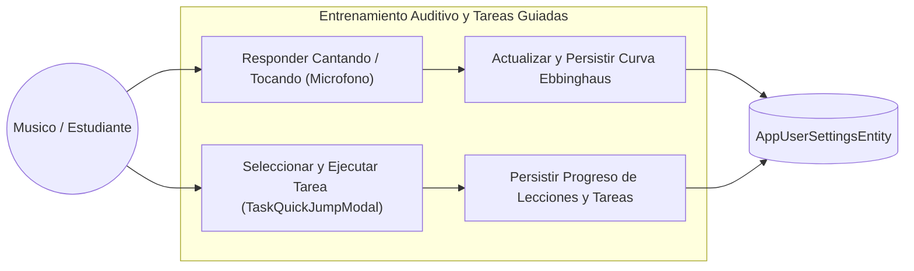
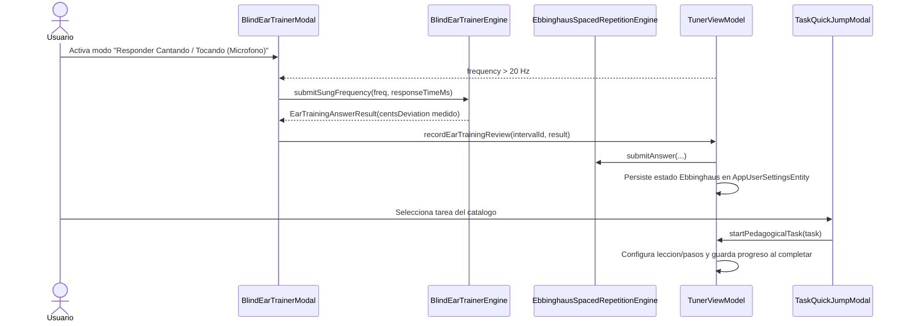

# UC-170: Respuesta Cantada por Microfono, Repeticion Espaciada Ebbinghaus y TaskCatalogIndex Ejecutable

## 1. Informacion General

| Campo | Valor |
| :--- | :--- |
| **ID** | UC-170 |
| **Historia de Usuario** | US-6.3 (EPIC-06) |
| **Actores** | Musico / Estudiante (Usuario), `BlindEarTrainerModal`, `BlindEarTrainerEngine`, `EbbinghausSpacedRepetitionEngine`, `TaskCatalogIndex`, `TaskQuickJumpModal`, `VocalPedagogyController`, `TunerViewModel` |
| **Precondiciones** | El usuario abre `BlindEarTrainerModal` o selecciona una tarea en `TaskQuickJumpModal` o completa una leccion guiada. |
| **Postcondiciones** | `BlindEarTrainerModal` evalua respuestas cantadas/tocadas via `submitSungFrequency`, actualiza y persiste `EbbinghausSpacedRepetitionEngine` en `AppUserSettingsEntity`; las 17 tareas de `TaskCatalogIndex` tienen `TaskStep` reales con estado inicial `notStarted`/`none` y se ejecutan con `TunerViewModel.startPedagogicalTask(task)`; las lecciones completadas se persisten en `AppUserSettingsEntity`. |

---

## 2. Diagrama de Casos de Uso

---

## 3. Diagrama de Secuencia

---

## 4. Flujo Principal

1. En `BlindEarTrainerModal`, el boton `'Responder Cantando / Tocando (Micrófono)'` conecta el flujo en vivo de `TunerViewModel.frequency` hacia `_engine.submitSungFrequency(...)`, midiendo `centsDeviation` real en lugar de `0.0`.
2. Al responder por boton teorico, `_selectOption` pasa `centsDeviation: null` para evitar reportar `'0.0 cents'` falsos.
3. Cada respuesta actualiza una instancia compartida de `EbbinghausSpacedRepetitionEngine` en `TunerViewModel`, persistiendo sus metricas en `AppUserSettingsEntity.earTrainingItemsJson`.
4. `TaskCatalogIndex._initializeSeedCatalog()` puebla `List<TaskStep>` reales en las 17 tareas con estado inicial `TaskCompletionStatus.notStarted` y `TaskGrade.none`.
5. `TaskQuickJumpModal` invoca `TunerViewModel.startPedagogicalTask(task)` antes de navegar al workspace de aprendizaje, y `VocalPedagogyController` notifica lecciones completadas para persistirlas en `AppUserSettingsEntity.completedLessonIds`.

---

## 5. Flujos Alternativos y de Error

- **FA-1 (Microfono sin senal en modo cantado):** Si `viewModel.frequency <= 20.0`, el evaluador no envia respuesta hasta capturar un tono valido o hasta que el usuario pulse evaluar manualmente.
- **FA-2 (Intervalo sin item directo en banco Ebbinghaus):** Si un intervalo no coincide por ID directo en `EbbinghausSpacedRepetitionEngine`, se mapea a su clave canonica (`interval_m2`, `interval_P5`, etc.) antes de invocar `submitAnswer`.
- **FA-3 (Entorno sin persistencia local):** En pruebas con `NoOpLocalPersistenceService`, la sesion Ebbinghaus y progreso de tareas operan en memoria sin lanzar excepciones.
