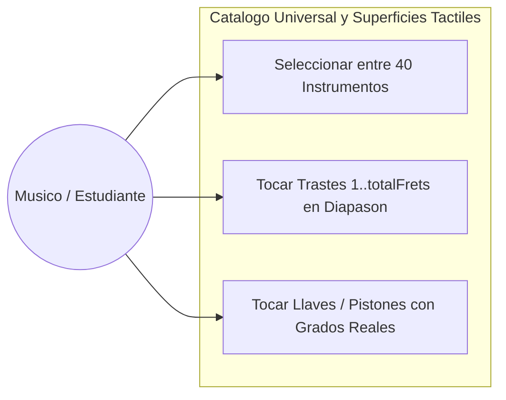
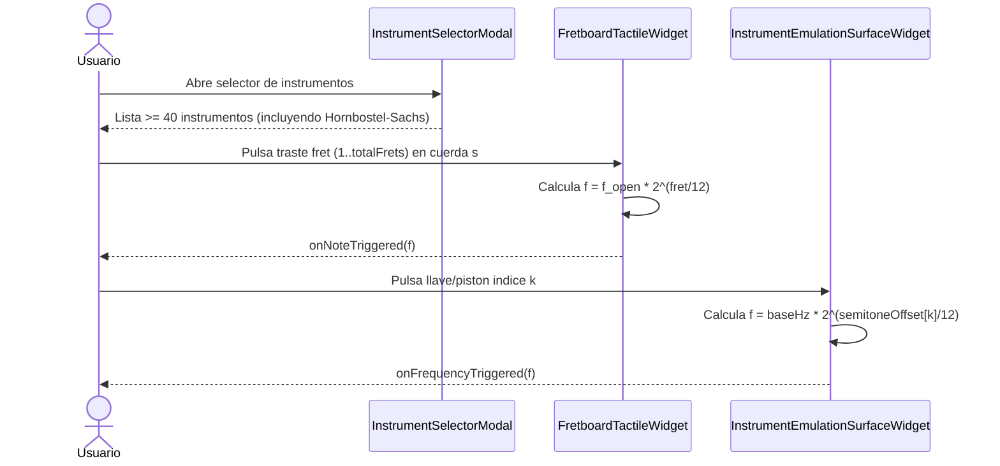

# UC-171: Catalogo Unificado de 40 Instrumentos (Hornbostel-Sachs) y Superficies Tactiles Interactivas

## 1. Informacion General

| Campo | Valor |
| :--- | :--- |
| **ID** | UC-171 |
| **Historia de Usuario** | US-6.4 (EPIC-06) |
| **Actores** | Musico / Estudiante (Usuario), `InstrumentSelectorModal`, `InstrumentProfileEntity`, `FretboardTactileWidget`, `InstrumentEmulationSurfaceWidget` |
| **Precondiciones** | El usuario abre `InstrumentSelectorModal` o interactua con `FretboardTactileWidget` o `InstrumentEmulationSurfaceWidget`. |
| **Postcondiciones** | Todos los 40 instrumentos de `UniversalInstrumentDefinition.masterCatalog` (incluyendo Kora, Sitar, Shakuhachi, Charango, Cuatro) son seleccionables en `InstrumentSelectorModal`; todos los trastes `1..totalFrets` de `FretboardTactileWidget` sintetizan f = f_open * 2^(fret/12); cada llave o piston en `_buildGenericAcousticSurface` dispara un grado diatonico/armonico real. |

---

## 2. Diagrama de Casos de Uso

---

## 3. Diagrama de Secuencia

---

## 4. Flujo Principal

1. `InstrumentProfileEntity.standardInstruments` sincroniza los perfiles correspondientes a los 40 instrumentos de `UniversalInstrumentDefinition.masterCatalog` (conservando los 21 IDs clasicos).
2. `FretboardTactileWidget` agrega zonas interactivas (`InkWell`/`GestureDetector`) para cada traste `1..totalFrets` de cada cuerda, calculando $f = f_{\text{open}} \cdot 2^{\text{fret}/12}$.
3. `InstrumentEmulationSurfaceWidget._buildGenericAcousticSurface` asigna un grado de escala diatonica/armonica real a cada boton de llave/piston dentro de `[minFrequencyHz, maxFrequencyHz]`, en lugar de emitir siempre el promedio `(min + max) / 2`.

---

## 5. Flujos Alternativos y de Error

- **FA-1 (Cuerda fuera de rango de afinacion):** Si `s >= tuningFrequencies.length`, el toque se ignora de forma segura sin `RangeError`.
- **FA-2 (Rango acustico invertido o nulo):** Si `minFrequencyHz <= 0` o `maxFrequencyHz <= minFrequencyHz` en `_buildGenericAcousticSurface`, se usa `220.0 Hz` como base segura y se acota la frecuencia resultante.
