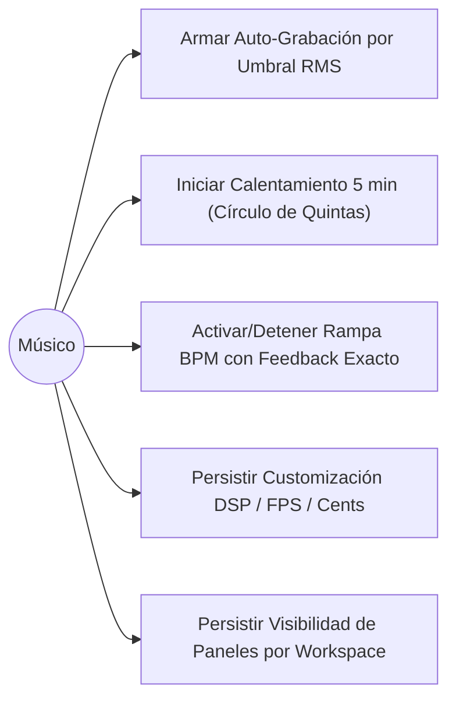
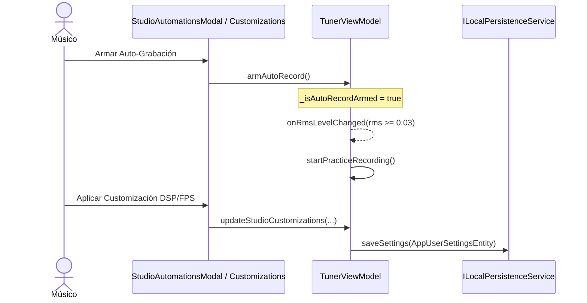

# UC-172: Automatizaciones de Estudio, Customización DSP y Persistencia de Workspaces

## 1. Identificación
- **ID:** UC-172
- **Historia de Usuario:** US-6.5
- **Actor Principal:** Músico / Estudiante / Ingeniero de Estudio
- **Precondiciones:** `TunerViewModel` inicializado con `ILocalPersistenceService` y `IPitchDetectorService`.
- **Postcondiciones:** Las preferencias de motor DSP (`dspEngineName`), FPS (`targetRenderFps`), precisión (`centsPrecision`) y visibilidad de paneles (`WorkspaceConfigurationEntity`) quedan persistidas en `AppUserSettingsEntity`. Las automatizaciones (rampa BPM, auto-grabación por RMS, calentamiento 5 min en círculo de quintas) muestran notificaciones coherentes con su estado real.

## 2. Diagrama de Casos de Uso

## 3. Diagrama de Secuencia

## 4. Flujo Principal
1. El usuario abre `StudioAutomationsModal` y selecciona Rampa BPM, Auto-Grabación o Calentamiento Guiado.
2. El modal captura el estado previo antes de mutar el `TunerViewModel` para emitir el `SnackBar` exacto.
3. Si arma Auto-Grabación, el detector RMS dispara `startPracticeRecording()` al superar `autoRecordRmsThreshold` (`0.03`).
4. Si inicia Calentamiento Guiado, un `Timer.periodic` de 300 s rota la tónica del dron cada 25 s siguiendo el círculo de quintas.
5. En `StudioCustomizationsModal`, al pulsar Aplicar Cambios, `updateStudioCustomizations` persiste motor DSP, FPS y precisión en `AppUserSettingsEntity`.

## 5. Flujos Alternativos / De Error
- **A1 (Desarmar Auto-Grabación):** Si el usuario pulsa "Desarmar Auto-Grabación" antes de superar el umbral RMS, `_isAutoRecordArmed` vuelve a `false` sin iniciar grabación.
- **A2 (Cancelación Temprana de Calentamiento):** Al pulsar "Detener Calentamiento" o hacer `dispose()`, `_warmupTimer` se cancela inmediatamente evitando fugas de recursos.
- **E1 (Configuración Corrupta o Ausente en Disco):** `AppUserSettingsEntity.fromMap` aplica valores predeterminados seguros y `WorkspaceConfigurationEntity.defaultFor(activeWorkspace)`.
