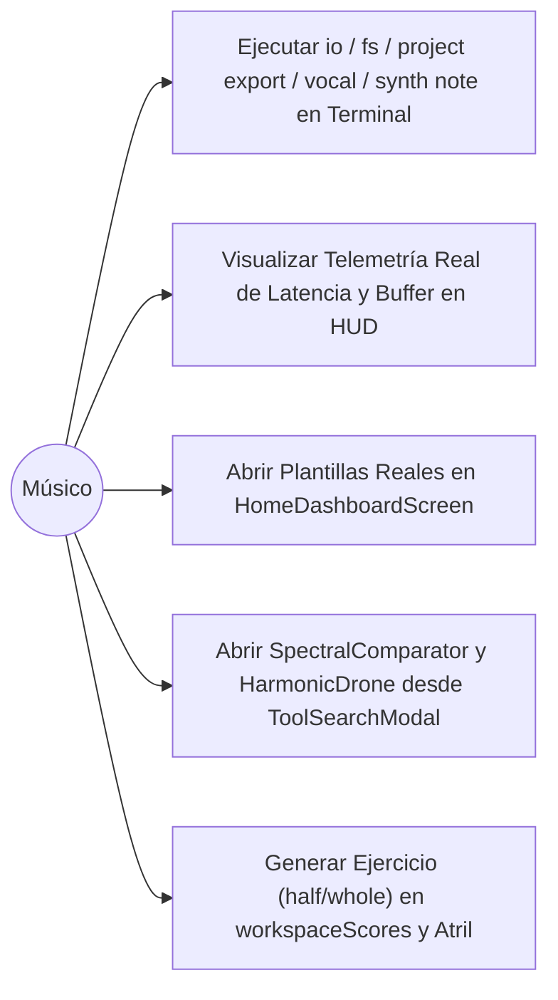
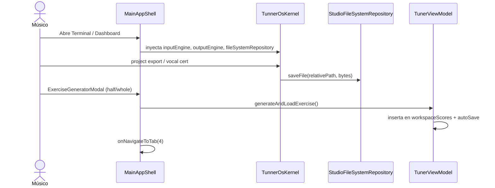

# UC-173: Cableado de TunnerOsKernel, Telemetría HUD/Templates, ToolSearchModal y ExerciseGenerator

## 1. Identificación
- **ID:** UC-173
- **Historia de Usuario:** US-6.6
- **Actor Principal:** Músico / Ingeniero de Audio / Usuario Terminal OS
- **Precondiciones:** `MainAppShell` montado con `StudioCompositionRoot` o servicios locales, `TunerViewModel` activo.
- **Postcondiciones:** `TunnerOsKernel` opera con puertos reales (`inputEngine`, `outputEngine`, `fileSystemRepository`, síntesis MIDI y evaluación vocal en vivo/disco), el HUD del Dashboard y Desktop Shell refleja latencia y búfer reales de `AudioDeviceMatrixEntity`, `ToolSearchModal` abre `SpectralComparatorModal` y `HarmonicDroneModal`, y `ExerciseGeneratorModal` soporta figuras `half`/`whole`, registra la partitura en `workspaceScores` y navega al Atril.

## 2. Diagrama de Casos de Uso

## 3. Diagrama de Secuencia

## 4. Flujo Principal
1. `MainAppShell` inyecta `inputEngine`, `outputEngine`, `fileSystemRepository`, `onTriggerSynthNote` y lectores de frecuencias vocales en `TunnerOsKernel`.
2. `project export` y `vocal cert` persisten los artefactos `.tunner` y `.pdf` en `fileSystemRepository` cuando está conectado.
3. `HomeDashboardScreen` y `StudioDesktopAppShell` calculan la latencia real `bufferSize / sampleRate * 1000` desde `AudioDeviceMatrixEntity`.
4. `ToolSearchModal` abre `SpectralComparatorModal` (`open_spectral_comparator`) y `HarmonicDroneModal` (`open_drone_studio`).
5. `ExerciseGeneratorModal` ofrece `quarter`, `eighth`, `sixteenth`, `half` y `whole`, registra el `SongPackage` en `workspaceScores` y navega al tab Atril (`4`).

## 5. Flujos Alternativos / De Error
- **A1 (Sin Captura Vocal Previa):** Si `onReadCapturedFrequencies` devuelve vacío en `vocal eval`/`cert`, se ejecuta la curva de calibración controlada señalando la fuente.
- **E1 (Sin Matriz de Hardware Conectada):** `HomeDashboardScreen` y `StudioDesktopAppShell` muestran telemetría nominal por defecto sin lanzar excepciones.
