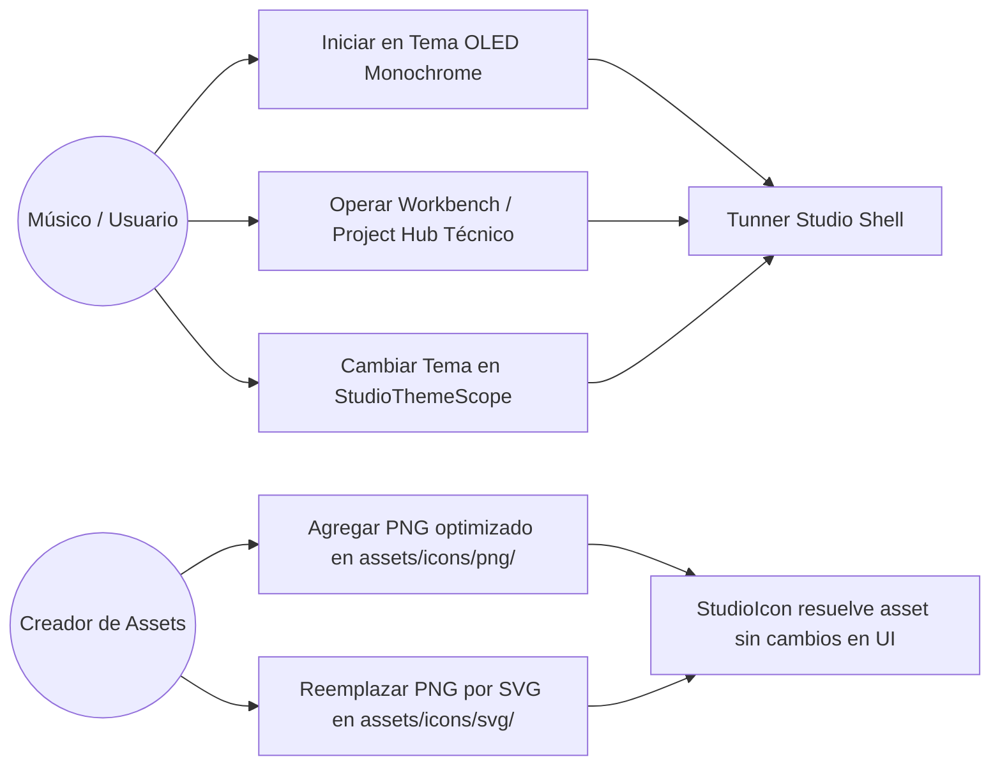
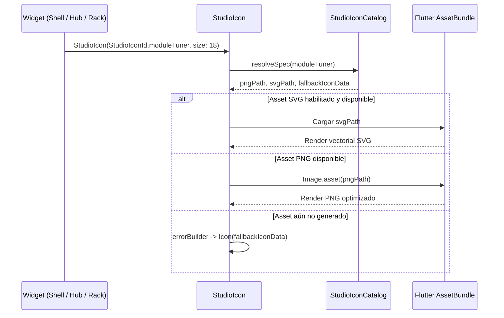

# UC-174: Estética Pro OLED Monochrome, Workbench Técnico y Sistema Progresivo de Iconos

## 1. Información General
- **ID:** `UC-174`
- **Actor Principal:** Músico / Ingeniero de Audio / Creador de Assets
- **Objetivo:** Operar **Tunner** con una interfaz Pro-DAW en Negro OLED Monocromático de alta densidad, sin tarjetas web genéricas, y con resolución automática de iconos personalizados (`SVG -> PNG -> Fallback`).
- **Precondiciones:**
  - `StudioThemeController` inicializado en el árbol de widgets.
  - Carpeta `assets/icons/png/` declarada en `pubspec.yaml`.
- **Postcondiciones:**
  - La aplicación arranca en `StudioDesignTokens.studioOledMonochrome`.
  - Todo icono invocado vía `StudioIcon` muestra automáticamente el asset personalizado del creador en cuanto el archivo existe en `assets/icons/png/` o `assets/icons/svg/`, o su fallback vectorial sin errores.
  - `HomeDashboardScreen` presenta un hub técnico compacto (`1px` borders, `2-4px` radius, tipografía tabular) en lugar de tarjetas SaaS.

## 2. Diagrama de Casos de Uso (Mermaid)

## 3. Diagrama de Secuencia (Resolución Progresiva de Iconos)

## 4. Flujo Principal y Flujos Alternativos
- **Flujo Principal:**
  1. El usuario abre Tunner; `StudioThemeController` carga `studioOledMonochrome` por defecto.
  2. La shell renderiza barra superior, explorador lateral, pestañas y `HomeDashboardScreen` con superficies `#000000` / `#0D0F12`, bordes `1px` `#22262E` y acentos plata/blanco.
  3. Cada módulo en el Hub técnico muestra su `StudioIcon`, título técnico, métricas monoespaciadas y acción directa en un solo clic.
- **Flujo Alternativo A (Asset PNG faltante):** Si el archivo `assets/icons/png/<id>.png` todavía no ha sido creado por el diseñador, `Image.asset` invoca `errorBuilder` y renderiza `fallbackIconData` sin excepciones ni cuadros rotos.
- **Flujo Alternativo B (Cambio de Tema):** El usuario selecciona `Studio Dark`, `Studio Obsidian` o `Studio Light` desde el selector superior y toda la jerarquía actualiza tokens inmediatamente.
