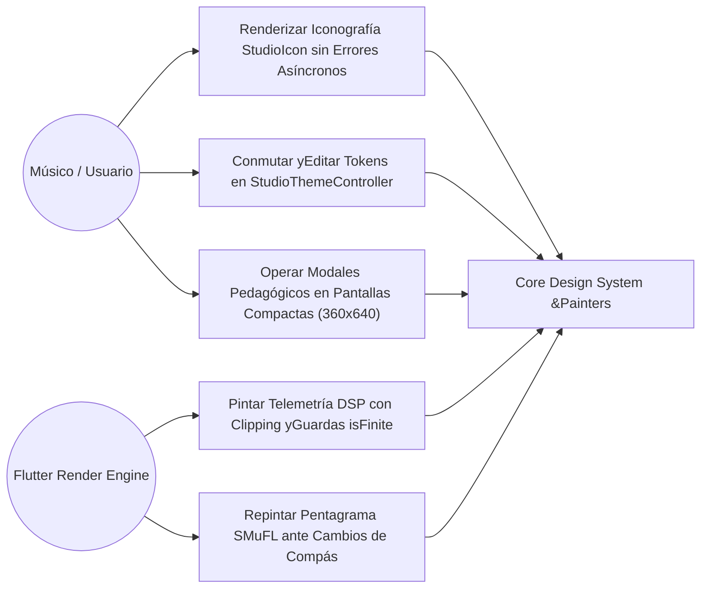
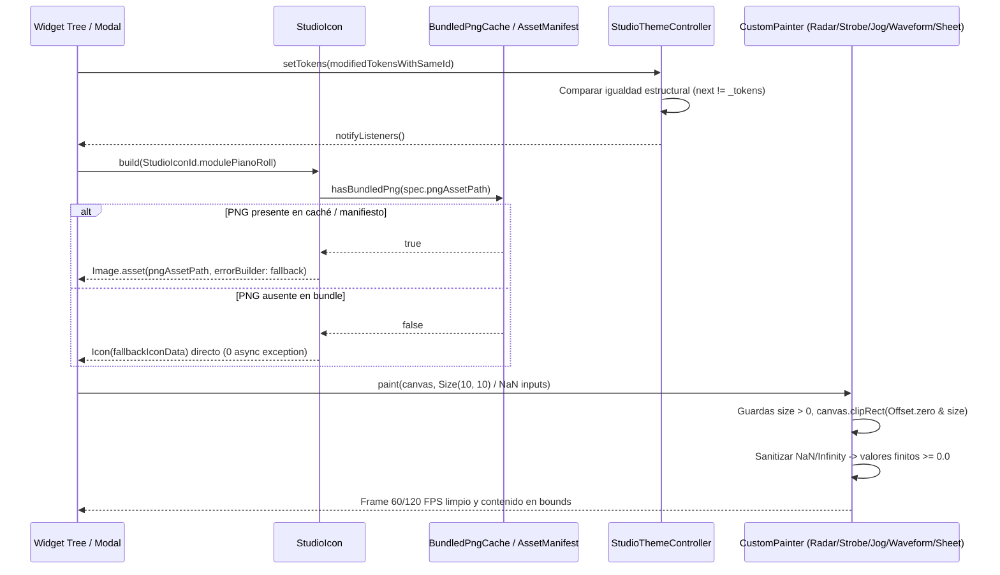

# UC-175: Caché de Manifiesto de Assets en `StudioIcon`, Sincronización OLED y Blindaje de `CustomPainter` / Layouts

## Metadatos del Documento

- **ID del Documento:** `DOC-CORE-UI-2026-175`
- **Título Oficial:** `Resolución Determinista de StudioIcon sin Excepciones Asíncronas, Sincronización OLED Monochrome y Blindaje de Painters/Layouts`
- **Estado:** `Approved`
- **Fecha de Creación:** `2026-11-23`
- **Última Modificación:** `2026-11-23`
- **Fase Asociada:** `Fase 6 — Hardening Estético v1.0`
- **Autor / Revisor Principal:** `Devs 1 (Agente 01) — Core, Editor de Partituras y Persistencia`

---

## 1. Resumen Ejecutivo (Executive Summary)

Este caso de uso formaliza las historias de usuario **US-7.1 (Issue #176)** y **US-7.4 (Issue #179)**. En primer lugar, elimina las cargas fallidas asíncronas de `Image.asset` en `StudioIcon` mediante un registro estático de assets empaquetados sincronizado con `AssetManifest`, alinea `StudioThemeCatalogService` con el tema por defecto `studio_oled_monochrome`, corrige la mutabilidad de tokens con mismo `id` en `StudioThemeController.setTokens()` y erradica colores cian hardcoded y archivos de tema obsoletos en `lib/core/design_system/`. En segundo lugar, blinda los `CustomPainter` de telemetría musical contra tamaños degenerados y valores no finitos (`NaN` / `Infinity`), y protege los modales pedagógicos e instrumentales contra desbordamientos `RenderFlex overflow` en resoluciones compactas.

---

## 2. Información General del Caso de Uso

- **ID:** `UC-175`
- **Actor Principal:** Músico / Ingeniero de Audio / Motor de Renderizado Flutter
- **Precondiciones:**
  - `StudioThemeController` y `StudioThemeCatalogService` inicializados en la estación de trabajo.
  - Carpeta `assets/icons/png/` declarada en `pubspec.yaml` con 38 de los 44 iconos presentes físicamente.
- **Postcondiciones:**
  - `StudioIcon` consulta la caché estática en $O(1)$ antes de instanciar `Image.asset`, devolviendo `Icon(fallback)` inmediatamente para los 6 `StudioIconId` sin PNG (`module_piano_roll`, `module_score_editor`, `module_spectrogram`, `module_chord_analyzer`, `module_autotune`, `module_pedagogy`) sin disparar errores asíncronos en el pipeline de imágenes.
  - `StudioThemeCatalogService` inicia por defecto en `studio_oled_monochrome` y `StudioThemeController.setTokens()` notifica cambios cuando cualquier propiedad del token difiere, incluso con igual `id`.
  - Todos los `CustomPainter` críticos aplican `canvas.clipRect(Offset.zero & size)`, validan `isFinite` y acotan radios/dimensiones a valores $\ge 0.0$.
  - Los modales `GuidedLessonsModal`, `ExerciseGeneratorModal`, `PracticeReportModal` y `DrumPadsTactileWidget` renderizan en viewports estrechos (`360x640`) con cero excepciones de `RenderFlex overflow`.

---

## 3. Diagrama de Casos de Uso (Mermaid)

---

## 4. Diagrama de Secuencia (Mermaid)

---

## 5. Flujo Principal y Flujos Alternativos / de Error

### 5.1 Flujo Principal
1. La aplicación inicializa `StudioThemeController` y `StudioThemeCatalogService` sincronizados en el skin `studio_oled_monochrome`.
2. Al construir cualquier `StudioIcon`, el widget verifica en $O(1)$ si la ruta `assets/icons/png/<key>.png` pertenece al conjunto de assets disponibles (pre-poblado con los 38 PNGs existentes y actualizable vía `AssetManifest.loadFromAssetBundle`).
3. Si el PNG existe, se monta `Image.asset`; si no existe, se monta directamente el widget `Icon` con el `IconData` canónico de respaldo.
4. En `StudioDesktopAppShell`, el selector `Archivos` / `Herramientas` utiliza exclusivamente los tokens de superficie, borde, texto y acento de `StudioDesignTokens`.
5. Durante el renderizado de `ChordRadarWidget`, `StrobeTunerWidget`, `VectorJogWheel`, `DjParallelWaveformPainter`, `_ClipWaveformPainter` y `RealSheetMusicPainter`, el lienzo aplica `clipRect` y sanitiza todas las entradas numéricas.

### 5.2 Flujos Alternativos y Condiciones de Borde
- **Flujo Alternativo A (Actualización en caliente de tokens con mismo ID):** Cuando el editor o servicio modifica propiedades de un `StudioDesignTokens` conservando el mismo `id`, `StudioThemeController.setTokens()` detecta la diferencia por igualdad de valor y reconstruye los widgets suscritos.
- **Flujo Alternativo B (Dimensiones diminutas o nulas en CustomPainter):** Si un panel acoplable se colapsa a `10x10` o `0x0`, `maxRadius` y `barHeight` se acotan con `math.max(0.0, ...)` evitando radios negativos o excepciones de `Rect.fromLTWH` / `clamp`.
- **Flujo Alternativo C (Entradas `NaN` o `Infinity` desde DSP):** Si un buffer de audio transitorio entrega `double.nan` en `cents`, `phase`, `rotationAngle`, `chromaVector` o `peaks`, las guardas `.isFinite` sustituyen el valor por `0.0` antes de operar sobre el `Canvas`.
- **Flujo Alternativo D (Viewport estrecho 360x640):** Los encabezados y filas de controles en `GuidedLessonsModal`, `ExerciseGeneratorModal`, `PracticeReportModal` y `DrumPadsTactileWidget` hacen scroll horizontal o ajustan su texto con `Expanded`/`Flexible` sin desbordar el layout.
