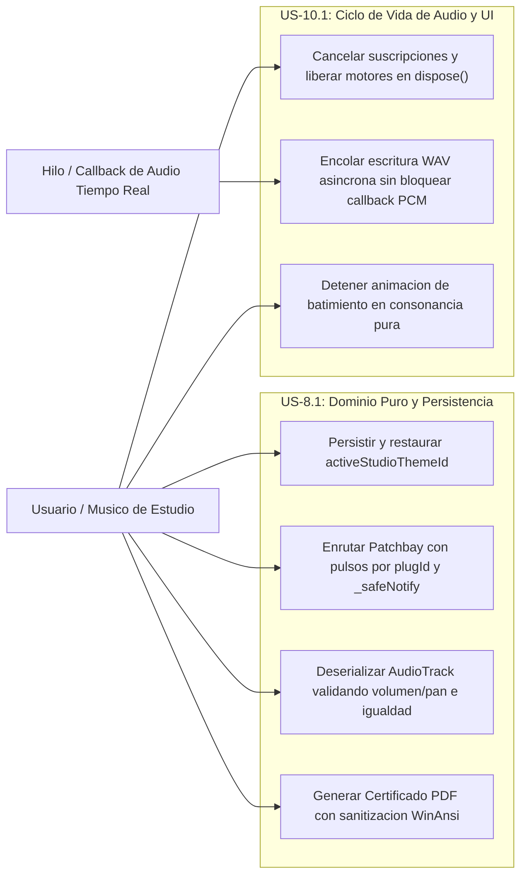
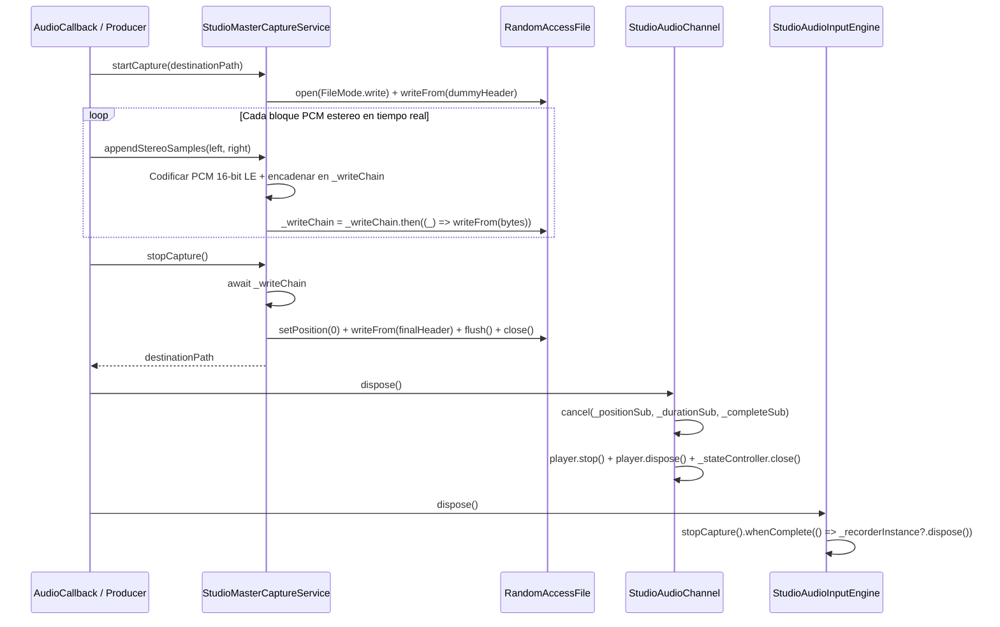

# Caso de Uso 176: Saneamiento de Fronteras de Dominio Puro y Ciclo de Vida de Captura/Reproduccion de Audio

## Metadatos del Documento

- **ID del Documento:** `DOC-CORE-AUDIO-2026-176`
- **Titulo Oficial:** `Saneamiento de Fronteras de Dominio Puro, Persistencia de Skin de Estudio y Endurecimiento del Ciclo de Vida de Audio Sin Bloqueos`
- **Estado:** `Approved`
- **Fecha de Creacion:** `2026-11-23`
- **Ultima Modificacion:** `2026-11-23`
- **Fase Asociada:** `Fase 6 - Hardening Arquitectonico y de Rendimiento Real-Time v1.0`
- **Autor / Revisor Principal:** `Devs 3 (Agente 03) - Parsers Polifonicos, Transcripcion y Audio DSP`
- **Incidencias Asociadas:** `US-8.1 (#180)`, `US-10.1 (#186)`

---

## 1. Resumen Ejecutivo (Executive Summary)

Este caso de uso formaliza el saneamiento de las entidades y servicios de la capa de dominio (`US-8.1 / #180`) junto con la eliminacion de fugas de recursos y bloqueos sincronos de entrada/salida en la infraestructura de audio y presentacion (`US-10.1 / #186`).

En el plano de dominio, se incorpora la persistencia del identificador de skin de estudio (`activeStudioThemeId`, con valor por defecto `'studio_oled_monochrome'`) en `AppUserSettingsEntity`, se aisla la semantica de colores y temporizadores de pulso independientes por `plugId` en `StudioPatchbayRoutingService` garantizando notificaciones seguras (`_safeNotify()`), se blinda `AudioTrack.fromMap` frente a valores no finitos (`NaN`, `Infinity`) o fuera de rango (`[0.0, 1.0]`) agregando soporte de paneo estereo (`pan` en `[-1.0, 1.0]`) e igualdad por valor (`==` y `hashCode`), y se corrige la codificacion de texto en `PedagogicalCertificatePdfGenerator` para sanitizar caracteres acentuados y eñes bajo el estandar WinAnsiEncoding de fuentes PostScript Type 1 Helvetica. En el plano de audio y presentacion, se cierran las fugas de `StreamSubscription` y motores instanciados internamente en `StudioAudioChannel`, `StudioAudioInputEngine`, `AudioPlaybackService` y `PitchDetectorService`, se reemplaza la escritura sincrona bloqueante `writeFromSync` en `StudioMasterCaptureService` por una cola asincrona encadenada (`Future<void> _writeChain`), y se detiene el `AnimationController` de `HarmonicBeatGauge` cuando el estado alcanza consonancia pura (`HarmonicLockStatus.pureConsonance`).

---

## 2. Diagramas Arquitectonicos y de Comportamiento (Mermaid)

### 2.1 Diagrama de Casos de Uso

### 2.2 Diagrama de Secuencia: Captura WAV Asincrona y Liberacion Determinista de Recursos

---

## 3. Precondiciones y Postcondiciones

### 3.1 Precondiciones
1. El sistema opera bajo la arquitectura monolitica modular de Tunner con separacion estricta entre `domain`, `data/infrastructure` y `presentation`.
2. Los servicios de audio pueden instanciar motores por defecto cuando no reciben inyeccion explicita o recibir instancias compartidas desde `StudioCompositionRoot`.
3. `StudioMasterCaptureService` recibe bloques estereo de punto flotante (`List<double>`) durante la captura maestra.

### 3.2 Postcondiciones
1. `AppUserSettingsEntity` conserva `activeStudioThemeId` (por defecto `'studio_oled_monochrome'`) en serializacion `toMap()` y deserializacion `fromMap()`.
2. `StudioPatchbayRoutingService` gestiona temporizadores de pulso individuales en `Map<String, Timer>` sin colisionar entre multiples sinks y ejecuta todas las notificaciones de estado mediante `_safeNotify()`.
3. `AudioTrack.fromMap` rechaza valores `NaN` o `Infinity` aplicando fallback seguro y `.clamp(0.0, 1.0)`, soporta `pan` en `[-1.0, 1.0]` y evalua igualdad estructural en `AudioTrack` y `MixerConsoleEntity`.
4. `PedagogicalCertificatePdfGenerator` codifica flujos PDF Type 1 Helvetica con `/Encoding /WinAnsiEncoding` y sanitizacion determinista de caracteres latinos.
5. `StudioAudioChannel`, `StudioAudioInputEngine`, `AudioPlaybackService` y `PitchDetectorService` liberan el 100% de sus suscripciones y motores propios al invocar `dispose()`.
6. `StudioMasterCaptureService.appendStereoSamples` nunca invoca `writeFromSync`, delegando la escritura en disco a `_writeChain` y aguardando su finalizacion antes de escribir la cabecera RIFF definitiva.
7. `HarmonicBeatGauge` detiene su `AnimationController` cuando `status == HarmonicLockStatus.pureConsonance`.

---

## 4. Flujo Principal y Flujos Alternativos / de Error

### 4.1 Flujo Principal
1. Al cargar o actualizar preferencias de usuario, `AppUserSettingsEntity` lee y persiste `activeStudioThemeId`.
2. Cuando un canal del Patchbay despacha señal a multiples sinks simultaneos, `StudioPatchbayRoutingService` registra un `Timer` por cada `plugId` en `_plugPulseTimers`, manteniendo activo el pulso visual de cada conector hasta que expira su ventana de 200 ms.
3. Al deserializar pistas del mezclador desde JSON, `AudioTrack.fromMap` valida que `volume` y `pan` sean finitos y los acota a `[0.0, 1.0]` y `[-1.0, 1.0]` respectivamente.
4. Durante la captura de audio maestro, `StudioMasterCaptureService.appendStereoSamples` convierte las muestras a PCM 16-bit Little-Endian y encadena la operacion `writeFrom` en `_writeChain`.
5. Al finalizar la captura (`stopCapture`), el servicio espera a que `_writeChain` concluya todas las escrituras pendientes antes de posicionar el puntero en el byte 0, actualizar el encabezado WAV de 44 bytes y cerrar el archivo.
6. Cuando el usuario afina un intervalo en `HarmonicBeatGauge` y entra en `HarmonicLockStatus.pureConsonance`, el widget detiene el `AnimationController` eliminando repintados innecesarios en reposo.

### 4.2 Flujos Alternativos y Condiciones de Error
- **FA-01 (Datos corruptos o no finitos en JSON de Mixer):** Si `map['volume']` contiene `double.nan`, `double.infinity` o valores negativos/superiores a `1.0`, `AudioTrack.fromMap` sustituye valores no finitos por `0.8` y aplica `.clamp(0.0, 1.0)`. Si `map['pan']` no es finito, aplica `0.0` y `.clamp(-1.0, 1.0)`.
- **FA-02 (Notificacion tras `dispose()` en Patchbay):** Si un timer de pulso o cambio de canal intenta notificar despues de `dispose()`, `_safeNotify()` verifica `!_isDisposed` y aborta la emision sin lanzar excepcion.
- **FA-03 (Doble invocacion a `dispose()` en motores de audio):** `StudioAudioChannel` y `StudioAudioInputEngine` verifican la bandera `_isDisposed` para garantizar idempotencia y evitar condiciones de carrera entre `stopCapture()` y `_recorderInstance?.dispose()`.
