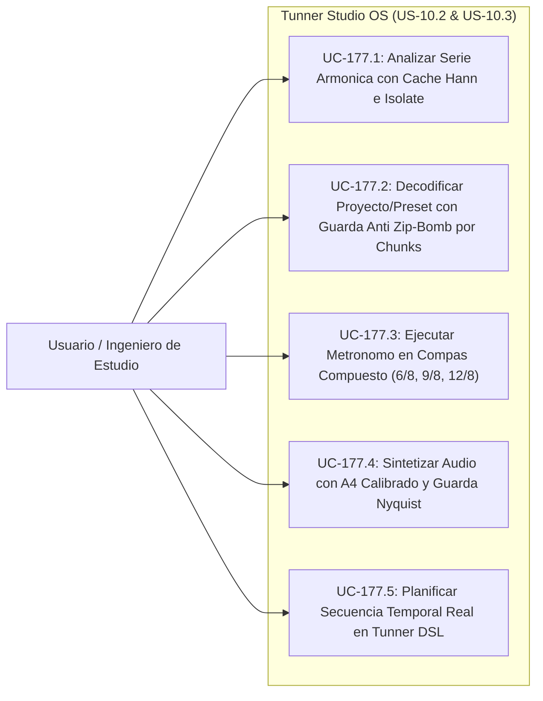

# Caso de Uso 177: Isolates DSP/ZLib, Protección Anti Zip-Bomb por Chunks, Compases Compuestos y Planificador Temporal del DSL

## Metadatos del Documento

- **ID del Documento:** `DOC-CORE-2026-177`
- **Título Oficial:** `Isolates DSP/ZLib, Protección Anti Zip-Bomb por Chunks, Calibración Acústica y Planificador Temporal Real de Tunner DSL`
- **Estado:** `Approved`
- **Fecha de Creación:** `2026-11-23`
- **Última Modificación:** `2026-11-23`
- **Fase Asociada:** `Fase 6 — Hardening de Rendimiento Real-Time v1.0 (US-10.2 y US-10.3)`
- **Autor / Revisor Principal:** `Devs 2 (Agente 02) — Importers, OMR & Parsers Musicales`

---

## 1. Resumen Ejecutivo (Executive Summary)

Este caso de uso formaliza el endurecimiento de tiempo real, seguridad de memoria y precisión rítmica/acústica del motor **Tunner** para las User Stories **US-10.2 (Issue #187)** y **US-10.3 (Issue #188)**. Resuelve el recálculo redundante de ventanas de Hann en el análisis de series armónicas (`HarmonicSeriesAnalyzer`), elimina la vulnerabilidad de agotamiento de memoria (Zip-Bomb) en la decodificación binaria ZLib de proyectos (`.tunner`) y presets (`.tnt`) mediante descompresión por chunks con aborto temprano, traslada la compresión/descompresión de archivos grandes a `Isolate.run`, soporta compases compuestos (`6/8`, `9/8`, `12/8`) en `MetronomeService`, parametriza la frecuencia de referencia `A4` junto con la guarda anti-aliasing de Nyquist en sintetizadores, y dota al intérprete `TunnerDslInterpreter` y `StudioOsAudioKernelBridge` de un planificador temporal real basado en acumulación de pulsos (`currentBeatOffset`) y milisegundos (`scheduledOffsetMs`).

---

## 2. Contexto del Problema y Justificación Teórica

### 2.1 Planteamiento del Problema
1. **Recálculo de Ventana de Hann y SampleRate Fijo:** `HarmonicSeriesAnalyzer.analyze` recalculaba $N$ veces la función trigonométrica $\cos(2\pi i / (N-1))$ en cada frame, y `HarmonicSpectrogramModal` no inyectaba el `sampleRate` activo de la matriz de hardware.
2. **Vulnerabilidad Zip-Bomb en `TunnerBinaryProjectCodec`:** La llamada síncrona `_zlib.decode(compressedPayload)` descomprimía la totalidad del flujo en RAM antes de verificar `maxDecompressedPayloadBytes`, permitiendo que un payload malicioso agotara la memoria del proceso.
3. **Sub-ticks en Compases Compuestos (`MetronomeService`):** El cálculo `meterDenominator == 2 ? 8.0 : 4.0` asumía únicamente denominadores 2 o 4, provocando que en compases de subdivisión ternaria con denominador 8 (`6/8`, `9/8`, `12/8`) la velocidad de sub-ticks de semicorchea se duplicara erróneamente.
4. **Afinación Fija y Aliasing de Nyquist:** `StemAudioSynthesizer.midiPitchToFrequency` y `PolyphonicVoicePool.midiToFrequency` fijaban `A4 = 440.0 Hz`, y `HarmonicDroneSynthesizer.synthesizeVoiceSample` podía sintetizar sobretonos por encima de $0.48 \cdot f_s$.
5. **Colapso Temporal en `TunnerDslInterpreter`:** Las instrucciones `note`, `chord` y `rest` se despachaban simultáneamente en $t = 0\text{ ms}$, y `rest` era un no-op que no desplazaba el cursor temporal de las notas subsecuentes.

### 2.2 Fundamento Teórico / Físico / Musical
- **Ventana de Hann:**
  $$w[i] = 0.5 \cdot \left(1 - \cos\left(\frac{2\pi i}{N - 1}\right)\right), \quad 0 \le i < N$$
- **Subdivisión de Semicorcheas por Unidad de Pulso (`subTicksPerBeat`):**
  $$\text{subTicksPerBeat} = \frac{16.0}{\text{meterDenominator}}$$
- **Conversión MIDI a Frecuencia con Referencia Calibrada ($f_{\text{A4}}$):**
  $$f(m) = f_{\text{A4}} \cdot 2^{\frac{m - 69}{12}}$$
- **Planificación Temporal del DSL:**
  $$\text{beats} = \text{fraction} \cdot 4.0, \quad \text{scheduledOffsetMs} = \text{round}\left(\text{currentBeatOffset} \cdot \frac{60000.0}{\text{BPM}}\right)$$

---

## 3. Diagramas Formales (Mermaid)

### 3.1 Diagrama de Casos de Uso



### 3.2 Diagrama de Secuencia Detallado

```mermaid
sequenceDiagram
    participant Caller as Usuario / Script DSL
    participant Codec as TunnerBinaryProjectCodec
    participant Interp as TunnerDslInterpreter
    participant Kernel as StudioOsAudioKernel
    participant Bridge as StudioOsAudioKernelBridge
    participant Synth as ISynthVoicePoolPort

    Caller->>Codec: decodeProject(bytes)
    Codec->>Codec: _decodeBounded(compressedPayload) via chunked ZLib
    alt Acumulado > maxDecompressedPayloadBytes
        Codec-->>Caller: throw FormatException (Aborto Temprano)
    else Payload Seguro
        Codec-->>Caller: TunnerProjectPackage
    end

    Caller->>Interp: interpret(ProgramNode [note C4 1/4; rest 1/4; note E4 1/4])
    Interp->>Kernel: dispatchNote(C4, scheduledOffsetMs: 0, durationMs: 500)
    Kernel->>Bridge: onNoteTriggered(C4, offset: 0ms, dur: 500ms)
    Bridge->>Synth: noteOn(60) en t=0ms y Timer noteOff(60) en t=500ms
    Interp->>Interp: currentBeatOffset += 1.0 (500ms)
    Interp->>Kernel: dispatchRest(1/4, scheduledOffsetMs: 500, durationMs: 500)
    Interp->>Interp: currentBeatOffset += 1.0 (1000ms)
    Interp->>Kernel: dispatchNote(E4, scheduledOffsetMs: 1000, durationMs: 500)
    Kernel->>Bridge: onNoteTriggered(E4, offset: 1000ms, dur: 500ms)
    Bridge->>Bridge: Timer(1000ms) -> Synth.noteOn(64) y Timer(1500ms) -> Synth.noteOff(64)
```

---

## 4. Precondiciones, Postcondiciones y Flujos

### 4.1 Precondiciones
- El motor de audio o el evaluador DSL recibe un buffer PCM válido, un archivo binario `.tunner`/`.tnt`, o un AST válido de `TunnerDslParser`.
- El tempo activo se encuentra dentro del rango $[20.0, 360.0]\text{ BPM}$.

### 4.2 Postcondiciones
- **Cache Hann:** Los coeficientes de ventana para longitud $N$ se calculan una única vez y se reutilizan desde `_hannCache[N]`.
- **Anti Zip-Bomb:** Ningún flujo comprimido que supere `maxDecompressedPayloadBytes` llega a alojarse completo en memoria.
- **Compases Compuestos:** `MetronomeService.computeSubTicksPerBeat(8)` produce exactamente `2.0` semicorcheas por pulso de corchea.
- **Planificación Temporal DSL:** Cada sentencia `note`, `chord` y `rest` registra su `scheduledOffsetMs` y `durationMs` exactos y avanza `currentBeatOffset`.

### 4.3 Flujo Principal
1. El analizador armónico consulta `_hannCache` para el tamaño de ventana $N$, aplica DFT dirigida y soporta ejecución asíncrona mediante `analyzeAsync`.
2. El códec binario valida cabecera mágica y versión mediante un método unificado de framing y descomprime por chunks verificando el límite en cada fragmento.
3. El intérprete DSL recorre el AST manteniendo `currentBeatOffset`, calculando `scheduledOffsetMs` y `durationMs` para cada evento musical y programando su disparo cronológico en `StudioOsAudioKernelBridge`.

### 4.4 Flujos Alternativos y Condiciones de Error
- **FA-01 (Zip-Bomb Detectado):** En cuanto la suma de bytes emitidos al sink por `_zlib.decoder.startChunkedConversion` supera `maxDecompressedPayloadBytes`, el sink lanza `FormatException` de inmediato sin procesar los bytes restantes.
- **FA-02 (Armónico sobre Nyquist en Drone):** Si un sobretono $k \cdot f_0 \ge 0.48 \cdot f_s$, `HarmonicDroneSynthesizer.synthesizeVoiceSample` omite dicho armónico para evitar aliasing.

---

## 5. Diseño Técnico y Arquitectura de la Solución

### 5.1 Capa de Dominio (Domain Layer)
- `HarmonicSeriesAnalyzer`: Caché estática `Map<int, Float64List> _hannCache`, suma precalculada `_hannSumCache` y método `analyzeAsync`.
- `StemAudioSynthesizer` y `PolyphonicVoicePool`: Parámetro opcional `{double referencePitchHz = 440.0}` en conversión MIDI a Hz.
- `HarmonicDroneSynthesizer`: Guarda de Nyquist `harmonicFreq < sampleRate * 0.48` en `synthesizeVoiceSample`.
- `TunnerDslInterpreter`, `StudioOsAudioKernel`, `StudioOsAudioEvent`: Inclusión de `currentBeatOffset`, `scheduledOffsetMs` y `durationMs` en eventos `StudioOsNoteEvent`, `StudioOsChordEvent` y `StudioOsRestEvent`.

### 5.2 Capa de Infraestructura / Datos (Data Layer)
- `TunnerBinaryProjectCodec`: Descompresión streaming por chunks con límite `maxAllowedBytes` configurable y framing compartido `_encodeFramed` / `_decodeFramed`.
- `LocalProjectStorageRepository`: Offloading con `Isolate.run` en `saveProject`, `loadProject`, `saveToolPreset` y `loadToolPreset`.
- `MetronomeService`: Cálculo `computeSubTicksPerBeat(int meterDenominator) => 16.0 / meterDenominator.clamp(1, 16)` y método `dispose()`.
- `StudioOsAudioKernelBridge`: Programación de timers con `scheduledOffsetMs` para notas y acordes futuros, manteniendo disparo síncrono inmediato cuando `scheduledOffsetMs == 0`.

### 5.3 Capa de Presentación (Presentation Layer)
- `HarmonicSpectrogramModal`: Inyección de `sampleRate: vm.audioDeviceMatrixService?.matrix.sampleRate.toDouble() ?? 44100.0`.
- `VocalPedagogyController`: Uso de `_autoTuneProcessor.processPracticeTakeAsync(take: originalTake)`.
- `PracticeRecorderController`: Actualización incremental en `addWaveformPeak` cuando `_rawWaveformPeaks.length <= maxWaveformPeaks`.

---

## 6. Criterios de Rendimiento y Benchmarking

- **Complejidad de Ventana Hann:** $O(1)$ tras el primer frame de tamaño $N$.
- **Techo de Memoria en Descompresión:** Estrictamente acotado a `maxDecompressedPayloadBytes + 1 chunk`.
- **Precisión Temporal DSL:** Desviación cero en el cálculo determinista de `scheduledOffsetMs`.

---

## 7. Plan de Pruebas y Validación (QA)

- [x] Prueba unitaria de aborto temprano ante zip-bomb en `TunnerBinaryProjectCodec`.
- [x] Prueba unitaria de `subTicksPerBeat` para `6/8` y `12/8` en `MetronomeService`.
- [x] Prueba unitaria de `midiPitchToFrequency` con `A4 = 442.0 Hz` y guarda de Nyquist en `HarmonicDroneSynthesizer`.
- [x] Prueba unitaria de caché Hann y `analyzeAsync` en `HarmonicSeriesAnalyzer`.
- [x] Prueba unitaria de progresión temporal (`scheduledOffsetMs > 0` tras `note` y `rest`) en `TunnerDslInterpreter` y `StudioOsAudioKernelBridge`.

---

## 8. Referencias Técnicas y Bibliografía

1. *RFC 1950 / RFC 1951 — ZLIB Compressed Data Format Specification.*
2. *Julius O. Smith III — Spectral Audio Signal Processing (Windowing & Nyquist Anti-Aliasing).*
3. *Dart SDK `dart:isolate` & `dart:convert` ChunkedConversionSink Specification.*
