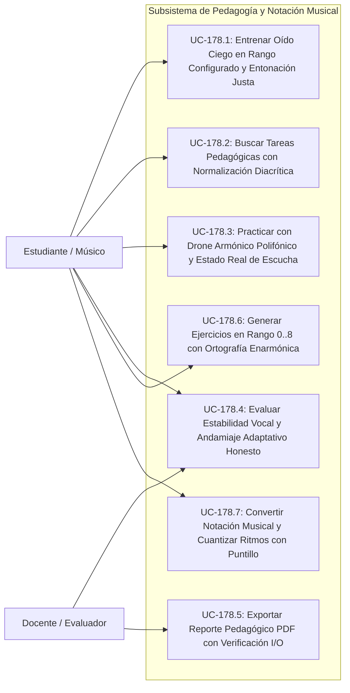
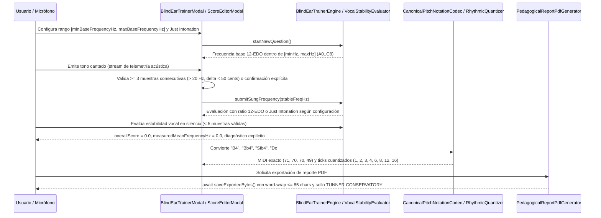

# Caso de Uso 178: Verdad Acústica en Pedagogía y Códec Canónico de Notación Musical

## Metadatos del Documento

- **ID del Documento:** `DOC-PEDAGOGY-NOTATION-2026-178`
- **Título Oficial:** `Verdad Acústica en Suite Pedagógica y Unificación del Códec Canónico Nota-MIDI`
- **Estado:** `Approved`
- **Fecha de Creación:** `2026-11-23`
- **Última Modificación:** `2026-11-23`
- **Fase Asociada:** `Fase 6 — Certificación de Rigor Acústico y Pedagógico v1.0`
- **Autor / Revisor Principal:** `Devs 1 (Agente 01) — Core, Editor de Partituras y Persistencia`

---

## 1. Resumen Ejecutivo (Executive Summary)

Este documento formaliza el comportamiento funcional y matemático requerido para erradicar valores sintéticos, truncamientos polifónicos, desvíos de ortografía enarmónica y ambigüedades de notación en la suite pedagógica (`ear_training`, `guided_lessons`, `harmonic_tutor`, `pedagogy`, `pedagogy_profiles`, `pedagogy_report`, `exercise_generator`) y en el subsistema de edición, importación y transcripción de partituras (`score_editor`, `universal_importer`, `transcription`).

Asimismo, establece el estándar del códec canónico `CanonicalPitchNotationCodec` para la conversión bidireccional determinista entre cadenas de notación musical (solfeo latino `Do..Si` y cifrado anglosajón `C..B` en todo el espectro `A0..C8`) y números de nota MIDI (`0..127`).

---

## 2. Diagrama de Casos de Uso (Mermaid)

---

## 3. Diagrama de Secuencia y Flujo (Mermaid)

---

## 4. Precondiciones y Postcondiciones

### 4.1 Precondiciones
- **PRE-01:** La configuración del entrenador auditivo (`EarTrainerConfig`) provee límites `minBaseFrequencyHz` y `maxBaseFrequencyHz` dentro del espectro audible ($27.5\text{ Hz} \le f \le 4186.01\text{ Hz}$).
- **PRE-02:** El índice de catálogo (`TaskCatalogIndex`) recibe consultas en español con o sin tildes y caracteres diacríticos (`á, é, í, ó, ú, ü, ñ`).
- **PRE-03:** El códec de notación (`CanonicalPitchNotationCodec`) recibe etiquetas de altura en cifrado anglosajón (`C..B`) o solfeo (`Do..Si`) con alteraciones opcionales (`#`, `b`) y octava (`0..8`).

### 4.2 Postcondiciones
- **POST-01:** `BlindEarTrainerEngine` genera frecuencias base exclusivamente dentro del intervalo `[minBaseFrequencyHz, maxBaseFrequencyHz]` y evalúa la respuesta cantada aplicando `config.useJustIntonation`.
- **POST-02:** `TaskCatalogIndex` normaliza diacríticos en indexación y búsqueda, y reemplaza registros existentes por código sin duplicar entradas en índices secundarios por dominio o nivel.
- **POST-03:** `HarmonicTutorViewModel` inicia con `isListening == false` sin telemetría ficticia y sintetiza todas las voces del acorde en `_regenerateDrone()`.
- **POST-04:** `VocalStabilityEvaluator` retorna `overallScore: 0.0` y `measuredMeanFrequencyHz: 0.0` cuando hay menos de 5 muestras válidas (`> 20 Hz`).
- **POST-05:** `CanonicalPitchNotationCodec` distingue sin ambigüedad la nota `B` / `b` (Si natural, semitono 11) del modificador bemol (`Bb`, `Sib`, semitono 10).

---

## 5. Flujo Principal y Flujos Alternativos / de Error

### 5.1 Flujo Principal
1. El usuario inicia un ejercicio auditivo, armónico, vocal o de edición de partitura.
2. En `BlindEarTrainerEngine`, el motor filtra las notas cromáticas desde `A0` (MIDI 21, $27.5\text{ Hz}$) hasta `C8` (MIDI 108, $4186.01\text{ Hz}$) que caen dentro de `[minBaseFrequencyHz, maxBaseFrequencyHz]` y selecciona una nota base aleatoria.
3. Cuando el usuario canta al micrófono, `BlindEarTrainerModal` acumula lecturas consecutivas con $f > 20.0\text{ Hz}$ cuya desviación entre muestras consecutivas sea menor a $50\text{ cents}$, o procesa la confirmación manual mediante `btn_submit_sung_tone`.
4. En `HarmonicTutorViewModel`, la síntesis del drone genera la suma polifónica normalizada de todas las frecuencias del acorde activo (tríadas y cuatríadas con séptima).
5. En `AlgorithmicExerciseGenerator`, cuando la tónica pertenece a una tonalidad con bemoles (`Fa`, `Sib`, `Mib`, `Lab`, `Reb`, `Solb`), las notas alteradas se escriben con ortografía de bemoles (`Reb`, `Mib`, `Solb`, `Lab`, `Sib`).
6. En `CanonicalPitchNotationCodec`, las conversiones entre nombres de nota y MIDI operan de forma unificada para `ScoreEditorModal` y `UniversalImporter`.
7. En `RhythmicQuantizer`, las duraciones se cuantizan al múltiplo más cercano dentro del conjunto `{1, 2, 3, 4, 6, 8, 12, 16}` sub-ticks, soportando figuras simples y con puntillo.

### 5.2 Flujos Alternativos y de Error
- **FA-01 (Silencio o Señal Insuficiente en Evaluación Vocal):** Si `VocalStabilityEvaluator.evaluate` recibe menos de 5 muestras con frecuencia $> 20.0\text{ Hz}$, retorna inmediatamente `measuredMeanFrequencyHz: 0.0`, `overallScore: 0.0` y un diagnóstico explícito indicando señal acústica insuficiente.
- **FA-02 (Fallo o Cancelación en Guardado de PDF):** Si `saveExportedBytes` lanza una excepción o retorna una ruta vacía en `PedagogicalReportModal`, se captura el fallo y se notifica el error en la interfaz sin mostrar confirmación falsa de éxito.
- **FA-03 (Partitura sin Compases en ScoreEditorModal):** Si `totalMeasures <= 0`, el cálculo del compás actual retorna `0` de forma segura sin invocar `.clamp(0, -1)`.
