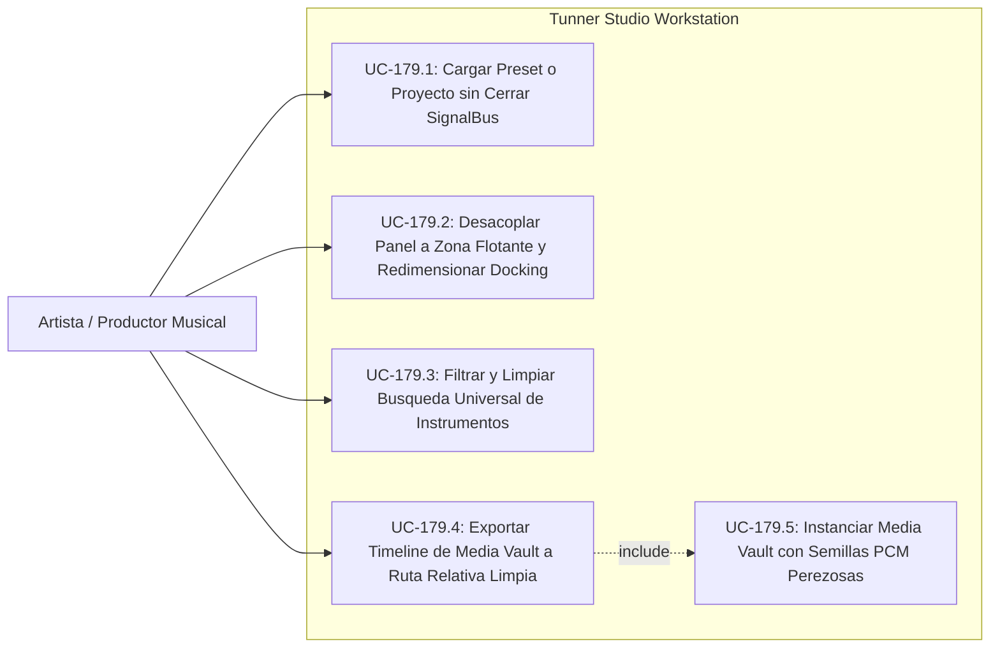
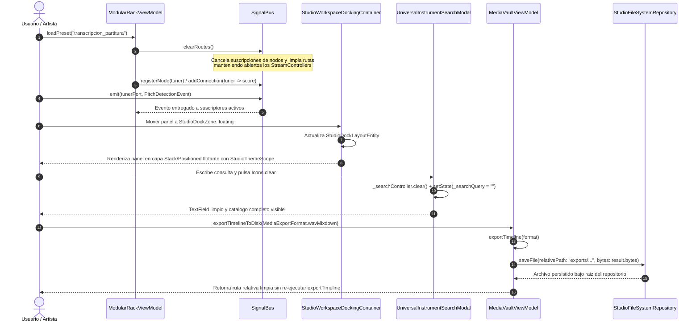

# Caso de Uso 179: SignalBus Reiniciable sin Disposicion, Zona Flotante de Docking y Exportacion Relativa en Media Vault

## Metadatos del Documento

- **ID del Documento:** `DOC-RACK-DOCK-VAULT-2026-179`
- **Titulo Oficial:** `SignalBus Reiniciable (clearRoutes), Renderizado de Zona Flotante en Docking con Tokens de Tema y Exportacion Relativa en Media Vault`
- **Estado:** `Approved`
- **Fecha de Creacion:** `2026-11-23`
- **Ultima Modificacion:** `2026-11-23`
- **Fase Asociada:** `Fase 6 — Hardening de Produccion y Enrutamiento v1.0`
- **Autor / Revisor Principal:** `Devs 2 (Agente 02) — Importers, OMR & Parsers / Modular Rack`

---

## 1. Resumen Ejecutivo (Executive Summary)

Este caso de uso formaliza la correccion arquitectonica y funcional de tres subsistemas criticos de la estacion de trabajo Tunner Studio correspondientes a las historias de usuario **US-11.1 (Issue #189)** y **US-11.3 (Issue #191)**:
1. **SignalBus Reiniciable (`clearRoutes`):** Evita la destruccion prematura de los `StreamController`s internos del bus de senales al cambiar de preset o cargar un paquete de proyecto `.tunner`, reservando `dispose()` exclusivamente para el cierre definitivo del `ModularRackViewModel`.
2. **Docking Multi-Panel Resiliente y Zona Flotante (`StudioDockZone.floating`):** Renderiza los paneles desacoplados en una capa flotante posicionada sobre el area de trabajo, protege el contenedor contra listas vacias o dimensiones reducidas (`< 134 px`), estabiliza `DefaultTabController` ante cambios dinamicos en la cantidad de pestanas y migra los estilos del sistema de acoplamiento a `StudioThemeScope`.
3. **Busqueda Universal de Instrumentos y Media Vault Optimizado:** Vincula un `TextEditingController` al buscador universal para limpiar visualmente el campo de texto, corrige la ruta relativa en `exportTimelineToDisk` evitando duplicar prefijos de directorio raiz y elimina la sintesis sincrona pesada en el constructor de `InMemoryMediaVaultRepository`.

---

## 2. Diagrama de Casos de Uso (Mermaid)

---

## 3. Diagrama de Secuencia Detallado (Mermaid)

---

## 4. Especificacion Funcional Detallada

### 4.1 Precondiciones
- El usuario opera dentro de `ModularRackViewModel`, `StudioWorkspaceDockingContainer`, `UniversalInstrumentSearchModal` o `MediaVaultWorkspaceModal`.
- `StudioThemeScope` provee una instancia activa de `StudioDesignTokens` (o fallback a `StudioDesignTokens.studioOledMonochrome`).

### 4.2 Postcondiciones
- Tras invocar `loadPreset()` o `loadProjectPackage()`, `SignalBus` conserva la capacidad de emitir eventos hacia cualquier suscripcion existente o nueva sin lanzar `Bad state: Cannot add event after closing`.
- Cuando `SignalBus.dispose()` es invocado al destruir `ModularRackViewModel`, `_isDisposed` pasa a `true` y bloquea mutaciones posteriores.
- Los paneles asignados a `StudioDockZone.floating` permanecen visibles e interactivos como ventanas flotantes sobre el espacio de acoplamiento.
- `StudioWorkspaceDockingContainer` soporta contenedores de tamano reducido (ej. `80x80`) sin lanzar `ArgumentError` en `.clamp()` ni errores de `RenderFlex` overflow.
- `MediaVaultViewModel.exportTimelineToDisk` invoca `fileSystemRepository.saveFile(relativePath: 'exports/${result.fileName}', ...)` sin anteponer rutas absolutas del sistema operativo.
- `InMemoryMediaVaultRepository` inicializa sus semillas de demostracion de manera ligera/perezosa sin bloquear el hilo principal sintetizando ~705,600 muestras flotantes en el constructor.

### 4.3 Flujo Principal
1. **Reinicio de Rutas en SignalBus:**
   - El usuario selecciona un nuevo preset en el Rack Modular.
   - `ModularRackViewModel` invoca `signalBus.clearRoutes()`.
   - `SignalBus` cancela las suscripciones de nodos previos, vacia `_nodeSubscriptions`, `_registeredNodes` y `_connections`, pero preserva `_portControllers` abiertos para no invalidar streams activos.
2. **Acoplamiento Flotante y Redimensionamiento Seguro:**
   - El usuario cambia la zona de un panel a `StudioDockZone.floating` o redimensiona la ventana.
   - `StudioWorkspaceDockingContainer` calcula la altura disponible con limite inferior `math.min(100.0, math.max(0.0, totalHeight - 34.0))`.
   - Si una zona cambia su numero de paneles, `DefaultTabController` se reconstruye limpiamente gracias a `ValueKey('tab_ctrl_${zone.name}_${zonePanels.length}')`.
   - Los paneles en `StudioDockZone.floating` se dibujan en una capa `Positioned` dentro del `Stack` principal del area de trabajo.
3. **Limpieza del Buscador Universal de Instrumentos:**
   - El usuario ingresa texto en `UniversalInstrumentSearchModal` y presiona el boton `Icons.clear`.
   - El modal ejecuta `_searchController.clear()` y limpia `_searchQuery`, sincronizando el `TextField` visual y la lista filtrada.
4. **Exportacion en Media Vault:**
   - El usuario solicita exportar el timeline a disco.
   - `MediaVaultViewModel.exportTimelineToDisk` genera los bytes mediante `exportTimeline(format)` y los guarda en la ruta relativa `'exports/${result.fileName}'`.
   - `MediaVaultWorkspaceModal` inspecciona `viewModel.lastExportResult` si `savedPath == null`, evitando ejecutar `exportTimeline(format)` por segunda vez.

### 4.4 Flujos Alternativos y Condiciones de Error
- **FA-01 (Lista de paneles vacia con panel maximizado):** Si `widget.panels.isEmpty`, `StudioWorkspaceDockingContainer.build` retorna inmediatamente `const SizedBox.shrink()` sin evaluar `widget.panels.first`.
- **FA-02 (Uso de SignalBus tras dispose):** Si se invoca `registerNode`, `addConnection` o `emit` despues de `dispose()`, la guarda `_isDisposed` ignora la operacion de forma segura.
- **FA-03 (Exportacion sin repositorio de disco configurado):** Si `fileSystemRepository` es `null`, `exportTimelineToDisk` aun actualiza `lastExportResult` y retorna `null`; el modal muestra el mensaje de `lastExportResult` sin recalcular la mezcla.
