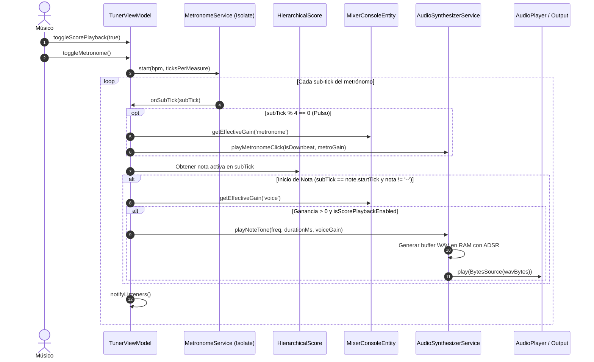

# Caso de Uso 17: Reproducción Acústica Procedural de Partituras (Score Playback)

Este documento define el caso de uso canónico para la reproducción sonora en tiempo real de las notas musicales de la partitura activa sincronizadas con el reloj métrico del metrónomo.

---

## Metadatos

- **ID:** `UC-17`
- **Nombre:** Reproducción Acústica Procedural de Partituras en Memoria
- **Actor Principal:** Músico / Estudiante practicando una obra musical.
- **Actores Secundarios:** Isolate de Reloj de Metrónomo, ViewModel del Afinador, Consola de Mezcla Multicanal, Sintetizador PCM Procedural, Motor de Audio Nativo.

---

## 1. Diagrama de Caso de Uso

```mermaid
flowchart TD
    User(["Músico / Estudiante"])
    MetroClock["Reloj de Metrónomo (onSubTick)"]
    TunerVM["TunerViewModel"]
    Mixer["MixerConsoleEntity (Pista 'voice')"]
    SynthService["IAudioSynthesizerService"]
    ScoreTree["HierarchicalScorePackage"]
    AudioOutput["Hardware de Audio (Altavoz / Audífonos)"]

    User -->|Activa reproducción con partitura sonora| TunerVM
    User -->|Ajusta volumen / Mute / Solo de pista melódica| Mixer
    MetroClock -->|subTick (cada 1/16 de pulso)| TunerVM
    TunerVM -->|Consulta nota en el tick actual| ScoreTree
    TunerVM -->|Calcula ganancia efectiva de 'voice'| Mixer
    TunerVM -->|playNoteTone(freq, duration, volume)| SynthService
    SynthService -->|Síntesis PCM 16-bit ADSR en RAM| AudioOutput
```

---

## 2. Diagrama de Secuencia y Flujo de Audio



---

## 3. Precondiciones y Postcondiciones

### 3.1 Precondiciones
1. Existe una partitura activa cargada en el ViewModel (`HierarchicalScorePackage`).
2. El sintetizador procedural `IAudioSynthesizerService` está inicializado.
3. El metrónomo se encuentra en ejecución o se inicia la práctica.

### 3.2 Postcondiciones
1. Cada nota se sintetiza y reproduce con entonación exacta según la calibración de concierto $A_4$ en vigor.
2. La duración temporal coincide matemáticamente con los ticks asignados a la nota y el tempo BPM activo.
3. Si la pista "voice" está en silencio (*muted*) o atenuada, la ganancia de reproducción refleja fielmente el estado de la consola de mezcla.

---

## 4. Flujos

### 4.1 Flujo Principal
1. El usuario pulsa el botón de reproducción métrica con el modo de audio de partitura activado (`isScorePlaybackEnabled == true`).
2. El metrónomo emite eventos de reloj `onSubTick`.
3. Al alcanzar el `startTick` de una nota válida, el ViewModel calcula su frecuencia fundamental en Hz vía `NoteEntity.frequencyForNote`.
4. Calcula la duración física $T = D_{\text{ticks}} \times \frac{60000}{\text{BPM} \times 4}$.
5. Obtiene la ganancia del canal melódico `mixer.getEffectiveGain('voice')`.
6. Invoca `_audioSynthesizer.playNoteTone(freq, duration, volume)`.
7. El sintetizador aplica la envolvente ADSR de 44.1 kHz en memoria y dispara la reproducción sin bloqueo de hilo.

### 4.2 Flujo Alternativo 1: Silencio o Pausa en la Partitura
- **Condición:** La posición actual corresponde a un silencio (`noteName == "--"` o `"rest"`).
- **Acción:** El ViewModel no genera orden de síntesis para esa nota.

### 4.3 Flujo Alternativo 2: Pista Melódica Silenciada (Modo Acompañamiento / Minus One)
- **Condición:** El usuario activa *Mute* en la pista "voice" para tocar su propio instrumento sin la melodía grabada.
- **Acción:** `getEffectiveGain('voice')` retorna `0.0`. La síntesis se omite y solo suenan el metrónomo y acompañamiento.
