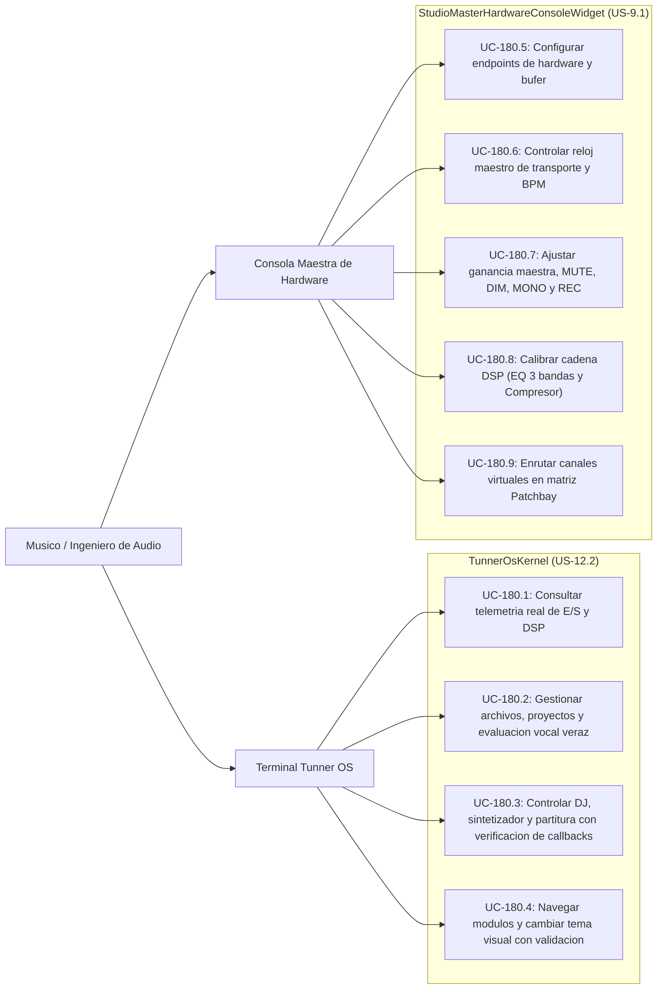
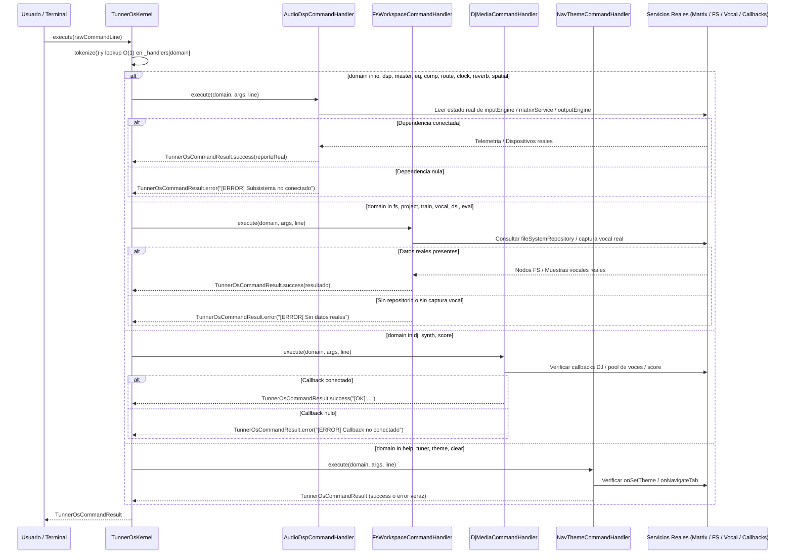

# UC-180: Veracidad Operativa de TunnerOsKernel, Despacho Modular y Atomizacion Tipada de la Consola Maestra

## Metadatos del Documento

- **ID del Documento:** `DOC-CORE-2026-180`
- **Título Oficial:** `Veracidad Operativa de TunnerOsKernel, Despacho Modular de Comandos y Atomizacion Tipada de la Consola Maestra`
- **Estado:** `Approved`
- **Fecha de Creación:** `2026-11-23`
- **Última Modificación:** `2026-11-23`
- **Fase Asociada:** `Fase 4`
- **Autor / Revisor Principal:** `Equipo de Arquitectura Tunner Studio`
- **User Stories / Issues:** `US-12.2 (#193)`, `US-9.1 (#183)`
- **ADR Relacionado:** `docs/04_adrs/0172_modular_terminal_handlers_and_typed_master_console.md`

---

## 1. Resumen Ejecutivo (Executive Summary)

Este documento especifica la remediacion integral de veracidad operativa y descomposicion arquitectonica en dos componentes centrales de Tunner Studio: el nucleo de comandos `TunnerOsKernel` (US-12.2 / #193) y la consola de hardware maestro `StudioMasterHardwareConsoleWidget` (US-9.1 / #183).

Por un lado, `TunnerOsKernel` elimina todas las respuestas sinteticas o ficticias cuando los subsistemas reales de hardware, sistema de archivos, captura vocal o callbacks de interfaz no se encuentran enlazados, reportando errores y advertencias veraces en su lugar. Simultaneamente, descompone el bloque `switch` monolitico de mas de 1,300 lineas en cuatro manejadores modulares que implementan `ITerminalCommandHandler` con despacho en tiempo constante $O(1)$. Por otro lado, `StudioMasterHardwareConsoleWidget` (1,148 lineas) se atomiza en cinco paneles especializados estrictamente tipados con `StudioDesignTokens`, `AudioDeviceMatrixEntity`, `StudioAudioDeviceMatrixService` y `StudioMasterClockService`, eliminando todo uso de `dynamic`, colores `Colors.*` incrustados e iconos crudos en favor de `StudioIcon`.

---

## 2. Contexto del Problema y Justificacion Teorica

### 2.1 Planteamiento del Problema

1. **Telemetria y respuestas ficticias en `TunnerOsKernel`:**
   - `io list` devolvia interfaces simuladas (`Focusrite Scarlett 2i2 USB`) cuando `inputEngine == null`.
   - `dsp status` imprimia cadenas estaticas (`EN LINEA (FULL-DUPLEX)`, `44.1 kHz / 48.0 kHz`, `1024 muestras (< 7.8 ms latencia)`) ignorando el estado real de `matrixService` y `outputEngine`.
   - `fs ls` fabricaba cuatro archivos inexistentes (`Suite_No1_Bach.tunner`, etc.) cuando `fileSystemRepository == null`.
   - `vocal eval` y `vocal cert` sintetizaban 50 muestras artificiales cuando no habia captura real de microfono, induciendo falsos reportes y certificados PDF.
   - `dj` y `theme set` devolvian `[OK]` aun cuando sus callbacks de accion eran `null`.
   - Toda la logica residia en un unico `switch` monolitico en `tunner_os_kernel.dart` (~1,306 LOC), dificultando mantenibilidad y aislamiento de pruebas.
2. **Monolito UI y tipado debil en `StudioMasterHardwareConsoleWidget`:**
   - Un unico widget de 1,148 lineas concentraba cabecera, endpoints de hardware, reloj maestro, tira de canal master, cadena DSP de masterizacion y patchbay.
   - Multiples metodos privados aceptaban parametros `dynamic tokens` y `dynamic matrix`, anulando la verificacion estatica del compilador Dart.
   - Existian multiples referencias hardcoded a `Colors.*` e iconos `Icon(Icons.*)` que violaban el sistema de diseno basado en `StudioDesignTokens` y `StudioIcon`.

### 2.2 Fundamento Tecnico

- **Latencia real de bufer:**
  $$\text{Latencia (ms)} = \frac{\text{bufferSize}}{\text{sampleRate}} \times 1000$$
  `dsp status` deriva la latencia y frecuencia de muestreo exclusivamente de `AudioDeviceMatrixEntity.estimatedBufferLatencyMs` y `AudioDeviceMatrixEntity.sampleRate`.
- **Despacho en tiempo constante:**
  El registro de manejadores `ITerminalCommandHandler` en una tabla hash `Map<String, ITerminalCommandHandler>` garantiza complejidad temporal $O(1)$ en la resolucion de dominio, preservando la capacidad de sobreescritura por manejadores personalizados registrados externamente.

---

## 3. Diagrama de Casos de Uso (Mermaid)

---

## 4. Diagrama de Secuencia (Mermaid)

---

## 5. Especificacion Funcional Detallada

### 5.1 Precondiciones
- `TunnerOsKernel` se instancia con cero o mas puertos de dominio/infraestructura inyectados.
- `StudioMasterHardwareConsoleWidget` se monta dentro de un `StudioThemeScope` que provee una instancia valida de `StudioDesignTokens`, junto con `StudioAudioDeviceMatrixService` y `StudioMasterClockService`.

### 5.2 Postcondiciones
- Ningun comando del kernel inventa dispositivos, archivos, telemetria de audio ni muestras vocales cuando las dependencias no existen o estan vacias.
- Todos los comandos integrados del kernel se despachan mediante cuatro manejadores modulares registrados en el mapa $O(1)$.
- `StudioMasterHardwareConsoleWidget` delega sus cinco secciones funcionales a paneles independientes en `lib/core/audio/presentation/panels/` con cero `dynamic` y cero `Colors.*`.

### 5.3 Flujo Principal
1. **Despacho modular en `TunnerOsKernel`:**
   - Al construirse, el kernel registra `AudioDspCommandHandler`, `FsWorkspaceCommandHandler`, `DjMediaCommandHandler` y `NavThemeCommandHandler`, seguidos de cualquier `customHandlers` inyectado.
   - `execute()` tokeniza la linea, resuelve `domain` en `_handlers[domain]` en $O(1)$ y delega la ejecucion.
2. **Telemetria real:**
   - `io list` consulta `inputEngine.listInputDevices()`.
   - `dsp status` lee `sampleRate`, `bufferSize`, `estimatedBufferLatencyMs`, dispositivos activos y estado de `matrixService`/`outputEngine`/`nativeDspBridge`.
   - `fs ls` enumera `fileSystemRepository.loadRootWorkspace()`.
   - `vocal eval` y `vocal cert` consumen exclusivamente muestras reales de `onReadCapturedFrequencies` y `onReadCapturedAmplitudes`.
3. **Renderizado atomizado de la Consola Maestra:**
   - `StudioMasterHardwareConsoleWidget` escucha `Listenable.merge([matrixService, clockService])` y compone `HardwareEndpointsPanel`, `MasterClockPanel`, `MasterStripPanel`, `MasteringChainPanel` y `MatrixRoutingPanel` pasando `StudioDesignTokens` y entidades tipadas.

### 5.4 Flujos Alternativos y de Error
- **FA-01 (`inputEngine == null`):** `io list` y `io set-input` retornan `isSuccess: false` con `[ERROR]`.
- **FA-02 (`matrixService == null` en `dsp status`):** Reporta estado real desconectado sin valores ficticios de frecuencia o latencia, manteniendo la informacion real de `nativeDspBridge`.
- **FA-03 (`fileSystemRepository == null`):** `fs ls` retorna `isSuccess: false` con `[ERROR]`.
- **FA-04 (Sin captura vocal real):** `vocal eval` y `vocal cert` retornan `isSuccess: false` con `[ERROR]` explicito.
- **FA-05 (Callbacks `null` en `dj` o `theme set`):** Retornan `isSuccess: false` con `[ERROR]` en lugar de `[OK]`.

---

## 6. Plan de Pruebas y Validacion (QA)

- [ ] Suite dedicada `test/core/terminal/us_12_2_9_1_kernel_truthfulness_and_console_test.dart` validando veracidad ante dependencias nulas, lectura de telemetria real, despacho modular y renderizado de los 5 paneles tipados.
- [ ] Regresion completa sobre `test/core/terminal/`, `test/core/audio/studio_master_hardware_console_widget_test.dart`, `test/features/navigation/us_6_6_kernel_dashboard_and_modals_test.dart` y `test/features/pedagogy/vocal_stability_and_pdf_test.dart`.
- [ ] Analisis estatico limpio con `flutter analyze --no-fatal-infos`.
