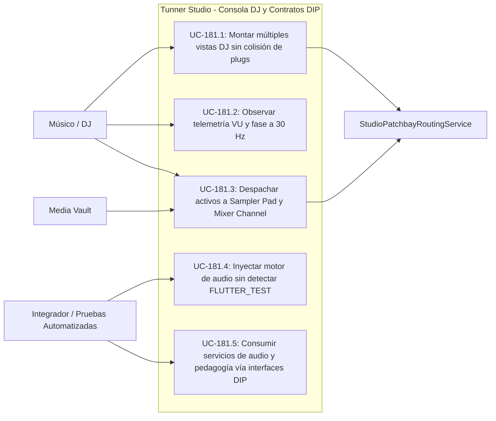
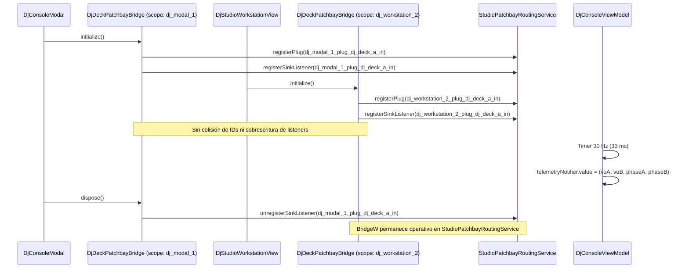

# UC-181: Aislamiento de Patchbay en Consola DJ, Telemetría Dedicada y Contratos DIP de Dominio

## Metadatos del Documento

- **ID del Documento:** `UC-DJ-2026-181`
- **Título Oficial:** Aislamiento de Patchbay en Consola DJ, Telemetría Reactiva 30 Hz y Contratos DIP de Dominio
- **Estado:** `Approved`
- **Fecha de Creación:** `2026-11-23`
- **Última Modificación:** `2026-11-23`
- **Fase Asociada:** `Global / Estabilización Arquitectónica (US-11.2 & US-8.2)`
- **Issues Asociados:** `#190 (US-11.2)`, `#181 (US-8.2)`

---

## 1. Resumen Ejecutivo

Este caso de uso formaliza dos mejoras estructurales en el monolito modular de Tunner:

1. **Deduplicación y aislamiento de instancias en el Patchbay de la Consola DJ (US-11.2):** Extrae la lógica duplicada de registro de plugs y sincronización bidireccional de `DjConsoleModal` y `DjStudioWorkstationView` hacia `DjDeckPatchbayBridge`, utilizando identificadores con ámbito de instancia (`'${scopePrefix}_plug_dj_deck_a_in'`). Adicionalmente, expone un `ValueNotifier` dedicado (`telemetryNotifier`) en `DjConsoleViewModel` para telemetría de vúmetros y fase de beat a 30 Hz, cablea los destinos reales `djSamplerPad` y `mixerChannel` desde Media Vault, y elimina el acoplamiento a `FLUTTER_TEST` en `DjDeckAudioService`.
2. **Completitud de Contratos DIP en la Capa de Dominio (US-8.2):** Define ocho interfaces puras en Dart (cero dependencias de Flutter UI o infraestructura) para los servicios críticos de reloj maestro, matriz de dispositivos de audio, sintetizador armónico de referencia, entrenamiento auditivo, índice de catálogo pedagógico, generador algorítmico de ejercicios, motor de andamiaje adaptativo y códec binario de proyectos.

---

## 2. Diagrama de Casos de Uso (Mermaid)

---

## 3. Diagrama de Secuencia (Mermaid)

---

## 4. Especificación del Caso de Uso

### 4.1 Precondiciones
- El contenedor de la aplicación dispone de una instancia activa de `StudioPatchbayRoutingService` (o instancia aislada en pruebas).
- `DjConsoleViewModel` está inicializado con una implementación de `IDjDeckAudioPlayer` e `IAudioSynthesizerService`.
- Los módulos de dominio de audio y pedagogía están cargados en Dart puro.

### 4.2 Flujo Principal
1. Al montarse `DjConsoleModal` o `DjStudioWorkstationView`, cada vista instancia su propio `DjDeckPatchbayBridge` con un `scopePrefix` único por instancia.
2. El puente registra los plugs `${scopePrefix}_plug_dj_deck_a_in` y `${scopePrefix}_plug_dj_deck_b_in` (y opcionalmente `${scopePrefix}_plug_dj_master_out`), suscribe listeners de recepción y sincroniza cambios del `DjConsoleViewModel` hacia los canales conectados.
3. Cuando algún deck se encuentra en reproducción, grabación o automix, el temporizador de 30 Hz de `DjConsoleViewModel` actualiza `telemetryNotifier.value` con los niveles RMS (`vuA`, `vuB`) y fases de pulso (`phaseA`, `phaseB`).
4. Cuando el usuario despacha un activo desde `MediaVaultWorkspaceModal`:
   - Hacia `MediaSynergyTarget.djSamplerPad`, `DjConsoleViewModel` carga y dispara el buffer PCM real del activo en el sintetizador de sampler.
   - Hacia `MediaSynergyTarget.mixerChannel`, `DjDeckPatchbayBridge` publica los parámetros y buffer PCM del activo en el bus del mezclador (`canal_c`) sin sobrescribir directamente el Deck A.
5. En `DjDeckAudioService`, la selección del motor de audio se resuelve exclusivamente mediante inyección de dependencia (`audioEngine ?? StudioAudioEngine()`), eliminando cualquier bifurcación basada en `Platform.environment['FLUTTER_TEST']`.
6. Los módulos consumidores (`HarmonicTutorViewModel` y clientes de dominio) operan contra interfaces puras (`IHarmonicReferenceSynth`, `IStudioMasterClockService`, `IStudioAudioDeviceMatrixService`, `IEarTrainerEngine`, `ITaskCatalogIndex`, `IExerciseGenerator`, `IAdaptiveScaffoldingEngine`, `ITunnerBinaryCodec`).

### 4.3 Flujos Alternativos y de Error
- **Desmontaje parcial de una vista:** Si `DjConsoleModal` se cierra mientras `DjStudioWorkstationView` permanece abierto, `BridgeM.dispose()` desregistra únicamente sus listeners y plugs con prefijo propio sin afectar a `BridgeW`.
- **Activo sin muestras PCM en Media Vault:** Si `asset.pcmSamples` es nulo o vacío, se genera un buffer seguro de silencio (`Float32List(4410)`) antes de despachar al sampler o al bus del mezclador.
- **Disposición del ViewModel:** Al invocar `DjConsoleViewModel.dispose()`, el temporizador de 30 Hz se cancela y `telemetryNotifier.dispose()` se ejecuta de forma determinista para evitar fugas de memoria.

### 4.4 Postcondiciones
- Ninguna instancia de vista DJ sobrescribe ni invalida los plugs de otra instancia en `StudioPatchbayRoutingService`.
- Los indicadores de vúmetro y fase pueden suscribirse únicamente a `telemetryNotifier` sin forzar reconstrucciones innecesarias de todo el árbol.
- El código de producción no contiene referencias a `FLUTTER_TEST` ni dependencias directas de clases concretas donde existe un puerto de dominio.
