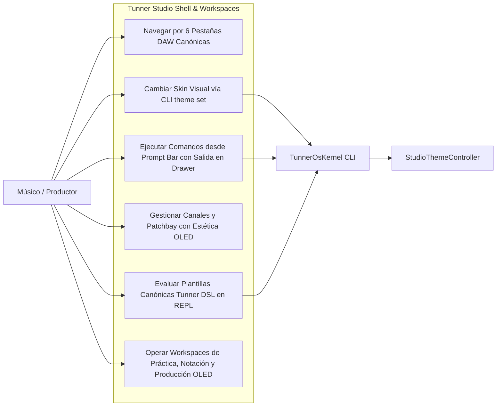
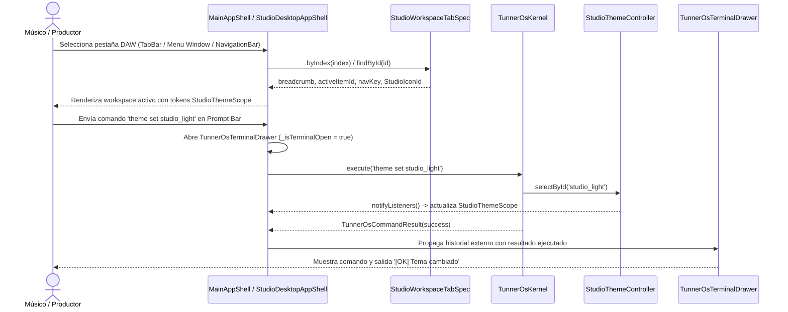

# UC-182: Migración OLED Pro-DAW de Shell, Canales, Terminal, Workspaces y Especificación Unificada de Pestañas DAW

- **ID:** UC-182
- **Historias de Usuario:** US-7.2 (Issue #177), US-9.2 (Issue #184)
- **ADR Relacionado:** [ADR-0174](../04_adrs/0174_unified_workspace_tab_spec_and_oled_shell_migration.md)
- **Estado:** Implementado
- **Fecha:** 2026-11-23

---

## 1. Propósito

Unificar la definición canónica de las 6 pestañas DAW de Tunner Studio (`home`, `tuner`, `learning`, `studio`, `library`, `dj`) mediante una entidad de dominio pura (`StudioWorkspaceTabSpec`) consumida simultáneamente por el shell de escritorio (`StudioDesktopAppShell`, `StudioWorkspaceTabBar`) y el shell móvil/principal (`MainAppShell`), eliminando divergencias entre etiquetas, atajos, breadcrumbs y claves de navegación.

Simultáneamente, completar la migración hacia el sistema de diseño OLED Monochrome (`StudioThemeScope.of(context)` + `StudioIcon`) en los módulos de Canales (`studio_channel_modals.dart`), Terminal (`tunner_os_terminal_drawer.dart`, `studio_dsl_terminal_panel_widget.dart` con `TunnerDslTemplateCatalog`) y Workspaces (`workspace_switch_bar.dart`, `learning_practice_workspace_view.dart`, `production_acoustic_lab_workspace_view.dart`, `composition_notation_workspace_view.dart`, `polyphonic_synth_modal.dart`), conectando el comando CLI `theme set` al `StudioThemeController` y renderizando la salida de `onCommandSubmitted` en el cajón de terminal.

---

## 2. Actores

- **Músico / Productor (Usuario Final):** Navega entre los 6 espacios de trabajo DAW, gestiona canales de parcheo, ejecuta scripts Tunner DSL y cambia skins visuales desde la UI o la terminal CLI.
- **Tunner OS Kernel (`TunnerOsKernel`):** Interpreta comandos CLI (`theme set`, `dsl`, `dsp status`, etc.) y despacha callbacks de tema y navegación.
- **Sistema de Diseño (`StudioThemeScope` / `StudioThemeController`):** Propaga tokens de superficie, borde, tipografía y telemetría de forma reactiva en tiempo real.

---

## 3. Diagrama de Casos de Uso

---

## 4. Diagrama de Secuencia

---

## 5. Precondiciones

1. `StudioThemeScope` provee un `StudioThemeController` (o fallback a `StudioDesignTokens.studioOledMonochrome`).
2. `StudioIcon` y `StudioIconCatalog` están inicializados para resolver iconos progresivos (SVG -> PNG -> Fallback).
3. `TunnerDslTemplateCatalog` expone las plantillas canónicas en Dart puro sin dependencia de red.

---

## 6. Postcondiciones

1. Las 6 pestañas DAW (`home`, `tuner`, `learning`, `studio`, `library`, `dj`) se derivan de una única fuente de verdad (`StudioWorkspaceTabSpec.canonicalTabs`).
2. Ninguna vista migrada de Shell, Canales, Terminal o Workspaces depende de colores neón fijos (`0xFF00E5FF`, `0xFF090D16`, `0xFF10131E`, etc.) para sus superficies o textos principales.
3. El comando `theme set <id>` actualiza simultáneamente `TunerViewModel` y `StudioThemeController`.
4. Toda orden enviada mediante `onCommandSubmitted` en `StudioDesktopAppShell` queda registrada y visible en `TunnerOsTerminalDrawer`.
5. `StudioDslTerminalPanelWidget` expone las plantillas de `TunnerDslTemplateCatalog` además de los presets rápidos del REPL.

---

## 7. Flujo Principal

1. Al renderizar `MainAppShell` en escritorio, `StudioDesktopAppShell` construye el menú `Window` y la barra `StudioWorkspaceTabBar` a partir de `StudioWorkspaceTabSpec.canonicalTabs`.
2. Al renderizar `MainAppShell` en vista compacta/móvil, `NavigationBar` construye sus 6 destinos a partir de `StudioWorkspaceTabSpec.canonicalTabs` usando `StudioIcon` y `StudioThemeScope.of(context)`.
3. Cuando el usuario envía un comando en la barra de comandos (`StudioCommandPromptBar`), `MainAppShell` ejecuta `_terminalKernel.execute(cmd)`, abre `TunnerOsTerminalDrawer` y sincroniza el `TunnerOsCommandHistoryItem` resultante en el drawer.
4. Si el comando es `theme set <id>`, `TunnerOsKernel` invoca `onSetTheme`, el cual actualiza `TunerViewModel.setPaletteById` y `StudioThemeScope.controllerOf(context)?.selectById`.
5. Al abrir modales de canales (`StudioCreateChannelModal`, `StudioRenameChannelModal`), el REPL DSL (`StudioDslTerminalPanelWidget`) o cualquiera de las vistas de `lib/features/workspaces/presentation/`, todos los contenedores, bordes, textos e iconos se resuelven dinámicamente desde `StudioThemeScope.of(context)` y `StudioIcon`.

---

## 8. Flujos Alternativos y de Error

- **Índice de pestaña fuera de rango:** `StudioWorkspaceTabSpec.byIndex(index)` retorna de forma segura la pestaña `home` (índice 0) sin lanzar excepciones.
- **ID de tema no reconocido en `theme set`:** `StudioThemeController.selectById` realiza búsqueda insensible a mayúsculas por `id` o `displayName`, haciendo fallback determinista a `StudioDesignTokens.studioOledMonochrome`.
- **Error de sintaxis en script Tunner DSL:** `StudioDslTerminalPanelWidget` renderiza el diagnóstico usando `tokens.accentDanger` manteniendo la legibilidad en temas claros y oscuros.
- **Comando `clear` desde Prompt Bar:** El historial externo se limpia y el cajón de terminal refleja el estado vacío sin errores de rango.
