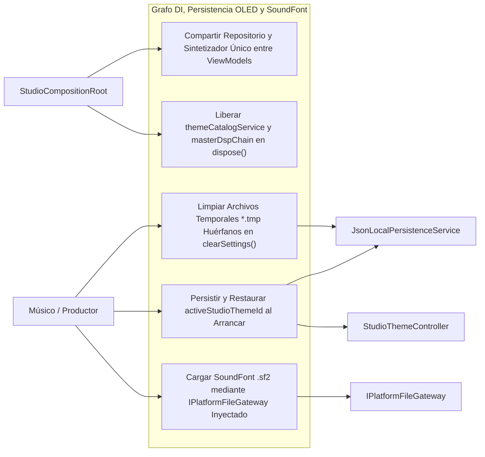
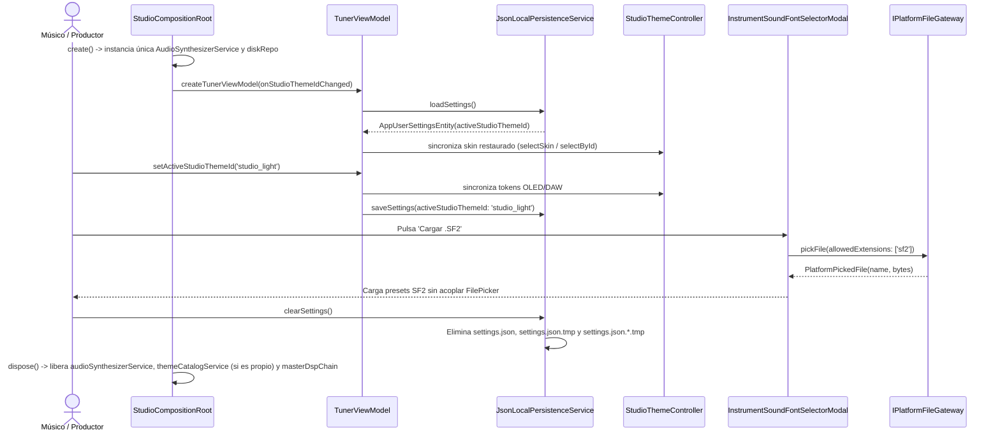

# UC-183: Completitud del Composition Root, Persistencia del Tema OLED y Limpieza de Archivos Temporales

- **ID:** UC-183
- **Historia de Usuario:** US-8.3 (Issue #182)
- **ADR Relacionado:** [ADR-0175](../04_adrs/0175_unified_composition_root_and_tmp_cleanup.md)
- **Estado:** Implementado
- **Fecha:** 2026-11-23

---

## 1. Propósito

Consolidar el grafo único de dependencias en `StudioCompositionRoot` eliminando instancias duplicadas de `LocalDiskStudioFileSystemRepository` y `AudioSynthesizerService` entre `TunerViewModel`, `DjConsoleViewModel` y `MediaVaultViewModel`, y asegurar la liberación determinista de `themeCatalogService` (cuando es propiedad del root) y `masterDspChain` al ejecutar `dispose()`.

Adicionalmente, garantizar que el identificador de tema visual OLED/DAW (`activeStudioThemeId`) se persista y restaure de forma bidireccional entre `TunerViewModel`, `AppUserSettingsEntity` y `StudioThemeController`, que `JsonLocalPersistenceService.clearSettings()` purgue archivos temporales huérfanos con marca de tiempo (`*.<timestamp>.tmp`), y que `InstrumentSoundFontSelectorModal` delegue la selección de archivos `.sf2` al puerto desacoplado `IPlatformFileGateway`.

---

## 2. Actores

- **Músico / Productor (Usuario Final):** Selecciona estéticas OLED/DAW persistentes entre reinicios, importa bancos SoundFont `.sf2` y restablece configuraciones locales.
- **Composition Root (`StudioCompositionRoot`):** Instancia, comparte y libera de forma determinista el grafo de servicios de audio, sistema de archivos, DSP y temas.
- **Servicio de Persistencia Local (`JsonLocalPersistenceService`):** Serializa atómicamente `AppUserSettingsEntity` en disco y limpia archivos `.tmp` residuales.
- **Controlador de Tema (`StudioThemeController` / `StudioThemeCatalogService`):** Aplica de forma reactiva los `StudioDesignTokens` activos en el árbol de widgets.

---

## 3. Diagrama de Casos de Uso

---

## 4. Diagrama de Secuencia

---

## 5. Precondiciones

1. `StudioCompositionRoot.create(...)` construye el grafo de servicios con `isolatedServices` configurado según entorno de producción o pruebas.
2. `AppUserSettingsEntity` soporta la clave serializable `activeStudioThemeId` con valor por defecto `'studio_oled_monochrome'`.
3. El directorio de documentos local es accesible de lectura y escritura para `JsonLocalPersistenceService`.
4. `IPlatformFileGateway` está disponible en el grafo de dependencias para inyectarse en modales de presentación.

---

## 6. Postcondiciones

1. `createTunerViewModel()`, `createDjConsoleViewModel()` y `createMediaVaultViewModel()` reciben exactamente la misma instancia de `AudioSynthesizerService`.
2. `createDjConsoleViewModel()` y `createMediaVaultViewModel()` reciben exactamente la misma instancia de `StudioFileSystemRepository` (`fileSystemService.fileSystemRepository`).
3. `StudioCompositionRoot.dispose()` invoca `themeCatalogService.dispose()` únicamente cuando fue creado de manera aislada por el root, y libera los recursos de `masterDspChain`.
4. `JsonLocalPersistenceService.clearSettings()` elimina el archivo JSON principal, `${targetFile.path}.tmp` y cualquier archivo huérfano que coincida con `${targetFile.path}.*.tmp` en el directorio padre sin afectar otros archivos.
5. `TunerViewModel` persiste y restaura `activeStudioThemeId` y expone `setActiveStudioThemeId(String id)` sincronizado con `StudioThemeController`.
6. `InstrumentSoundFontSelectorModal` acepta `IPlatformFileGateway? fileGateway` y utiliza `viewModel.platformFileGateway` desde sus puntos de invocación.

---

## 7. Flujo Principal

1. Al inicializar la aplicación o un entorno de pruebas, `StudioCompositionRoot.create()` crea una sola instancia de `LocalDiskStudioFileSystemRepository` (inyectada en `StudioWorkspaceFileSystemService`) y una sola instancia de `AudioSynthesizerService` conectada al `StudioAudioEngine` compartido.
2. Al crear `TunerViewModel`, `DjConsoleViewModel` y `MediaVaultViewModel`, el Composition Root inyecta las instancias compartidas evitando duplicación de canales de audio y repositorios de disco.
3. Durante `loadPersistedState()`, `TunerViewModel` lee `settings.activeStudioThemeId`, actualiza su estado interno y dispara la sincronización con `StudioThemeController` / `StudioThemeCatalogService`.
4. Cuando el usuario selecciona otro tema OLED/DAW mediante `setActiveStudioThemeId(id)` o desde el selector visual / CLI, `TunerViewModel` actualiza `_activeStudioThemeId`, sincroniza el controlador de temas y dispara `_triggerAutoSave()`.
5. Cuando el usuario abre `InstrumentSoundFontSelectorModal` y pulsa `Cargar .SF2`, el modal invoca `fileGateway.pickFile(allowedExtensions: ['sf2'])` sobre la puerta de archivos inyectada y pasa los bytes al `ISoundFontSynthesizerService`.
6. Al invocar `clearSettings()`, `JsonLocalPersistenceService` elimina el archivo objetivo, el `.tmp` simple y recorre el directorio padre eliminando todos los temporales huérfanos `*.<timestamp>.tmp` pertenecientes a ese archivo de configuración.
7. Al cerrar el ciclo de vida del root, `StudioCompositionRoot.dispose()` libera `masterClockService`, `audioMatrixService`, `audioSynthesizerService`, `audioInputEngine`, `audioEngine`, `fileSystemService`, `patchbayService`, `themeCatalogService` (si es propiedad del root), `themeController`, `masterDspChain` y `nativeDspBridge`.

---

## 8. Flujos Alternativos y de Error

- **Root no aislado (`isolatedServices: false`):** `StudioCompositionRoot` conserva la bandera de propiedad en `false` para `themeCatalogService` (singleton global), evitando llamar `dispose()` sobre una instancia compartida fuera del root.
- **Llamada repetida a `StudioCompositionRoot.dispose()`:** La guardia `_isDisposed` vuelve idempotente el cierre y evita notificaciones tardías de `loadPersistedState()` sobre un `StudioThemeController` ya liberado.
- **Archivos `.tmp` de otros servicios en el mismo directorio:** `clearSettings()` valida estrictamente el prefijo `${targetBaseName}.` y sufijo `.tmp`, preservando archivos ajenos al servicio de preferencias.
- **Cancelación o archivo vacío en selector `.sf2`:** Si `pickFile()` retorna `null` o bytes vacíos, `InstrumentSoundFontSelectorModal` finaliza sin alterar el banco activo ni lanzar excepciones.
- **ID de tema vacío o repetido en `setActiveStudioThemeId`:** Se ignora de forma segura sin disparar escrituras redundantes en disco.
