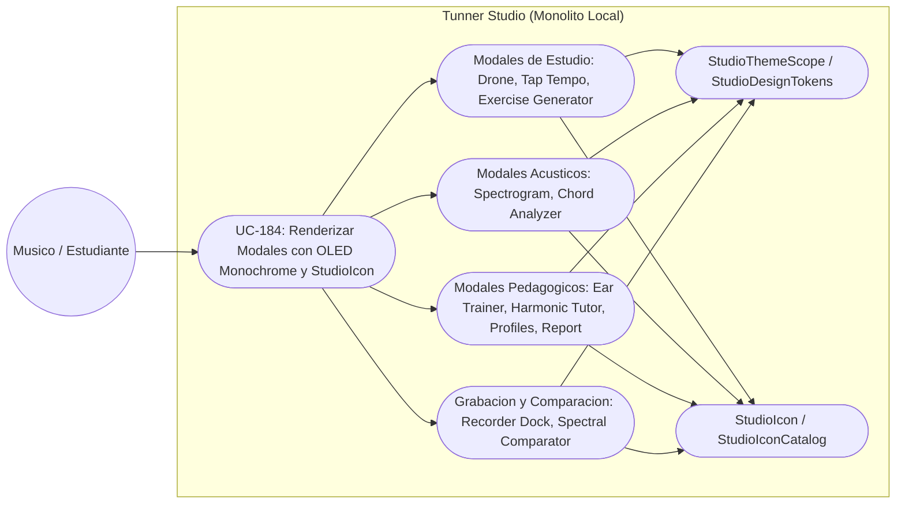
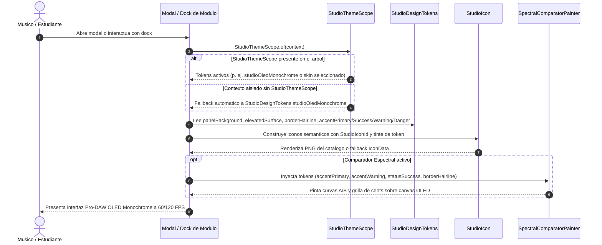

# UC-184: Migración OLED Monochrome y Estandarización de StudioIcon en Modales de Estudio, Acústica y Pedagogía

## Metadatos del Caso de Uso

- **ID del Caso de Uso:** `UC-184-OLED-MONOCHROME-STUDIO-ICON-MODULES`
- **Nombre Canónico:** Renderizar modales de estudio, laboratorio acústico, grabación y pedagogía con tokens Pro OLED Monochrome e iconografía `StudioIcon`
- **Fase Asociada:** Fase 7 (Pro OLED Design System & Iconography) - US-7.3 (Issue #178)
- **Actor Principal:** Músico / Estudiante / Ingeniero de Estudio
- **Actores Secundarios:** `StudioThemeScope`, `StudioThemeController`, `StudioIcon`, `StudioDesignTokens`
- **Estado:** Approved
- **ADR Asociado:** [ADR-0176](../04_adrs/0176_oled_monochrome_module_migration_and_icon_standardization.md)

---

## 1. Descripción Breve y Propósito

Unifica la superficie visual, la jerarquía de contraste OLED Monochrome y la iconografía semántica (`StudioIcon`) en once módulos críticos de Tunner (Generador de Ejercicios, Dron Armónico, Tap Tempo, Espectrograma Armónico, Analizador Polifónico de Acordes, Entrenador Auditivo a Ciegas, Tutor de Entonación Armónica, Selector de Perfil Pedagógico, Reporte Pedagógico PDF, Comparador Espectral y Dock de Grabación de Práctica). Elimina casts `dynamic` de paleta, colores neón hardcodeados (`0xFF00E5FF`, `0xFF00E676`, `0xFFFFD700`) e iconos dispersos de Material Icons en favor de `StudioThemeScope.of(context)` y `StudioIcon`, garantizando coherencia cromática y cambio de tema en caliente sin romper pruebas heredadas.

---

## 2. Diagrama de Caso de Uso (Mermaid)

---

## 3. Precondiciones y Postcondiciones

### 3.1 Precondiciones
1. El sistema de diseño `lib/core/design_system/studio_design_system.dart` expone `StudioThemeScope`, `StudioDesignTokens.studioOledMonochrome` y el átomo `StudioIcon`.
2. El usuario o una prueba de widgets abre cualquiera de los modales objetivo o monta `PracticeRecorderDock`.
3. `StudioThemeScope` puede estar presente en el árbol de widgets o ausente (en pruebas unitarias aisladas).

### 3.2 Postcondiciones
1. Todas las superficies, bordes hairline, acentos funcionales, estados semánticos (`accentSuccess`, `accentWarning`, `accentDanger`) y tipografías derivan de `StudioThemeScope.of(context)`.
2. Ningún modal migrado utiliza `dynamic palette` ni colores neón hardcodeados (`0xFF00E5FF`, `0xFF00E676`, `0xFFFFD700`).
3. Los controles e indicadores primarios renderizan mediante `StudioIcon`, con resolución determinística hacia PNG empaquetado o `IconData` canónico sin excepciones.
4. Si `StudioThemeScope` cambia de skin en tiempo de ejecución, todos los modales abiertos actualizan su apariencia de forma reactiva sin reconstruir ViewModels.

---

## 4. Diagrama de Flujo y Secuencia (Mermaid)

---

## 5. Flujo Principal de Eventos (Happy Path)

1. **Apertura del módulo:** El usuario invoca un modal de estudio, análisis acústico, pedagogía o grabación desde el shell principal o el dock.
2. **Resolución tipada de tokens:** El método `build` ejecuta `final tokens = StudioThemeScope.of(context);` sin depender de casts `dynamic`.
3. **Aplicación de jerarquía de superficies:** El contenedor raíz aplica `tokens.panelBackground` (o `tokens.canvasBackground`), tarjetas internas usan `tokens.elevatedSurface` / `tokens.inputSurface`, separadores y bordes usan `tokens.borderHairline` / `tokens.borderSubtle`.
4. **Renderizado de iconografía:** Encabezados, botones de cierre, transporte, micrófono, exportación y diagnóstico utilizan `StudioIcon` con `tintCustomAsset: true` cuando requieren heredar el color de token activo.
5. **Telemetría semántica:** Los indicadores de acierto/afinación justa, advertencia/ajuste y grabación/error usan exclusivamente `tokens.accentSuccess`, `tokens.accentWarning` y `tokens.accentDanger`.
6. **Respuesta a cambio de tema:** Al modificar `StudioThemeController.setTokens(...)`, `InheritedNotifier` notifica a los modales montados y repinta sin pérdida de estado local.

---

## 6. Flujos Alternativos y Excepciones

### Flujo Alternativo A1: Montaje en pruebas sin `StudioThemeScope`
- Cuando una prueba monta directamente un modal dentro de `MaterialApp(home: Scaffold(body: ...))` sin envolver en `StudioThemeScope`, `StudioThemeScope.of(context)` devuelve automáticamente `StudioDesignTokens.studioOledMonochrome`, evitando excepciones de `ProviderNotFound` o nulos.

### Flujo Alternativo A2: Retrocompatibilidad de constructores heredados
- `HarmonicTutorModal` y `SpectralComparatorPainter` aceptan el parámetro legado `palette` de forma opcional para mantener compatibilidad binaria con invocaciones existentes mientras priorizan `StudioDesignTokens` para el renderizado visual.

### Flujo de Excepción E1: Asset PNG ausente en bundle de prueba
- Si un identificador de `StudioIconId` no dispone de PNG en el bundle o falla su decodificación, `StudioIcon` degrada en tiempo O(1) a su `IconData` canónico (`fallbackOverride` o `fallbackIconFor(id)`) manteniendo contraste y layout intactos.

---

## 7. Criterios de Calidad y No Negociables Asociados

- **Tipado estático estricto:** Cero usos de `dynamic` para resolución de temas o paletas en los módulos migrados.
- **Cero colores neón hardcodeados:** Eliminación de `0xFF00E5FF`, `0xFF00E676` y `0xFFFFD700` en los archivos objetivo.
- **Compatibilidad offline-first y 60/120 FPS:** Resolución en memoria O(1) de tokens e iconos sin I/O síncrono ni asignación redundante en `CustomPainter`.
- **Aislamiento de cambios:** Sin modificaciones sobre `tuner_screen.dart` ni `tuner_viewmodel.dart`.
