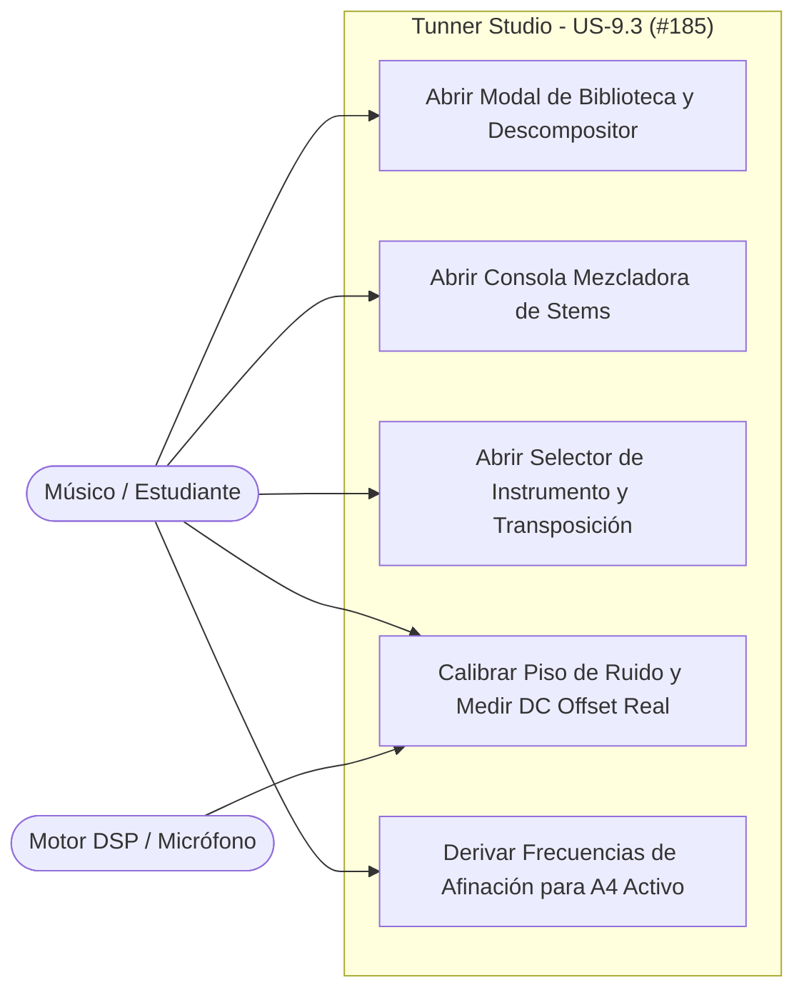
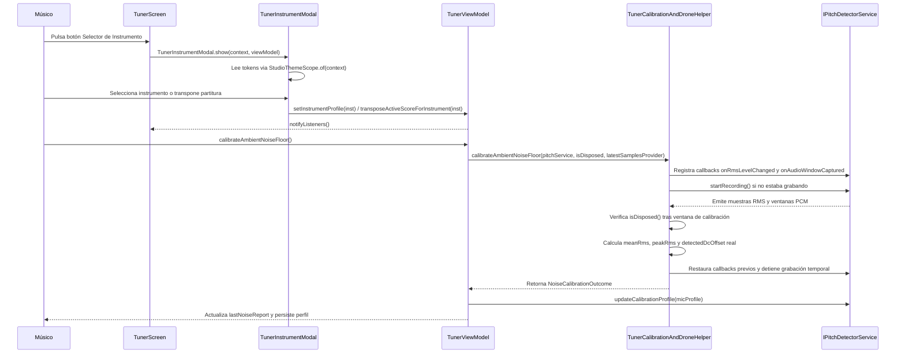

# UC-185: Atomización de TunerScreen, Extracción de Calibración/Dron y Afinaciones Derivadas de A4

## Metadatos del Documento

- **ID del Documento:** `DOC-TUNER-2026-185`
- **Título Oficial:** Atomización de TunerScreen, Extracción de Controlador de Calibración/Dron y Derivación de Frecuencias de Instrumento con A4
- **Estado:** `Approved`
- **Fecha de Creación:** `2026-11-23`
- **Última Modificación:** `2026-11-23`
- **Fase Asociada:** `Fase 4 (Wave 3 - US-9.3)`
- **Issue Relacionado:** `#185`
- **ADR Relacionado:** [ADR-0177](../04_adrs/0177_tuner_modal_extraction_and_midi_derived_tunings.md)

---

## 1. Resumen Ejecutivo

Esta especificación formaliza la descomposición modular de `TunerScreen`, la extracción de las responsabilidades de calibración de ruido ambiental y dron armónico desde `TunerViewModel` hacia `TunerCalibrationAndDroneHelper`, y la incorporación de derivación pura de frecuencias de afinación escaladas a la referencia de concierto A4 en `UniversalInstrumentDefinition`.

El objetivo es reducir drásticamente el acoplamiento y tamaño del archivo de pantalla principal (eliminando más de 600 líneas mediante la extracción de tres modales embebidos), migrar los controles y modales al sistema de diseño `StudioThemeScope` y `StudioIcon`, eliminar el hardcoding de `detectedDcOffset: 0.0` durante la calibración de ruido ambiental y desacoplar las afinaciones estándar del catálogo de instrumentos respecto a `440.0 Hz` fijo.

---

## 2. Contexto del Problema y Justificación Teórica

### 2.1 Planteamiento del Problema
1. **Sobrecarga de `TunerScreen` (1,380 LOC):** Tres hojas modales completas (Biblioteca y Descompositor, Consola Mezcladora de Stems y Selector de Instrumento) vivían embebidas en métodos privados dentro de `TunerScreen`, mezclando estilos legacy (`TunnerThemePalette`) con íconos Material dispersos.
2. **Calibración con DC Offset Hardcodeado y Riesgo Post-Dispose:** `TunerViewModel.calibrateAmbientNoiseFloor` esperaba un `Future.delayed` sin verificar `_isDisposed` al reanudar y reportaba `detectedDcOffset: 0.0` fijo sin medir el sesgo real de las muestras PCM capturadas.
3. **Afinaciones Estándar Acopladas a 440.0 Hz:** `UniversalInstrumentDefinition` exponía únicamente frecuencias fijas a `A4 = 440.0 Hz`, impidiendo derivar de forma pura las frecuencias objetivo para orquestas sinfónicas (`442.0 Hz`), barrocas (`415.0 Hz`) o afinación Verdi (`432.0 Hz`).

### 2.2 Fundamento Teórico / Matemático

#### Escalado Proporcional por Frecuencia de Concierto $A_4$
Dado que en temperamento igual y en transposición proporcional todas las alturas escalan linealmente con la frecuencia de referencia $f_{A4}$:

$$f_{\text{scaled}}(f_{440}, f_{A4}) = f_{440} \cdot \frac{f_{A4}}{440.0}$$

#### Medición Real de DC Offset sobre Muestras PCM
Para una ventana de $N$ muestras PCM normalizadas $x_0, x_1, \dots, x_{N-1} \in [-1.0, 1.0]$:

$$\mu_{\text{DC}} = \frac{1}{N} \sum_{i=0}^{N-1} x_i$$

Si se capturan $K$ ventanas durante la calibración ambiental, el DC offset reportado es el promedio de los $\mu_{\text{DC}}$ de cada ventana, con respaldo sobre `latestAudioSamples` cuando el motor ya dispone de una ventana activa.

---

## 3. Diagrama de Casos de Uso

---

## 4. Diagrama de Secuencia

---

## 5. Especificación Funcional Detallada

### 5.1 Precondiciones
- `TunerViewModel` inicializado y provisto mediante `Provider` en el árbol de widgets.
- `StudioThemeScope` disponible en el árbol de widgets (con fallback automático a `StudioDesignTokens.studioOledMonochrome`).
- Definiciones de instrumentos cargadas en `UniversalInstrumentDefinition.masterCatalog`.

### 5.2 Flujo Principal
1. **Modales Desacoplados:** Al interactuar con los controles de Biblioteca, Mezclador o Instrumento en `TunerScreen`, se invocan `TunerLibraryModal.show`, `TunerMixerModal.show` y `TunerInstrumentModal.show`. Todos resuelven sus colores desde `StudioThemeScope.of(context)` y renderizan iconografía semántica con `StudioIcon`.
2. **Calibración Ambiental Segura:** Al invocar `calibrateAmbientNoiseFloor()`, `TunerCalibrationAndDroneHelper` recolecta muestras RMS y ventanas PCM durante el intervalo de calibración, valida `isDisposed()` antes de mutar estado, calcula el promedio real de DC offset (`detectedDcOffset`) y devuelve el reporte para actualizar el perfil del micrófono.
3. **Derivación de Frecuencias A4:** Al invocar `instrument.standardTuningFrequenciesFor(referencePitchHz: 442.0)`, el dominio calcula de forma pura la lista inmutable de frecuencias escaladas sin modificar las constantes originales.

### 5.3 Flujos Alternativos y Condiciones de Error
- **Dispose durante calibración:** Si `TunerViewModel.dispose()` ocurre mientras `calibrateAmbientNoiseFloor()` espera la ventana de medición, el helper restaura callbacks en el bloque `finally`, detiene la grabación temporal si corresponde y aborta la actualización de estado sin lanzar excepciones ni llamar a `notifyListeners()`.
- **Ausencia de señal PCM en calibración:** Si no llegan muestras PCM ni existe `latestAudioSamples`, `detectedDcOffset` retorna `0.0` de forma determinista y `meanRms` usa el valor base seguro `0.002`.
- **Instrumentos sin cuerdas al aire (`standardTuningFrequencies` vacío):** `standardTuningFrequenciesFor` devuelve una lista vacía inmutable `const []`.
- **`referencePitchHz <= 0`:** Se rechaza mediante validación `ArgumentError` para impedir frecuencias inválidas o negativas.

### 5.4 Postcondiciones
- `TunerScreen` mantiene todas las `Key`s, tooltips y contratos interactivos previos con una reducción superior a 600 líneas.
- `TunerViewModel` mantiene 100% de compatibilidad en su API pública.
- `lastNoiseReport.detectedDcOffset` refleja el sesgo DC real de las muestras analizadas.
- Las pruebas unitarias y de widgets en `test/features/tuner/` y `test/features/instrument/` pasan al 100%.

---

## 6. Plan de Pruebas y Validación (QA)

- [x] Pruebas de widgets para `TunerLibraryModal`, `TunerMixerModal` y `TunerInstrumentModal` con `StudioThemeScope`.
- [x] Prueba unitaria de `calibrateAmbientNoiseFloor` verificando cálculo real de `detectedDcOffset` y seguridad ante `dispose()`.
- [x] Prueba unitaria de `UniversalInstrumentDefinition.standardTuningFrequenciesFor(referencePitchHz: 442.0)` y casos borde.
- [x] Ejecución de `flutter analyze --no-fatal-infos` sin errores.
- [x] Ejecución completa de `test/features/tuner/` y `test/features/instrument/`.
