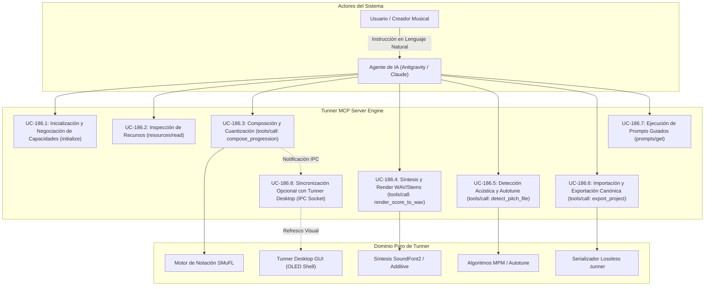
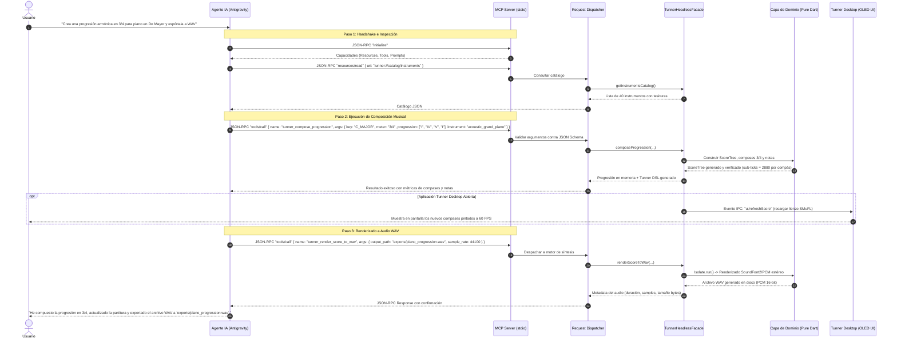

# UC-186: Orquestación Inteligente Headless Mediante Servidor MCP (Model Context Protocol)

## Metadatos del Documento

- **ID del Documento:** `DOC-USECASE-2026-186`
- **Título Oficial:** Orquestación y Conexión de Agentes de Inteligencia Artificial mediante Servidor Nativo MCP
- **Estado:** `Approved`
- **Fecha de Creación:** `2026-11-23`
- **Última Modificación:** `2026-11-23`
- **Fase Asociada:** `Fase 5 / Épica 13`
- **Issue Relacionado:** `#186`
- **ADR Relacionado:** [ADR-0178](../04_adrs/0178_dart_native_mcp_server_and_headless_engine.md)
- **Documento de Arquitectura:** [DOC-ARCH-2026-186](../01_architecture/186_tunner_mcp_server_architecture.md)

---

## 1. Resumen Ejecutivo

Este caso de uso define la especificación operacional completa para la interacción entre clientes de Inteligencia Artificial (Antigravity, Claude Desktop, Cursor) y el motor musical Tunner a través del protocolo abierto **Model Context Protocol (MCP)** implementado en un proceso autónomo de Dart (`bin/tunner_mcp_server.dart`).

Permite a cualquier modelo de lenguaje actuar como asistente de composición, arreglista orquestal, ingeniero de mezcla y tutor de pedagogía musical, invocando herramientas de alta fidelidad acústica sin requerir que la interfaz gráfica esté en ejecución, pero sincronizándose visualmente con ella si se encuentra activa mediante sockets IPC locales.

---

## 2. Diagrama de Casos de Uso

---

## 3. Diagrama de Secuencia Detallado

---

## 4. Precondiciones, Flujos y Postcondiciones

### 4.1 Precondiciones
1. El ejecutable del servidor `tunner_mcp_server` está compilado o se ejecuta mediante el comando `dart run bin/tunner_mcp_server.dart`.
2. El cliente de IA tiene configurado el servidor en su manifiesto de configuración local (`mcpServers`).
3. El entorno de ejecución dispone de permisos de lectura y escritura en el sistema de archivos del espacio de trabajo.

### 4.2 Flujo Principal (Composición y Renderizado Headless)
1. **Inicialización:** El cliente IA abre el proceso hijo y envía el mensaje JSON-RPC `initialize`. El servidor responde con su versión y manifiesto de capacidades.
2. **Consulta de Contexto:** El cliente lee `tunner://project/active` para conocer la tonalidad, tempo y pistas actuales.
3. **Invocación de Herramientas:** El cliente solicita la ejecución de `tunner_compose_progression` pasando parámetros musicales válidos.
4. **Validación de Dominio:** El servidor valida la teoría musical (armadura válida, conducción de voces, compatibilidad métrica).
5. **Generación Determinista:** Se genera la estructura de partitura inmutable y se almacena en el estado headless activo.
6. **Sincronización IPC:** Si el socket IPC local está conectado, se emite una notificación de refresco a la GUI.
7. **Respuesta Estructurada:** El servidor retorna el resumen en texto estructurado y datos JSON con el AST musical y su representación en Tunner DSL.

### 4.3 Flujos Alternativos y Manejo de Errores
- **Argumento Acústico Inválido (Código de Error -32602):** Si la IA solicita una nota fuera del rango físico del instrumento (ejemplo: $C_1$ en un violín soprano con tesitura $G_3 - C_7$), el servidor intercepta el error, rechaza la operación sin romper el proceso y retorna un mensaje explicativo con la tesitura en Hz soportada.
- **Archivo Corrupto o No Encontrado (Código de Error -32001):** Si se solicita importar un archivo MusicXML o WAV inexistente o mal formado, el servidor responde con el código de error y detalle de la línea de parsing que falló.
- **GUI No Disponible (Comportamiento Silencioso):** Si Tunner Desktop no está encendido, el intento de conexión por socket local falla silenciosamente sin detener el servidor MCP; todo el flujo continúa en modo headless.

### 4.4 Postcondiciones
1. El estado del proyecto en memoria refleja fielmente las operaciones ejecutadas.
2. Los archivos de salida (WAV, MusicXML, PDF, contenedor `.tunner`) quedan persistidos en disco de forma atómica.
3. El proceso MCP se mantiene listo para la siguiente petición sin fugas de memoria y con cero consumo de CPU residual.
