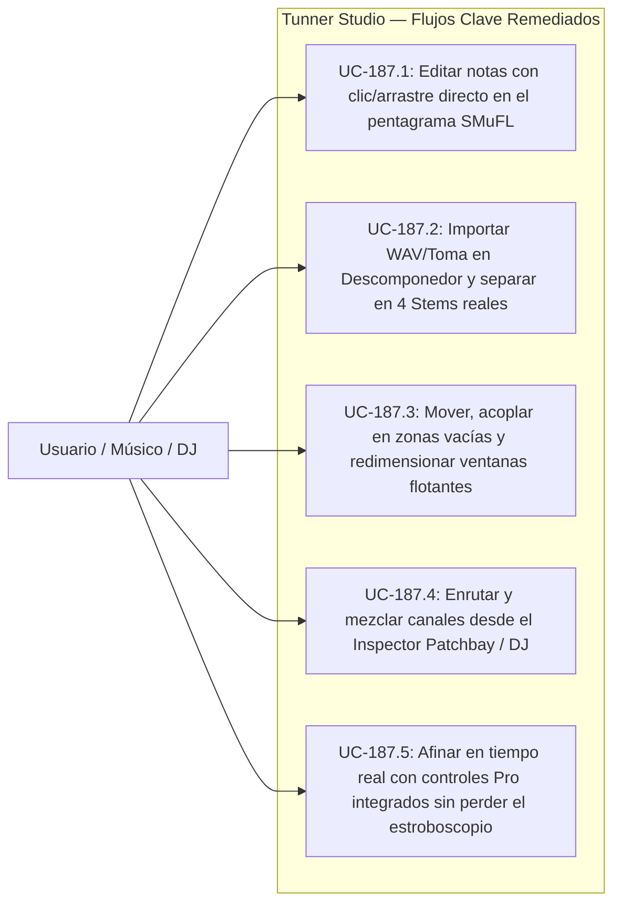
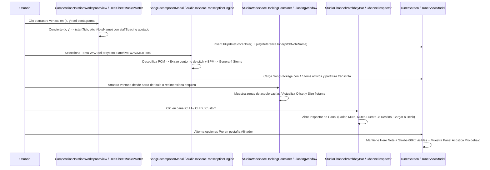

# Caso de Uso 187: Remediación Integral UX/DSP — Editor de Partituras en Lienzo, Descomponedor de Audio Real, Ventanas Flotantes Redimensionables, Inspector de Canales y Afinador Permanente

---

## Metadatos del Documento

- **ID del Documento:** `DOC-UX-DSP-2026-187`
- **Título Oficial:** `Remediación Integral de Flujos Clave: Editor de Partituras Directo en Lienzo, Descomponedor Acústico WAV/MIDI a 4 Stems, Ventanas Flotantes Redimensionables, Inspector de Canales Patchbay y Afinador Permanente`
- **Estado:** `Approved`
- **Fecha de Creación:** `2026-11-23`
- **Última Modificación:** `2026-11-23`
- **Fase Asociada:** `Global`
- **Autor / Revisor Principal:** `Nicolás León`

---

## 1. Resumen Ejecutivo (Executive Summary)

Este documento formaliza la remediación integral de cinco subsistemas críticos de **Tunner** cuya experiencia de usuario presentaba desconexiones funcionales o comportamientos percibidos como maquetas (mocks):
1. **Editor de Partituras Directo sobre el Lienzo SMuFL:** Corrección de la proporción geométrica del pentagrama en pantallas de escritorio (evitando el recorte de la clave de Sol y colisión de alteraciones) e incorporación de edición interactiva por clic y arrastre vertical directamente sobre las líneas y espacios del pentagrama.
2. **Descomponedor Musical Acústico Real:** Incorporación de ingesta real de archivos de audio (`.wav`, `.mid`, `.musicxml`) y tomas grabadas del estudio en el Descomponedor Musical, ejecutando transcripción automática DSP y separación en 4 Stems (Melodía, Armonía, Bajo, Ritmo) con controles de preescucha, Mute y Solo.
3. **Ventanas Flotantes Redimensionables y Zonas de Acople Siempre Activas:** Reparación del sistema de acoplamiento DAW para permitir soltar ventanas en zonas vacías, arrastrar ventanas flotantes exclusivamente desde su barra de título sin interferir con controles internos, redimensionarlas libremente desde su esquina inferior derecha y desacoplar módulos individuales del Rack Modular.
4. **Inspector y Mezclador de Canales en Matriz Patchbay y Consola DJ:** Transformación de las píldoras de canal en la barra Patchbay para que al pulsarlas abran un inspector de ruteo y mezcla en tiempo real (conexión de fuentes/destinos, ganancia, volumen, Mute, Solo y carga directa en Decks DJ).
5. **Afinador Estroboscópico Permanente en Modo Esencial y Pro:** Reestructuración de `TunerScreen` para que el afinador cromático/estroboscópico, sus lecturas a 60 Hz y su control de micrófono permanezcan siempre visibles en la pestaña "Afinador", integrando los paneles de calibración Pro sin ocultar el instrumento principal ni duplicar otras pestañas del estudio.

---

## 2. Diagramas Canónicos (Mermaid)

### 2.1 Diagrama de Casos de Uso

### 2.2 Diagrama de Secuencia y Flujo de Interacción

---

## 3. Precondiciones, Postcondiciones y Flujos

### 3.1 Precondiciones
- El motor de composición (`StudioCompositionRoot`) y `TunerViewModel` están inicializados.
- El usuario opera en cualquiera de las vistas del Desktop Shell o vista móvil/tablet.

### 3.2 Postcondiciones
- **Pentagrama:** La clave de Sol/Fa/Do y la métrica nunca se recortan independientemente del alto de la ventana; hacer clic en el pentagrama en modo edición coloca o modifica la nota en la línea/espacio pulsado y emite su frecuencia.
- **Descomponedor:** Permite elegir una grabación WAV del proyecto o un archivo de audio del sistema, extrayendo la melodía a partitura y generando las 4 pistas (Melodía, Armonía, Bajo, Ritmo) listas para mezcla.
- **Ventanas Flotantes:** Pueden acoplarse en zonas vacías, moverse desde su barra superior sin bloquear sliders hijos, cambiar de tamaño y abrirse desde el Rack Modular.
- **Canales Patchbay:** Permiten inspeccionar y modificar conexiones, nivel de ganancia, muteo y carga directa hacia los Decks de la Consola DJ.
- **Afinador:** La pestaña "Afinador" muestra siempre el afinador estroboscópico y la lectura reactiva de nota/frecuencia/cents tanto en modo Esencial como en modo Pro.

### 3.3 Flujo Principal
1. **Edición en Pentagrama:** El usuario selecciona una figura (Negra, Corchea, Blanca, etc.) y alteración en la barra superior del lienzo de partituras y hace clic directamente sobre la línea o espacio deseado del pentagrama. El sistema calcula el `startTick` y la altura diatónica (`Do3`–`Do6`), inserta la nota y reproduce su timbre.
2. **Descomposición de Audio:** El usuario abre "Descomponer Audio", selecciona un archivo WAV de su disco o una toma grabada del proyecto, visualiza las notas detectadas y los 4 Stems generados, prueba su sonido y los carga al estudio.
3. **Gestión de Ventanas:** El usuario desacopla un panel o módulo a modo flotante, lo mueve desde su barra de título, lo redimensiona desde la esquina inferior derecha o lo arrastra hacia cualquier borde (incluso vacío) para acoplarlo.
4. **Control de Canal:** El usuario pulsa sobre un canal en la barra Patchbay, ajusta su volumen/mute, conecta fuentes o envía audio directamente a un Deck DJ.
5. **Afinación Continua:** El usuario entra a la pestaña "Afinador", activa el micrófono o tono de referencia y ajusta parámetros Pro (A4, Temperamento, Acordes, Espectro) en la parte inferior mientras observa el estroboscopio en la parte superior.

### 3.4 Flujos Alternativos y Condiciones de Error
- **Archivo WAV sin tono claro o silencio en Descomponedor:** Si la señal PCM tiene energía RMS por debajo del umbral de detección, el sistema informa al usuario y genera un compás base editable sin bloquear la interfaz.
- **Redimensionamiento de ventana flotante fuera de límites:** Las dimensiones de toda ventana flotante se acotan dinámicamente entre un mínimo (`260x180`) y el tamaño máximo del contenedor disponible.

---

## 4. Fundamento Matemático y Geométrico

### 4.1 Escala Geométrica Acotada del Pentagrama SMuFL
Para evitar que en monitores grandes el espaciado entre líneas ($s$) crezca desmesuradamente y desborde el margen izquierdo:
$$s = \text{clamp}\left(\frac{H}{14.0},\ 10.0,\ 18.0\right)$$
El margen izquierdo ($M_L$), la posición horizontal de la clave ($X_{\text{clef}}$) y de la cifra de compás ($X_{\text{time}}$) se calculan proporcionalmente a $s$:
$$X_{\text{clef}} = 1.8 \cdot s, \quad X_{\text{time}} = 3.8 \cdot s + (0.65 \cdot s \cdot |k_{\text{fifths}}|), \quad M_L = X_{\text{time}} + 1.8 \cdot s$$

### 4.2 Inversión Coordenada Vertical a Altura Diatónica
Dada una coordenada vertical de toque $y$ sobre el lienzo y la coordenada de la primera línea inferior $Y_1 = \frac{H}{2} + 2s$:
$$\text{step} = \text{round}\left(\frac{Y_1 - y}{s / 2.0}\right)$$
El paso diatónico absoluto se obtiene sumando el paso de referencia de la clave activa ($\text{refStep} \in \{30, 24, 18\}$ para Sol, Do, Fa):
$$\text{absStep} = \text{clamp}(\text{refStep} + \text{step},\ 14,\ 48)$$
$$\text{octave} = \lfloor \text{absStep} / 7 \rfloor, \quad \text{degree} = \text{absStep} \bmod 7$$
