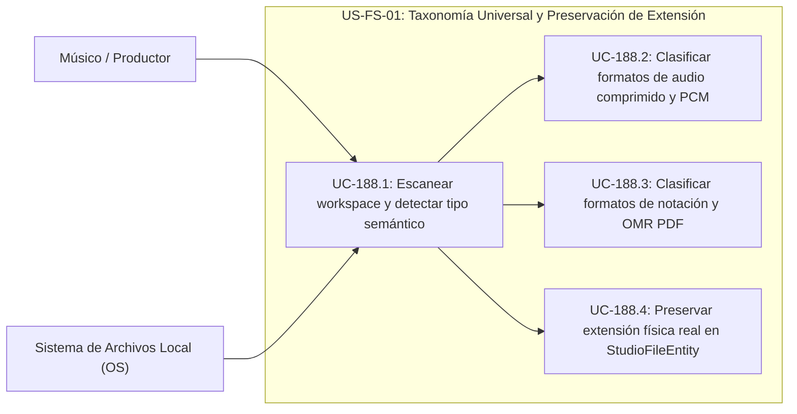
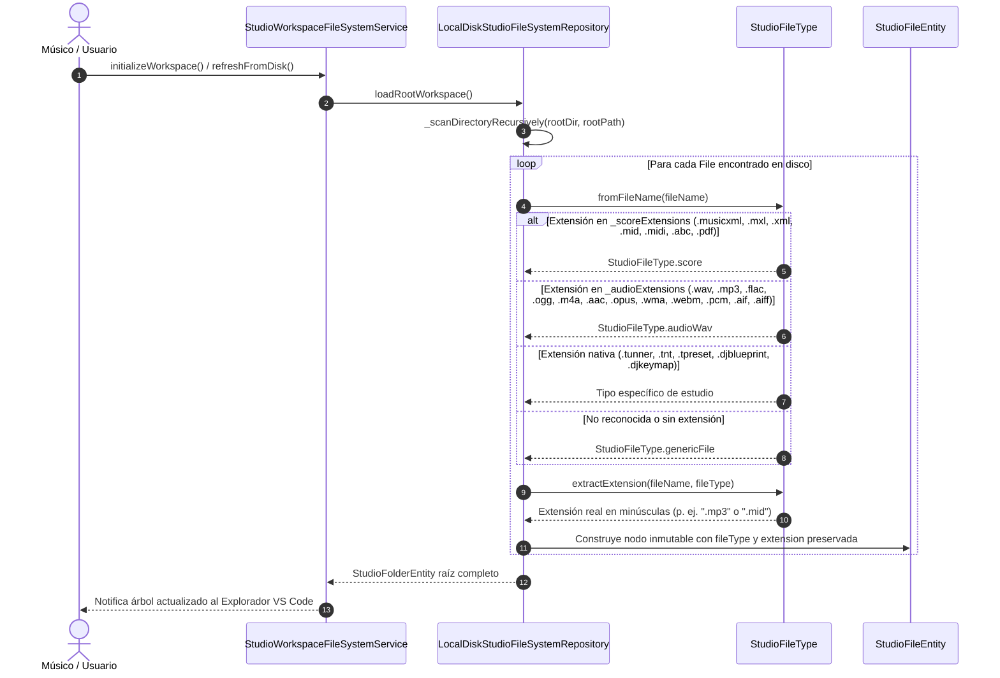

# Caso de Uso 188: Taxonomía Universal de Archivos y Preservación de Extensión en Disco (US-FS-01)

---

## Metadatos del Documento

- **ID del Documento:** `DOC-FS-2026-188`
- **ID del Caso de Uso:** `UC-188`
- **Historia de Usuario Asociada:** `US-FS-01`
- **Título Oficial:** `Taxonomía Universal de StudioFileType y Preservación de Extensión Física en Repositorio Local`
- **Estado:** `Approved`
- **Fecha de Creación:** `2026-11-23`
- **Última Modificación:** `2026-11-23`
- **Fase Asociada:** `Fase 2 / Infraestructura de Sistema de Archivos`
- **Autor / Revisor Principal:** `Nicolás León`
- **ADR Relacionado:** [ADR 0180: Taxonomía Universal de Tipos de Archivo y Preservación de Extensión Física](../04_adrs/0180_universal_studio_file_type_taxonomy_and_extension_preservation.md)

---

## 1. Resumen Ejecutivo (Executive Summary)

Este caso de uso especifica la clasificación universal de archivos musicales y de notación dentro del sistema de archivos de **Tunner**, garantizando que cualquier formato de audio digital (`.wav`, `.pcm`, `.aif`, `.aiff`, `.mp3`, `.flac`, `.ogg`, `.m4a`, `.aac`, `.opus`, `.wma`, `.webm`) sea tipado como `StudioFileType.audioWav` y cualquier formato de partitura o secuencia simbólica (`.musicxml`, `.mxl`, `.xml`, `.mid`, `.midi`, `.abc`, `.pdf`) como `StudioFileType.score`. Simultáneamente, asegura que el escaneo en disco preserve la extensión real del archivo físico mediante `StudioFileType.extractExtension`, evitando la sobreescritura semántica hacia `.wav` o `.musicxml` y habilitando la apertura contextual exacta en los módulos del estudio.

---

## 2. Diagramas Canónicos (Mermaid)

### 2.1 Diagrama de Casos de Uso

### 2.2 Diagrama de Secuencia Detallado

---

## 3. Precondiciones, Postcondiciones y Flujos

### 3.1 Precondiciones
1. Existe un directorio raíz de proyecto resuelto por `LocalDiskStudioFileSystemRepository.getRootPath()` (por defecto `~/Documents/TunnerProjects` o ruta inyectada vía `customRootPath` / `TUNNER_WORKSPACE_ROOT`).
2. Los archivos depositados en el proyecto poseen permisos de lectura del sistema operativo.

### 3.2 Postcondiciones
1. Todo archivo con extensión de audio soportada posee `fileType == StudioFileType.audioWav` independientemente de su capitalización (`CANCION.MP3`, `grabacion.FLAC`).
2. Todo archivo de notación soportado posee `fileType == StudioFileType.score` independientemente de su capitalización (`OBRA.MIDI`, `PARTITURA.PDF`).
3. La propiedad `StudioFileEntity.extension` refleja fielmente la extensión física del archivo en disco en minúsculas (por ejemplo, `.mp3`, `.flac`, `.mid`, `.pdf`), salvo nombres inválidos o sin extensión explícita donde aplica `fallbackType.extension`.
4. La capa de dominio (`lib/core/file_system/domain/studio_file_type.dart`) permanece libre de dependencias externas.

### 3.3 Flujo Principal
1. El usuario o el sistema invoca `loadRootWorkspace()` sobre `LocalDiskStudioFileSystemRepository`.
2. `_scanDirectoryRecursively` lista directorios y archivos ordenados alfabéticamente sin seguir enlaces simbólicos (`followLinks: false`).
3. Para cada archivo encontrado, el repositorio invoca `StudioFileType.fromFileName(fileName)` para asignar la categoría funcional y color/icono en UI.
4. A continuación, invoca `StudioFileType.extractExtension(fileName, fileType)` para obtener la extensión física normalizada en minúsculas.
5. El repositorio construye la instancia inmutable `StudioFileEntity` conservando `relativePath`, `sizeBytes`, `modifiedAtMicros`, `fileType` y `extension`.

### 3.4 Flujos Alternativos y Condiciones de Error
- **Nombre con múltiples puntos (p. ej. `mi.obra.maestra.flac`):** `extractExtension` localiza el último separador `.` mediante `lastIndexOf('.')` y extrae `.flac`.
- **Archivo sin extensión (`sin_extension`) o terminado en punto (`archivo.`):** `dotIndex <= 0 || dotIndex >= trimmed.length - 1` retorna `fallbackType.extension` (`.bin` para `genericFile`, `.wav` si el tipo provisto era `audioWav`).
- **Archivo oculto estilo POSIX (`.oculto`):** Al tener `dotIndex == 0`, no se interpreta el nombre completo como extensión; retorna `fallbackType.extension`.
- **Extensión con separadores de ruta o espacios:** La presencia de `/`, `\` o espacio en el sufijo invalida la extracción y retorna `fallbackType.extension`.

---

## 4. Trazabilidad Arquitectónica y Pruebas Automatizadas

- **Archivos de Código Fuente:**
  - [studio_file_type.dart](file:///home/nicomania11/Proyectos~/Escritorio/TUNER/tunner/lib/core/file_system/domain/studio_file_type.dart)
  - [local_disk_studio_file_system_repository.dart](file:///home/nicomania11/Proyectos~/Escritorio/TUNER/tunner/lib/core/file_system/data/local_disk_studio_file_system_repository.dart)
- **Suite de Pruebas Automatizadas:**
  - [us_fs_01_studio_file_type_test.dart](file:///home/nicomania11/Proyectos~/Escritorio/TUNER/tunner/test/core/file_system/us_fs_01_studio_file_type_test.dart): verifica clasificación case-insensitive de las 12 extensiones de audio y 7 de partitura, preservación de tipos nativos, casos borde de `extractExtension` y escaneo físico real en disco temporal.
