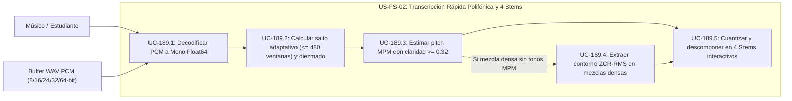
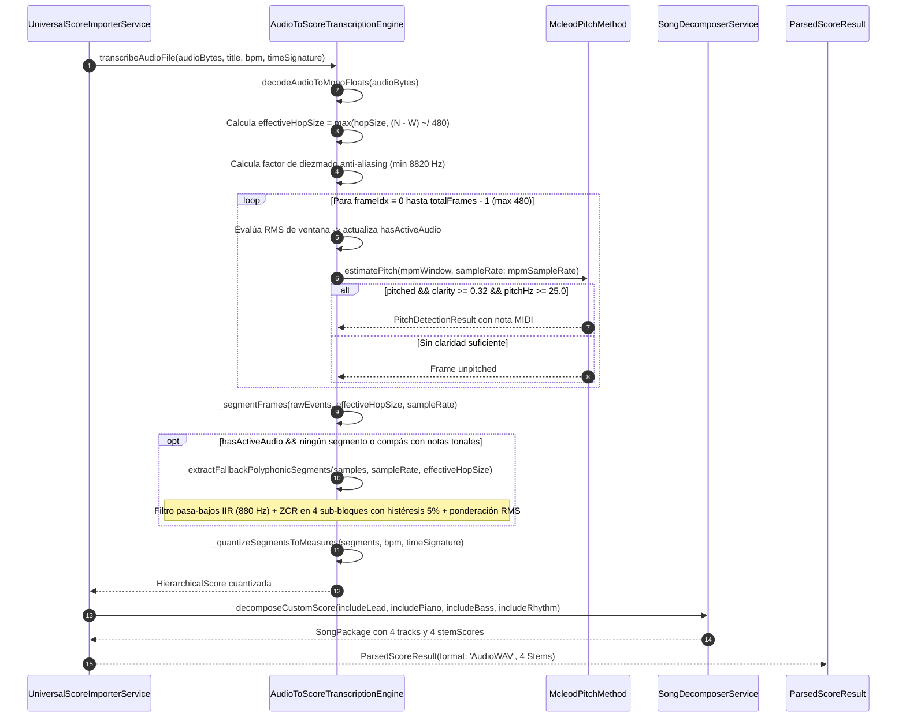

# Caso de Uso 189: Transcripción Polifónica Rápida por Salto Adaptativo y Descomposición en 4 Stems (US-FS-02)

---

## Metadatos del Documento

- **ID del Documento:** `DOC-DSP-2026-189`
- **ID del Caso de Uso:** `UC-189`
- **Historia de Usuario Asociada:** `US-FS-02`
- **Título Oficial:** `Transcripción Acústica Acotada por Salto Adaptativo, Respaldo Polifónico ZCR-RMS y Descomposición en 4 Stems`
- **Estado:** `Approved`
- **Fecha de Creación:** `2026-11-23`
- **Última Modificación:** `2026-11-23`
- **Fase Asociada:** `Fase 4 / Motor DSP y Transcripción Polifónica`
- **Autor / Revisor Principal:** `Nicolás León`
- **ADR Relacionado:** [ADR 0181: Transcripción Polifónica Acotada por Salto Adaptativo](../04_adrs/0181_adaptive_hop_polyphonic_audio_transcription_and_four_stem_decomposition.md)

---

## 1. Resumen Ejecutivo (Executive Summary)

Este caso de uso describe el flujo de transcripción offline de audio PCM/WAV a partitura vectorial `HierarchicalScore` con separación automática en 4 Stems (`Lead`, `Armonía`, `Bajo` y `Ritmo`). Mediante el cálculo de salto adaptativo acotado a `maxAnalysisFrames = 480` ventanas, diezmado anti-aliasing ($8820\text{ Hz}$ mínimo), umbral de claridad NSDF de `0.32` y un extractor espectral de respaldo basado en tasa de cruces por cero ponderada por RMS sobre señal filtrada pasa-bajos ($f_c = 880\text{ Hz}$), **Tunner** transcribe pistas musicales completas de varios minutos en fracción de segundo sin colgar el hilo de ejecución ni perder contenido melódico en mezclas densas.

---

## 2. Diagramas Canónicos (Mermaid)

### 2.1 Diagrama de Casos de Uso

### 2.2 Diagrama de Secuencia Detallado

---

## 3. Precondiciones, Postcondiciones y Flujos

### 3.1 Precondiciones
1. El buffer de entrada `audioBytes` corresponde a un archivo RIFF/WAVE PCM válido (8, 16, 24, 32 o 64 bits; entero o IEEE Float) o PCM crudo de 16 bits mono, previamente transcodificado si provenía de un formato comprimido.
2. El tamaño de muestras decodificadas es mayor o igual a `windowSize` (`4096` muestras) para análisis espectral; en caso contrario se retorna un compás de silencio válido.

### 3.2 Postcondiciones
1. El análisis concluye en tiempo determinista acotado por `maxAnalysisFrames = 480` ventanas ($< 250\text{ ms}$ típico; $< 800\text{ ms}$ bajo carga completa de CI para 60 s de audio a $44.1\text{ kHz}$).
2. La estructura `ParsedScoreResult.package` contiene exactamente 4 `AudioTrack` (`lead_stem`, `harmony_stem`, `bass_stem`, `rhythm_stem`) y sus 4 entradas homólogas en `stemScores`.
3. Señales de silencio puro ($\text{RMS} \le 2 \cdot \text{silenceRms}$) no activan el extractor de respaldo y producen `totalNotes == 0`.
4. Señales armónicas claras (p. ej., `La4 = 440 Hz`) conservan su altura MIDI exacta.

### 3.3 Flujo Principal
1. `UniversalScoreImporterService.transcribeAudioToScoreResult` invoca `AudioToScoreTranscriptionEngine.transcribeAudioFile`.
2. El motor decodifica la cabecera `RIFF`/`WAVE` (soportando también `WAVEFORMATEXTENSIBLE` `0xFFFE`) y mezcla canales a monofónico en `Float64List` normalizado $[-1.0, 1.0]$.
3. Calcula `effectiveHopSize` y `totalFrames` acotados a `480` ventanas, junto con el factor de diezmado anti-aliasing que preserva la banda hasta $C_8 = 4186.01\text{ Hz}$.
4. Ejecuta `McleodPitchMethod.estimatePitch` por ventana con `minClarity = 0.32` y registra si existe energía activa (`windowRms > silenceRms * 2.0`).
5. Agrupa frames consecutivos de igual MIDI en segmentos temporales $\Delta t = (\text{count} \cdot H_{\text{eff}}) / f_s$.
6. Cuantiza cada segmento en sub-ticks de semicorchea (`RhythmicQuantizer.quantizeDuration`) y empaqueta los compases según `timeSignature`.
7. `SongDecomposerService.decomposeCustomScore` deriva las capas de Armonía (tríadas diatónicas con inferencia de modo menor), Bajo (registro grave MIDI $[36, 47]$) y Ritmo (pulso del compás).

### 3.4 Flujos Alternativos y Condiciones de Error
- **Buffer vacío (`audioBytes.isEmpty`) o menor a `windowSize`:** Retorna inmediatamente un `HierarchicalScore` con un compás completo de silencio evitando divisiones por cero o lecturas fuera de rango.
- **Mezcla polifónica densa con rechazo total de MPM:** Al detectarse `hasActiveAudio == true` pero sin segmentos tonales válidos, `_extractFallbackPolyphonicSegments` filtra la señal a $880\text{ Hz}$, evalúa cruces por cero con histéresis del $5\%$ por sub-bloque ponderados por RMS, pliega la frecuencia estimada al rango $[110\text{ Hz}, 880\text{ Hz}]$ y aplica agrupamiento mínimo de $120\text{ ms}$ para superar el filtro de transitorios breves (`secondsPerSubTick * 0.75`).

---

## 4. Trazabilidad Arquitectónica y Pruebas Automatizadas

- **Archivos de Código Fuente:**
  - [audio_to_score_transcription_engine.dart](file:///home/nicomania11/Proyectos~/Escritorio/TUNER/tunner/lib/features/transcription/domain/audio_to_score_transcription_engine.dart)
  - [universal_score_importer_service.dart](file:///home/nicomania11/Proyectos~/Escritorio/TUNER/tunner/lib/features/universal_importer/data/universal_score_importer_service.dart)
  - [song_decomposer_service.dart](file:///home/nicomania11/Proyectos~/Escritorio/TUNER/tunner/lib/features/song_library/domain/song_decomposer_service.dart)
- **Suite de Pruebas Automatizadas:**
  - [us_fs_02_fast_polyphonic_song_transcription_test.dart](file:///home/nicomania11/Proyectos~/Escritorio/TUNER/tunner/test/features/universal_importer/us_fs_02_fast_polyphonic_song_transcription_test.dart)
