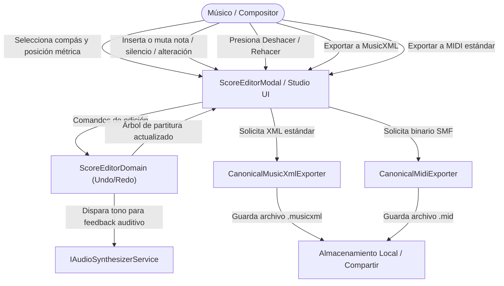
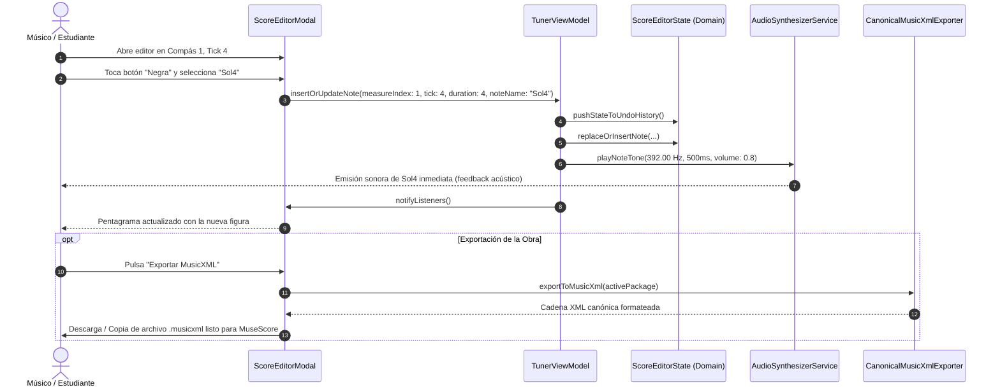

# Caso de Uso 18: Editor Interactivo de Partituras y Exportador Canónico MusicXML/MIDI

Este documento define el caso de uso canónico para la edición interactiva de partituras y la exportación bidireccional estándar en **Tunner**.

---

## Metadatos

- **ID:** `UC-18`
- **Nombre:** Edición Musical Interactiva y Exportación Canónica MusicXML/MIDI
- **Actor Principal:** Compositor / Estudiante / Educador Musical.
- **Actores Secundarios:** Capa de Dominio del Editor de Partituras, Serializador MusicXML, Serializador MIDI, Sintetizador Procedural de Audio, Sistema de Archivos Local.

---

## 1. Diagrama de Caso de Uso

---

## 2. Diagrama de Secuencia y Flujo de Edición

---

## 3. Precondiciones y Postcondiciones

### 3.1 Precondiciones
1. Existe una partitura activa en el ViewModel.
2. La métrica del compás define los ticks máximos permitidos (ej. 16 ticks para $4/4$).
3. El sintetizador procedural está inicializado para proveer feedback sonoro inmediato.

### 3.2 Postcondiciones
1. El compás seleccionado refleja la nueva configuración rítmica y melódica sin solapamiento de ticks.
2. Cada cambio queda registrado en la pila de historial (*Undo/Redo*) permitiendo revertir con exactitud.
3. Los archivos generados por los exportadores cumplen rigurosamente las especificaciones W3C MusicXML y Standard MIDI File Format 0.

---

## 4. Flujos

### 4.1 Flujo Principal: Inserción de Nota con Audición Inmediata
1. El usuario abre el modal del editor de partituras sobre el compás actual.
2. Selecciona la posición de inicio (tick) y la figura musical deseada (redonda, blanca, negra, corchea, semicorchea).
3. Selecciona la altura de nota deseada (ej. Do4, Re4, Mi4) o introduce una alteración accidental ($\sharp$, $\flat$).
4. El dominio añade la nota, ajusta la duración y valida que no exceda la métrica del compás.
5. El sintetizador procedural hace sonar la nota inmediatamente a través del altavoz.
6. El pentagrama re-dibuja las notas con tipografía SMuFL y el usuario puede seguir editando.

### 4.2 Flujo Alternativo 1: Deshacer / Rehacer (Undo / Redo)
- **Acción:** El usuario pulsa el botón "Deshacer".
- **Resultado:** Se restaura la instantánea previa de la partitura. El botón "Rehacer" queda habilitado.

### 4.3 Flujo Alternativo 2: Exportación Canónica MusicXML / MIDI
- **Acción:** El usuario selecciona "Exportar MusicXML" o "Exportar MIDI".
- **Resultado:** Los serializadores puros de dominio generan el archivo correspondiente con estructura canónica internacional.
