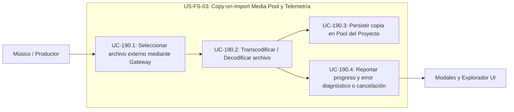

# Caso de Uso 190: Copy-on-Import hacia el Pool del Proyecto y Telemetría Diagnóstica de Ingesta (US-FS-03)

---

## Metadatos del Documento

- **ID del Documento:** `DOC-FS-2026-190`
- **ID del Caso de Uso:** `UC-190`
- **Historia de Usuario Asociada:** `US-FS-03`
- **Título Oficial:** `Persistencia Automática Copy-on-Import en Pool de Proyecto y Telemetría Diagnóstica en TunerViewModel`
- **Estado:** `Approved`
- **Fecha de Creación:** `2026-11-23`
- **Última Modificación:** `2026-11-23`
- **Fase Asociada:** `Fase 2 / Gestión de Proyectos y Pool de Medios`
- **Autor / Revisor Principal:** `Nicolás León`
- **ADR Relacionado:** [ADR 0182: Patrón Copy-on-Import Project Media Pool y Telemetría Diagnóstica](../04_adrs/0182_copy_on_import_project_media_pool_and_diagnostic_telemetry.md)

---

## 1. Resumen Ejecutivo (Executive Summary)

Este caso de uso formaliza la ingesta persistente de archivos externos dentro de **Tunner** bajo el patrón industrial *Copy-on-Import Project Media Pool*. Cada vez que el usuario importa una partitura o pista de audio mediante `TunerViewModel`, el sistema decodifica (y transcodifica si es audio comprimido), carga el recurso en la sesión activa y almacena automáticamente una copia física dentro de `/Tomas de Audio & WAV/` o `/Partituras & Notación/` en `IStudioWorkspaceFileSystem`. Paralelamente, expone los getters reactivos `isImportingFile` y `lastImportError` para distinguir con exactitud entre una cancelación voluntaria del usuario y un error técnico de lectura o decodificación.

---

## 2. Diagramas Canónicos (Mermaid)

### 2.1 Diagrama de Casos de Uso



### 2.2 Diagrama de Secuencia Detallado

```mermaid
sequenceDiagram
    autonumber
    actor User as Usuario
    participant Modal as StudioAssetsModals
    participant VM as TunerViewModel
    participant Gateway as IPlatformFileGateway
    participant Transcoder as IAudioTranscoderPort
    participant Importer as UniversalScoreImporterService
    participant FS as IStudioWorkspaceFileSystem

    User->>Modal: Solicita importar archivo externo
    Modal->>VM: importScoreFromFilePicker()
    VM->>VM: _lastImportError = null
    VM->>Gateway: pickFile(allowedExtensions: [...])

    alt Usuario cancela el selector
        Gateway-->>VM: null
        VM-->>Modal: null (lastImportError == null)
        Note over Modal: No muestra alerta de error
    else Archivo vacío o ilegible
        Gateway-->>VM: PlatformPickedFile(bytes: [])
        VM->>VM: _lastImportError = 'El archivo seleccionado "..." está vacío...'
        VM-->>Modal: null
    else Archivo válido seleccionado
        Gateway-->>VM: PlatformPickedFile(name, bytes)
        VM->>VM: importScoreFromBytes(bytes, name)
        VM->>VM: _isImportingFile = true; notifyListeners()

        opt Es extensión de audio comprimido
            VM->>Transcoder: transcodeToWav16BitPcm(bytes, fileExtension: ext)
            Transcoder-->>VM: wavBytes (o null si falla)
        end

        VM->>Importer: parseScoreData(bytes: effectiveBytes, fileName: effectiveFileName)
        Importer-->>VM: ParsedScoreResult
        VM->>VM: addSongPackage(result.package)

        opt _workspaceFileSystem != null
            VM->>FS: Busca o crea "/Tomas de Audio & WAV" o "/Partituras & Notación"
            VM->>FS: createFile(name: effectiveFileName, fileType, initialBytes: effectiveBytes)
        end

        VM->>VM: _isImportingFile = false; notifyListeners()
        VM-->>Modal: ParsedScoreResult
    end
```

---

## 3. Precondiciones, Postcondiciones y Flujos

### 3.1 Precondiciones
1. `TunerViewModel` cuenta con referencias inyectadas (o por defecto) a `IScoreParserService`, `IAudioTranscoderPort`, `IPlatformFileGateway` y opcionalmente `IStudioWorkspaceFileSystem` inicializado.

### 3.2 Postcondiciones
1. Para toda importación exitosa con `_workspaceFileSystem != null`, existe un `StudioFileEntity` persistido en `/Partituras & Notación/<nombre>` (si es notación) o `/Tomas de Audio & WAV/<base>.wav` (si es audio).
2. `isImportingFile` retorna a `false` tras finalizar el flujo (éxito o error) mediante bloque `finally`.
3. `lastImportError` es `null` tras éxito o cancelación, y contiene una cadena descriptiva con el nombre del archivo ante cualquier fallo de lectura, transcodificación o parseo.

### 3.3 Flujo Principal
1. El usuario invoca la importación y `TunerViewModel.importScoreFromFilePicker()` limpia `_lastImportError` y delega a `_platformFileGateway.pickFile(...)`.
2. Con el `PlatformPickedFile` no vacío, invoca `importScoreFromBytes(picked.bytes!, picked.name)`.
3. `importScoreFromBytes` activa `_isImportingFile = true` y notifica a la UI.
4. Si la extensión es audio comprimido (`.mp3`, `.flac`, `.ogg`, `.m4a`, `.aac`, `.opus`, `.wma`, `.aiff`, `.aif`, `.webm`), transcodifica a WAV PCM 16-bit y normaliza el nombre de salida a `<baseTitle>.wav`.
5. Invoca `_scoreImporterService.parseScoreData` y registra el `SongPackage` en `activePackage` y `_workspaceScores`.
6. Determina la carpeta destino (`/Tomas de Audio & WAV` o `/Partituras & Notación`), la crea si no existe y persiste la copia física mediante `_workspaceFileSystem.createFile(...)`.
7. Ejecuta `_triggerAutoSave()` y restaura `_isImportingFile = false`.

### 3.4 Flujos Alternativos y Condiciones de Error
- **Cancelación en diálogo nativo (`picked == null`):** `lastImportError` permanece en `null` para evitar falsos `SnackBar` de error.
- **Bytes vacíos (`picked.bytes == null || picked.bytes!.isEmpty`):** Establece `lastImportError` mencionando `picked.name`, notifica listeners y aborta antes de invocar al parser.
- **Fallo de `IAudioTranscoderPort` (`transcodedWav == null`):** Establece `lastImportError` detallando `fileName` y la extensión `.$ext`, registra advertencia en `_logger` y retorna `null`.
- **Excepción de `parseScoreData` o `pickFile`:** Captura la excepción, asigna el mensaje diagnóstico a `_lastImportError`, registra el evento y limpia `_isImportingFile = false`.

---

## 4. Trazabilidad Arquitectónica y Pruebas Automatizadas

- **Archivos de Código Fuente:**
  - [tuner_viewmodel.dart](file:///home/nicomania11/Proyectos~/Escritorio/TUNER/tunner/lib/features/tuner/presentation/tuner_viewmodel.dart)
  - [i_studio_workspace_file_system.dart](file:///home/nicomania11/Proyectos~/Escritorio/TUNER/tunner/lib/core/file_system/domain/i_studio_workspace_file_system.dart)
  - [studio_workspace_file_system_service.dart](file:///home/nicomania11/Proyectos~/Escritorio/TUNER/tunner/lib/core/file_system/data/studio_workspace_file_system_service.dart)
- **Suite de Pruebas Automatizadas:**
  - [us_fs_03_copy_on_import_project_pool_test.dart](file:///home/nicomania11/Proyectos~/Escritorio/TUNER/tunner/test/features/universal_importer/us_fs_03_copy_on_import_project_pool_test.dart)
