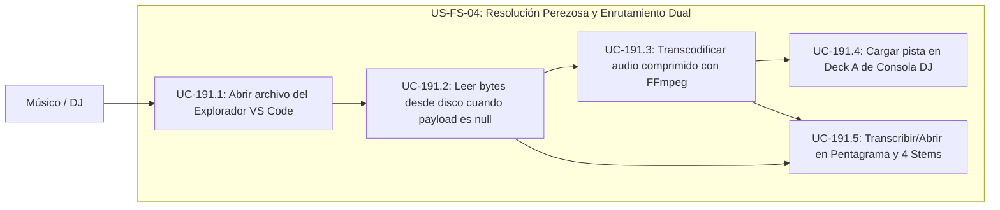
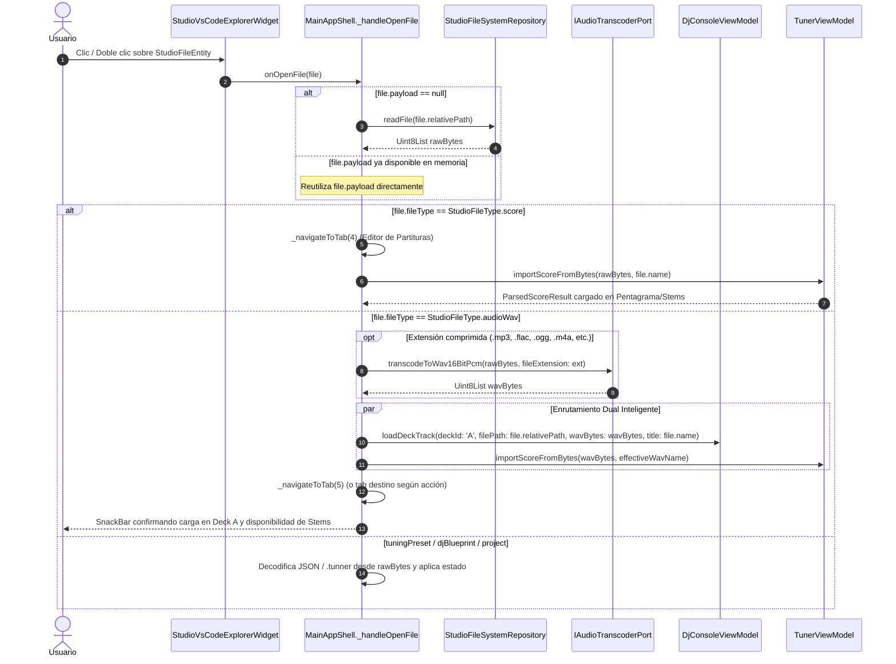

# Caso de Uso 191: Resolución Perezosa de Payload desde Disco y Enrutamiento Dual Deck A / Partitura (US-FS-04)

---

## Metadatos del Documento

- **ID del Documento:** `DOC-NAV-2026-191`
- **ID del Caso de Uso:** `UC-191`
- **Historia de Usuario Asociada:** `US-FS-04`
- **Título Oficial:** `Resolución Asíncrona de Bytes desde Disco en MainAppShell y Enrutamiento Dual hacia Consola DJ y Pentagrama/Stems`
- **Estado:** `Approved`
- **Fecha de Creación:** `2026-11-23`
- **Última Modificación:** `2026-11-23`
- **Fase Asociada:** `Fase 2 / Orquestación de Shell y Enrutamiento de Medios`
- **Autor / Revisor Principal:** `Nicolás León`
- **ADR Relacionado:** [ADR 0183: Resolución Perezosa de Payload desde Disco y Enrutamiento Dual](../04_adrs/0183_lazy_disk_payload_resolution_and_dual_deck_score_routing.md)

---

## 1. Resumen Ejecutivo (Executive Summary)

Este caso de uso especifica el mecanismo mediante el cual `MainAppShell._handleOpenFile` resuelve de forma perezosa y asíncrona el contenido binario de cualquier `StudioFileEntity` escaneado desde disco (`payload == null`), evitando la precarga masiva en memoria al iniciar la aplicación. Cuando el usuario selecciona un archivo en el Explorador VS Code, el shell lee los bytes reales mediante `fileSystemRepository.readFile` (o puerto de lectura `readFileBytes`), ejecuta transcodificación automática a WAV PCM 16-bit vía `IAudioTranscoderPort` (`FfmpegAudioTranscoderService`) si se trata de audio comprimido y realiza un enrutamiento dual inteligente hacia el `Deck A` de la Consola DJ y el Editor de Partituras / Mezclador de 4 Stems.

---

## 2. Diagramas Canónicos (Mermaid)

### 2.1 Diagrama de Casos de Uso

### 2.2 Diagrama de Secuencia Detallado

---

## 3. Precondiciones, Postcondiciones y Flujos

### 3.1 Precondiciones
1. `_fileSystemService.onOpenFile` está vinculado a `MainAppShell._handleOpenFile`.
2. `StudioFileSystemRepository` apunta al directorio de trabajo válido donde reside `file.relativePath`.
3. Para formatos comprimidos (`.mp3`, `.flac`, `.ogg`, `.m4a`, `.aac`, `.opus`, `.wma`, `.webm`, `.aiff`), `IAudioTranscoderPort` está conectado a `FfmpegAudioTranscoderService` en el árbol de dependencias (`StudioCompositionRoot`).

### 3.2 Postcondiciones
1. Todo archivo escaneado desde disco (`payload == null`) es leído asíncronamente sin requerir precarga en memoria durante `loadRootWorkspace()`.
2. Los archivos de audio comprimido se convierten de forma transparente a WAV PCM 16-bit antes de alimentar el motor DJ y el transcriptor.
3. `Deck A` de `DjConsoleViewModel` recibe los bytes WAV y metadatos de pista; simultáneamente, `TunerViewModel` dispone de la transcripción y los 4 Stems en el Pentagrama y Mezclador.
4. Ninguna operación de lectura de archivo evade el confinamiento de ruta (`_resolveSafePath` en `LocalDiskStudioFileSystemRepository`).

### 3.3 Flujo Principal
1. El usuario selecciona un archivo en `StudioVsCodeExplorerWidget`, disparando `_fileSystemService.onOpenFile(file)`.
2. `_handleOpenFile` inspecciona `file.payload`. Si es `null`, invoca `await _fileSystemService.fileSystemRepository.readFile(file.relativePath)` y verifica `mounted`.
3. Según `file.fileType`:
   - **`score`:** Navega al tab `4` y ejecuta `vm.importScoreFromBytes(bytes, file.name)` (o `vm.loadSongPackage` si el payload ya era un `SongPackage`).
   - **`audioWav`:** Detecta la extensión mediante `StudioFileType.extractExtension`. Si es formato comprimido soportado por `IAudioTranscoderPort`, ejecuta `transcodeToWav16BitPcm`. Posteriormente carga los bytes WAV resultantes en `Deck A` (`_djConsoleViewModel.loadDeckTrack`) y sincroniza la transcripción a partitura y 4 Stems en `TunerViewModel`.
   - **`tuningPreset` / `rackTool` / `djBlueprint` / `project`:** Decodifica los bytes leídos del disco y aplica la configuración en su módulo respectivo (`TunerViewModel`, `ModularRackViewModel`, `DjConsoleViewModel`).
4. Presenta retroalimentación visual inmediata mediante `SnackBar` con el nombre del archivo y destino.

### 3.4 Flujos Alternativos y Condiciones de Error
- **Archivo borrado o ilegible en disco (`FileSystemException` o bytes vacíos):** El shell captura el error de lectura, evita invocar a `loadDeckTrack` o `importScoreFromBytes` con un buffer vacío y muestra un `SnackBar` diagnóstico al usuario.
- **Fallo de transcodificación en `FfmpegAudioTranscoderService` (retorno `null`):** Se cancela el enrutamiento hacia el motor PCM y se notifica que no fue posible decodificar el formato comprimido (p. ej. archivo corrupto o binario `ffmpeg` no disponible).
- **Widget desmontado durante la lectura asíncrona (`!mounted`):** La ejecución retorna limpiamente tras el `await` sin acceder a `context`.

---

## 4. Trazabilidad Arquitectónica y Pruebas Automatizadas

- **Archivos de Código Fuente:**
  - [main_app_shell.dart](file:///home/nicomania11/Proyectos~/Escritorio/TUNER/tunner/lib/features/navigation/presentation/main_app_shell.dart)
  - [studio_file_system_repository.dart](file:///home/nicomania11/Proyectos~/Escritorio/TUNER/tunner/lib/core/file_system/domain/studio_file_system_repository.dart)
  - [i_audio_transcoder_port.dart](file:///home/nicomania11/Proyectos~/Escritorio/TUNER/tunner/lib/core/audio/domain/i_audio_transcoder_port.dart)
  - [ffmpeg_audio_transcoder_service.dart](file:///home/nicomania11/Proyectos~/Escritorio/TUNER/tunner/lib/core/audio/infrastructure/ffmpeg_audio_transcoder_service.dart)
  - [dj_console_view_model.dart](file:///home/nicomania11/Proyectos~/Escritorio/TUNER/tunner/lib/features/dj_console/presentation/dj_console_view_model.dart)
- **Suite de Pruebas Automatizadas:**
  - [local_disk_file_system_repository_test.dart](file:///home/nicomania11/Proyectos~/Escritorio/TUNER/tunner/test/core/file_system/local_disk_file_system_repository_test.dart)
  - [mp3_import_and_didactic_browser_test.dart](file:///home/nicomania11/Proyectos~/Escritorio/TUNER/tunner/test/features/universal_importer/mp3_import_and_didactic_browser_test.dart)
  - [main_app_shell_test.dart](file:///home/nicomania11/Proyectos~/Escritorio/TUNER/tunner/test/features/navigation/main_app_shell_test.dart) (y casos de verificación `us_fs_04_*` de apertura perezosa desde disco y enrutamiento dual).
