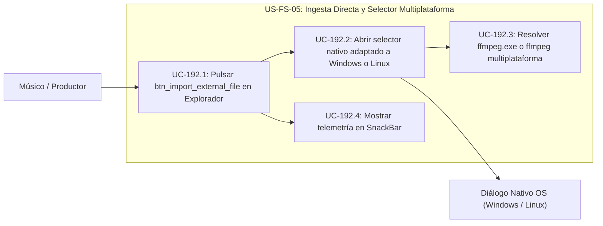
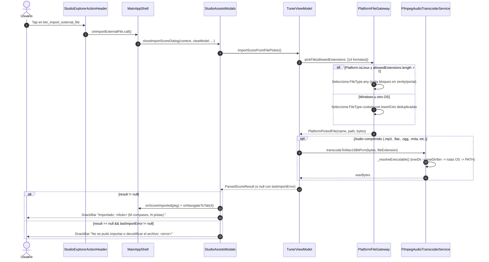

# Caso de Uso 192: Acción de Ingesta Directa en el Explorador y Selector Nativo Multiplataforma (US-FS-05)

---

## Metadatos del Documento

- **ID del Documento:** `DOC-UI-2026-192`
- **ID del Caso de Uso:** `UC-192`
- **Historia de Usuario Asociada:** `US-FS-05`
- **Título Oficial:** `Acción Directa btn_import_external_file en StudioExplorerActionHeader, Selector Nativo Windows/Linux y Resolución FFmpeg`
- **Estado:** `Approved`
- **Fecha de Creación:** `2026-11-23`
- **Última Modificación:** `2026-11-23`
- **Fase Asociada:** `Fase 2 / Experiencia de Escritorio y Portabilidad OS`
- **Autor / Revisor Principal:** `Nicolás León`
- **ADR Relacionado:** [ADR 0184: Acción Directa de Ingesta en el Explorador y Selector Nativo Multiplataforma](../04_adrs/0184_explorer_direct_ingestion_action_and_cross_platform_native_picker.md)

---

## 1. Resumen Ejecutivo (Executive Summary)

Este caso de uso define el punto de entrada directo para importar audio o partituras externas desde la barra de cabecera del Explorador VS Code (`StudioExplorerActionHeader` mediante `btn_import_external_file`), desacoplado arquitectónicamente por callback hacia el modal orquestador `StudioAssetsModals.showImportScoreDialog`. Asimismo, formaliza la lógica adaptativa por sistema operativo en `PlatformFileGateway.pickFile` para evitar el bloqueo de extensiones mixtas en diálogos nativos de Linux (`zenity`/portales) frente a `IFileOpenDialog` en Windows, y la resolución determinista de binarios `ffmpeg.exe` / `ffmpeg` en `FfmpegAudioTranscoderService`.

---

## 2. Diagramas Canónicos (Mermaid)

### 2.1 Diagrama de Casos de Uso

### 2.2 Diagrama de Secuencia Detallado

---

## 3. Precondiciones, Postcondiciones y Flujos

### 3.1 Precondiciones
1. `StudioVsCodeExplorerWidget` recibe un callback `onImportExternalFile` válido desde el contenedor padre (`MainAppShell`).
2. `TunerViewModel` está conectado a `PlatformFileGateway` y `FfmpegAudioTranscoderService` en el `StudioCompositionRoot`.

### 3.2 Postcondiciones
1. `StudioExplorerActionHeader` renderiza el botón con `Key('btn_import_external_file')` sin introducir dependencias de `features/` dentro de `lib/core/file_system/`.
2. En Windows, el selector nativo aplica filtro `FileType.custom` insensible a mayúsculas; en Linux multi-formato, aplica `FileType.any` garantizando visibilidad de `.mp3`, `.wav`, `.flac`, `.mid`, `.musicxml` y `.pdf`.
3. `FfmpegAudioTranscoderService` localiza `ffmpeg.exe` o `ffmpeg` en rutas empaquetadas junto a la aplicación antes de recurrir a rutas estándar del OS o al `PATH`.
4. El usuario recibe confirmación exacta con compases y pistas al importar o un mensaje diagnóstico claro ante error.

### 3.3 Flujo Principal
1. El usuario pulsa el icono de carga (`btn_import_external_file`) en la cabecera del Explorador de Proyecto.
2. `StudioExplorerActionHeader` ejecuta `widget.onImportExternalFile?.call()`.
3. `StudioAssetsModals.showImportScoreDialog` llama a `viewModel.importScoreFromFilePicker()`.
4. `PlatformFileGateway.pickFile` adapta el modo del `FilePicker` al sistema operativo activo (`FileType.any` multi-formato en Linux vs `FileType.custom` en Windows) y obtiene los bytes del archivo seleccionado.
5. Si el archivo es audio comprimido, `FfmpegAudioTranscoderService` resuelve el ejecutable multiplataforma y decodifica a WAV PCM 16-bit.
6. Al completar, `showImportScoreDialog` invoca `onScoreImported`, navega al tab del editor (`4`) y muestra el `SnackBar` resumen.

### 3.4 Flujos Alternativos y Condiciones de Error
- **Callback `onImportExternalFile` nulo (p. ej., vista aislada):** El botón usa invocación segura `widget.onImportExternalFile?.call()` sin lanzar `NoSuchMethodError`.
- **Lectura vacía desde `file_picker` en Linux/Windows con ruta válida (`picked.path`):** `PlatformFileGateway.pickFile` realiza lectura directa desde `File(picked.path!)` como respaldo.
- **Fallo de decodificación o formato inválido:** `showImportScoreDialog` lee `viewModel.lastImportError`; si es no nulo y no vacío, muestra el `SnackBar` de error. Si es `null` (cancelación), cierra silenciosamente sin alertas espurias.

---

## 4. Trazabilidad Arquitectónica y Pruebas Automatizadas

- **Archivos de Código Fuente:**
  - [studio_explorer_action_header.dart](file:///home/nicomania11/Proyectos~/Escritorio/TUNER/tunner/lib/core/file_system/presentation/studio_explorer_action_header.dart)
  - [studio_vscode_explorer_widget.dart](file:///home/nicomania11/Proyectos~/Escritorio/TUNER/tunner/lib/core/file_system/presentation/studio_vscode_explorer_widget.dart)
  - [studio_assets_modals.dart](file:///home/nicomania11/Proyectos~/Escritorio/TUNER/tunner/lib/features/song_library/presentation/studio_assets_modals.dart)
  - [platform_file_gateway.dart](file:///home/nicomania11/Proyectos~/Escritorio/TUNER/tunner/lib/core/file_system/data/platform_file_gateway.dart)
  - [ffmpeg_audio_transcoder_service.dart](file:///home/nicomania11/Proyectos~/Escritorio/TUNER/tunner/lib/core/audio/infrastructure/ffmpeg_audio_transcoder_service.dart)
- **Suite de Pruebas Automatizadas:**
  - [us_fs_05_explorer_import_button_ui_test.dart](file:///home/nicomania11/Proyectos~/Escritorio/TUNER/tunner/test/core/file_system/us_fs_05_explorer_import_button_ui_test.dart)
