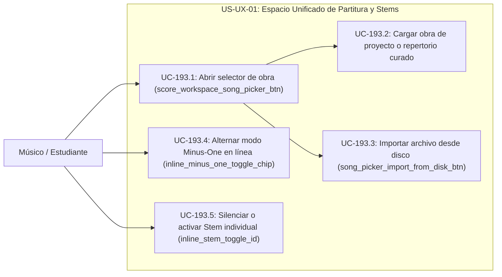
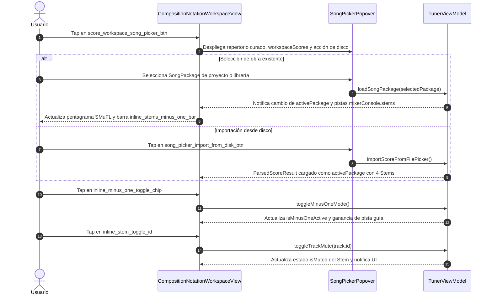

# Caso de Uso 193: Espacio de Trabajo Unificado de Partituras y Dock en Línea de Stems / Minus-One (US-UX-01)

---

## Metadatos del Documento

- **ID del Documento:** `DOC-UI-2026-193`
- **ID del Caso de Uso:** `UC-193`
- **Historia de Usuario Asociada:** `US-UX-01`
- **Título Oficial:** `Selector Interactivo de Repertorio y Barra Integrada en Línea de 4 Stems y Minus-One en CompositionNotationWorkspaceView`
- **Estado:** `Approved`
- **Fecha de Creación:** `2026-11-24`
- **Última Modificación:** `2026-11-24`
- **Fase Asociada:** `Fase 2 / Experiencia de Escritorio y Flujo Pedagógico Unificado`
- **Autor / Revisor Principal:** `Nicolás León`
- **ADR Relacionado:** [ADR 0185: Unificación del Espacio de Trabajo de Partituras y Barra Integrada en Línea de Stems y Minus-One](../04_adrs/0185_unified_score_workspace_and_inline_stems_dock.md)

---

## 1. Resumen Ejecutivo (Executive Summary)

Este caso de uso especifica la unificación operativa del espacio de composición y notación (`CompositionNotationWorkspaceView`) para eliminar la navegación fragmentada a través de múltiples modales superpuestos. El usuario puede conmutar entre obras del proyecto y repertorio curado, o importar archivos de audio/partitura desde disco mediante un selector interactivo unificado (`score_workspace_song_picker_btn` y `song_picker_import_from_disk_btn`), así como controlar en tiempo real los 4 Stems (`lead_stem`, `harmony_stem`, `bass_stem`, `rhythm_stem`) y el modo Minus-One directamente desde una barra integrada en línea (`inline_stems_minus_one_bar`) sin ocultar el pentagrama SMuFL.

---

## 2. Diagramas Canónicos (Mermaid)

### 2.1 Diagrama de Casos de Uso

### 2.2 Diagrama de Secuencia Detallado

---

## 3. Precondiciones, Postcondiciones y Flujos

### 3.1 Precondiciones
1. `TunerScreen` se encuentra en `AppDisplayMode.conservatoryPro` con el espacio activo `WorkspaceType.composition`, renderizando `CompositionNotationWorkspaceView`.
2. `TunerViewModel` dispone de un `activePackage` válido, listas `curatedLibrary` / `workspaceScores` y colección `mixerConsole.stems` inicializada.

### 3.2 Postcondiciones
1. El cambio de obra mediante `score_workspace_song_picker_btn` actualiza `viewModel.activePackage`, los compases renderizados en `RealSheetMusicPainter` y los chips de `inline_stems_minus_one_bar` sin requerir apertura previa de `TunerLibraryModal` ni `TunerMixerModal`.
2. Pulsar `song_picker_import_from_disk_btn` dispara el flujo de importación local y carga la partitura transcrita con sus pistas.
3. Pulsar `inline_minus_one_toggle_chip` conmuta `viewModel.isMinusOneActive` mediante `viewModel.toggleMinusOneMode()`.
4. Pulsar `inline_stem_toggle_<id>` invoca `viewModel.toggleTrackMute(trackId)` y refleja inmediatamente el estado silenciado o activo sobre el chip correspondiente.

### 3.3 Flujo Principal
1. El usuario abre el espacio de Composición y Notación y pulsa el selector de obra `Key('score_workspace_song_picker_btn')` en la cabecera del pentagrama.
2. El selector contextual muestra agrupadas las partituras creadas o importadas en el proyecto (`viewModel.workspaceScores`), el repertorio curado (`viewModel.curatedLibrary`) y el botón `Key('song_picker_import_from_disk_btn')`.
3. Al elegir una obra de la lista, el selector invoca `viewModel.loadSongPackage(pkg)` y se cierra automáticamente devolviendo el foco inmediato al pentagrama.
4. Debajo o integrado junto a la barra de edición/transporte del pentagrama, el usuario visualiza `Key('inline_stems_minus_one_bar')` con el chip `Key('inline_minus_one_toggle_chip')` y los chips `Key('inline_stem_toggle_<id>')` por cada stem disponible en `viewModel.mixerConsole.stems`.
5. El usuario activa el modo Minus-One con un clic en `inline_minus_one_toggle_chip` o silencia selectivamente una pista (p. ej. `inline_stem_toggle_lead_stem` o `inline_stem_toggle_bass_stem`) mientras observa en vivo el cursor del pentagrama.

### 3.4 Flujos Alternativos y Condiciones de Error
- **Cancelación del selector nativo tras pulsar `song_picker_import_from_disk_btn`:** Si el usuario cierra el diálogo del sistema operativo sin elegir archivo, `importScoreFromFilePicker()` retorna `null` con `lastImportError == null`, manteniendo intacto el `activePackage` previo sin alertas espurias.
- **Error de decodificación al importar desde disco:** Si `lastImportError` es no nulo, se informa al usuario de forma no destructiva manteniendo activa la obra anterior en el lienzo.
- **Obra sin stems adicionales (pista única):** `inline_stems_minus_one_bar` renderiza únicamente los tracks presentes en `viewModel.mixerConsole.stems` sin generar índices fuera de rango ni chips huérfanos.
- **Ventana horizontal reducida:** El contenedor de chips en línea utiliza desplazamiento horizontal seguro para prevenir errores de desbordamiento (`RenderFlex overflow`).

---

## 4. Trazabilidad Arquitectónica y Pruebas Automatizadas

- **ADR Relacionado:** [ADR 0185: Unificación del Espacio de Trabajo de Partituras y Barra Integrada en Línea de Stems y Minus-One](../04_adrs/0185_unified_score_workspace_and_inline_stems_dock.md).
- **Archivos de Código Fuente:**
  - [composition_notation_workspace_view.dart](file:///home/nicomania11/Proyectos~/Escritorio/TUNER/tunner/lib/features/workspaces/presentation/composition_notation_workspace_view.dart)
  - [tuner_viewmodel.dart](file:///home/nicomania11/Proyectos~/Escritorio/TUNER/tunner/lib/features/tuner/presentation/tuner_viewmodel.dart)
- **Suite de Pruebas Automatizadas (`US-UX-01`):**
  - `test/features/workspaces/us_ux_01_unified_score_and_stems_flow_test.dart`
