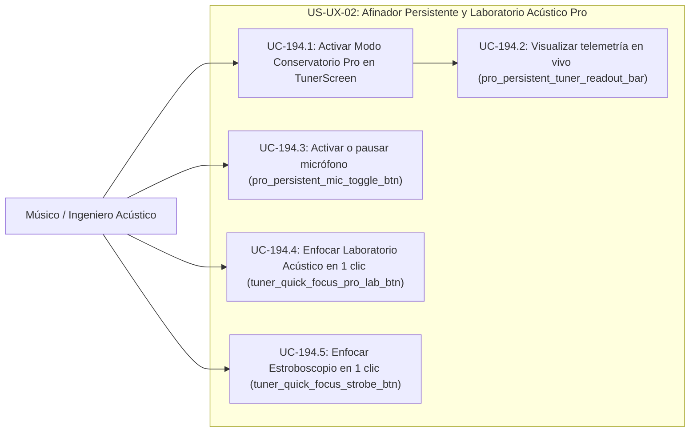
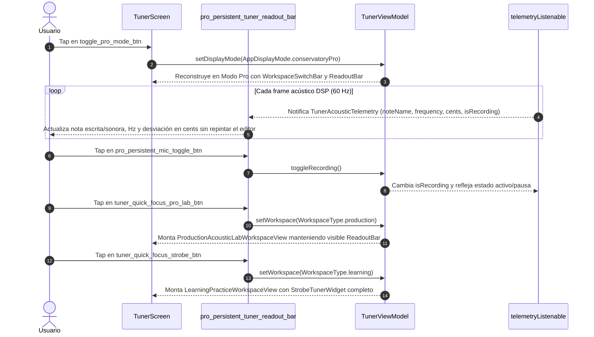

# Caso de Uso 194: Barra Persistente de Telemetría del Afinador y Acceso Integrado al Laboratorio Acústico (US-UX-02)

---

## Metadatos del Documento

- **ID del Documento:** `DOC-UI-2026-194`
- **ID del Caso de Uso:** `UC-194`
- **Historia de Usuario Asociada:** `US-UX-02`
- **Título Oficial:** `Barra Persistente de Afinador en Vivo y Conmutación Rápida al Laboratorio Acústico y Estroboscopio en TunerScreen`
- **Estado:** `Approved`
- **Fecha de Creación:** `2026-11-24`
- **Última Modificación:** `2026-11-24`
- **Fase Asociada:** `Fase 1 & Fase 2 / Afinador en Vivo y Modo Conservatorio Pro`
- **Autor / Revisor Principal:** `Nicolás León`
- **ADR Relacionado:** [ADR 0186: Afinador Estroboscópico Permanente y Acceso Integrado al Laboratorio Acústico en Modo Pro](../04_adrs/0186_permanent_strobe_tuner_and_integrated_acoustic_lab.md)

---

## 1. Resumen Ejecutivo (Executive Summary)

Este caso de uso garantiza la continuidad permanente del afinador en vivo dentro de `TunerScreen` cuando el usuario activa el Modo Conservatorio Pro (`AppDisplayMode.conservatoryPro`). Independientemente de si el espacio de trabajo activo es Práctica (`WorkspaceType.learning`), Composición (`WorkspaceType.composition`) o Laboratorio Acústico (`WorkspaceType.production`), la pantalla mantiene visible una barra persistente de telemetría acústica y control de micrófono (`pro_persistent_tuner_readout_bar` y `pro_persistent_mic_toggle_btn`) junto con accesos directos de 1 clic hacia el Laboratorio Acústico (`tuner_quick_focus_pro_lab_btn`) y hacia el Estroboscopio (`tuner_quick_focus_strobe_btn`).

---

## 2. Diagramas Canónicos (Mermaid)

### 2.1 Diagrama de Casos de Uso

### 2.2 Diagrama de Secuencia Detallado

---

## 3. Precondiciones, Postcondiciones y Flujos

### 3.1 Precondiciones
1. `TunerScreen` está montado bajo un `Provider<TunerViewModel>` válido y tokens de diseño `StudioThemeScope`.
2. `TunerViewModel.telemetryListenable` emite objetos `TunerAcousticTelemetry` actualizados por el motor de detección de tono.

### 3.2 Postcondiciones
1. Al cambiar de `AppDisplayMode.essential` a `AppDisplayMode.conservatoryPro`, `Key('pro_persistent_tuner_readout_bar')` permanece montada y visible en todos los valores de `WorkspaceType` (`learning`, `composition`, `production`).
2. `Key('pro_persistent_mic_toggle_btn')` permite iniciar o detener la captura de micrófono (`viewModel.toggleRecording()`) desde cualquier espacio de trabajo Pro.
3. Pulsar `Key('tuner_quick_focus_pro_lab_btn')` cambia inmediatamente a `WorkspaceType.production` (Laboratorio Acústico).
4. Pulsar `Key('tuner_quick_focus_strobe_btn')` cambia inmediatamente a `WorkspaceType.learning` (Estroboscopio y Práctica).

### 3.3 Flujo Principal
1. El usuario se encuentra en `TunerScreen` (Modo Esencial) y presiona `Key('toggle_pro_mode_btn')`.
2. `TunerViewModel.setDisplayMode(AppDisplayMode.conservatoryPro)` habilita el `WorkspaceSwitchBar` y la barra fija `Key('pro_persistent_tuner_readout_bar')`.
3. `ValueListenableBuilder<TunerAcousticTelemetry>` suscrito a `viewModel.telemetryListenable` renderiza en vivo la nota actual (respetando `viewModel.hasTransposition`), la frecuencia en Hz y los cents respecto a `viewModel.centsTolerance`.
4. Incluso si el usuario navega a `WorkspaceType.composition` para leer o editar un pentagrama, `pro_persistent_tuner_readout_bar` continúa mostrando su afinación y permite alternar el micrófono mediante `Key('pro_persistent_mic_toggle_btn')`.
5. Cuando necesita inspección espectral o calibración microtonal, el usuario pulsa `Key('tuner_quick_focus_pro_lab_btn')`, activando `ProductionAcousticLabWorkspaceView`; para volver al modo estroboscópico ampliado, pulsa `Key('tuner_quick_focus_strobe_btn')`.

### 3.4 Flujos Alternativos y Condiciones de Error
- **Sin señal de audio o frecuencia $\le 0\text{ Hz}$:** La barra persistente muestra placeholders neutros (`--`, `-- Hz`) sin arrojar valores `NaN` o `Infinity`.
- **Cambio de retorno a Modo Esencial (`toggle_essential_mode_btn`):** `TunerScreen` desmonta limpiamente `pro_persistent_tuner_readout_bar` y restaura `EssentialTunerPanel` sin dejar listeners colgados ni detener el estado de grabación elegido por el usuario.
- **Ancho de pantalla reducido:** Los elementos de la barra persistente utilizan truncamiento controlado (`overflow: TextOverflow.ellipsis`) o disposición responsiva para evitar desbordamientos en ventanas compactas.

---

## 4. Trazabilidad Arquitectónica y Pruebas Automatizadas

- **ADR Relacionado:** [ADR 0186: Afinador Estroboscópico Permanente y Acceso Integrado al Laboratorio Acústico en Modo Pro](../04_adrs/0186_permanent_strobe_tuner_and_integrated_acoustic_lab.md).
- **Archivos de Código Fuente:**
  - [tuner_screen.dart](file:///home/nicomania11/Proyectos~/Escritorio/TUNER/tunner/lib/features/tuner/presentation/tuner_screen.dart)
  - [production_acoustic_lab_workspace_view.dart](file:///home/nicomania11/Proyectos~/Escritorio/TUNER/tunner/lib/features/workspaces/presentation/production_acoustic_lab_workspace_view.dart)
  - [learning_practice_workspace_view.dart](file:///home/nicomania11/Proyectos~/Escritorio/TUNER/tunner/lib/features/workspaces/presentation/learning_practice_workspace_view.dart)
  - [tuner_viewmodel.dart](file:///home/nicomania11/Proyectos~/Escritorio/TUNER/tunner/lib/features/tuner/presentation/tuner_viewmodel.dart)
- **Suite de Pruebas Automatizadas (`US-UX-02`):**
  - `test/features/tuner/us_ux_02_unified_tuner_pro_lab_flow_test.dart`
