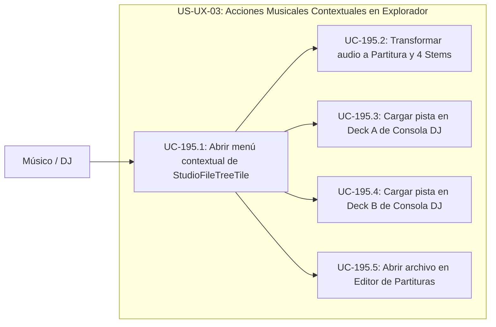
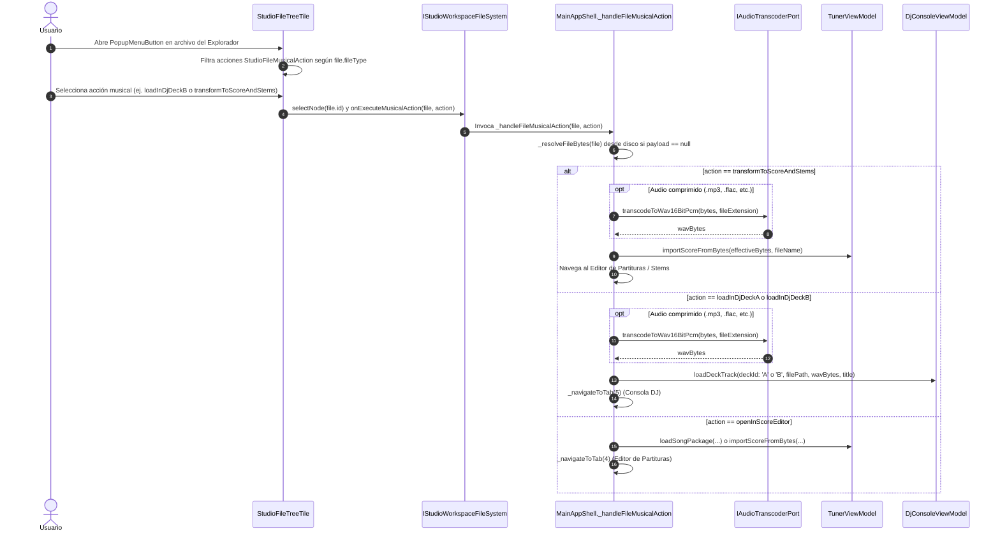

# Caso de Uso 195: Acciones Musicales Contextuales en el Explorador de Proyecto (US-UX-03)

---

## Metadatos del Documento

- **ID del Documento:** `DOC-FS-2026-195`
- **ID del Caso de Uso:** `UC-195`
- **Historia de Usuario Asociada:** `US-UX-03`
- **Título Oficial:** `Contrato StudioFileMusicalAction en IStudioWorkspaceFileSystem, Menú Contextual en StudioFileTreeTile y Despacho en MainAppShell`
- **Estado:** `Approved`
- **Fecha de Creación:** `2026-11-24`
- **Última Modificación:** `2026-11-24`
- **Fase Asociada:** `Fase 2 / Sistema de Archivos y Orquestación del Shell`
- **Autor / Revisor Principal:** `Nicolás León`
- **ADR Relacionado:** [ADR 0187: Acciones Musicales Contextuales por Tipo de Archivo en el Explorador de Proyecto](../04_adrs/0187_contextual_musical_actions_in_project_explorer.md)

---

## 1. Resumen Ejecutivo (Executive Summary)

Este caso de uso formaliza el sistema de acciones musicales explícitas y sensibles al tipo de archivo (`StudioFileType`) dentro del Explorador de Proyecto estilo VS Code. Mediante el contrato puro `StudioFileMusicalAction` (`transformToScoreAndStems`, `loadInDjDeckA`, `loadInDjDeckB`, `openInScoreEditor`) en `IStudioWorkspaceFileSystem`, el usuario puede decidir desde el menú contextual de `StudioFileTreeTile` el destino musical exacto de un archivo de audio o partitura, delegando el enrutamiento real, la lectura perezosa desde disco y la transcodificación FFmpeg a `MainAppShell._handleFileMusicalAction` sin romper la separación de capas definida en `AGENTS.md`.

---

## 2. Diagramas Canónicos (Mermaid)

### 2.1 Diagrama de Casos de Uso

### 2.2 Diagrama de Secuencia Detallado

---

## 3. Precondiciones, Postcondiciones y Flujos

### 3.1 Precondiciones
1. `StudioFileTreeTile` recibe un `StudioFileEntity` y una instancia de `IStudioWorkspaceFileSystem`.
2. En el entorno completo de aplicación, `MainAppShell` ha registrado `_fileSystemService.onExecuteMusicalAction = _handleFileMusicalAction`.

### 3.2 Postcondiciones
1. `lib/core/file_system/` permanece libre de importaciones hacia `lib/features/`, comunicando la intención exclusivamente mediante `StudioFileMusicalAction` y `StudioFileEntity`.
2. Los archivos `StudioFileType.audioWav` muestran en su menú contextual las opciones `transformToScoreAndStems`, `loadInDjDeckA` y `loadInDjDeckB`, además de las acciones estándar de disco (`open_in_explorer`, `rename`, `move`, `delete`).
3. Los archivos `StudioFileType.score` muestran `openInScoreEditor` (y `transformToScoreAndStems` cuando aplique), omitiendo acciones exclusivas de decks DJ.
4. `MainAppShell._handleFileMusicalAction` resuelve perezosamente los bytes desde disco si `file.payload == null`, transcodifica formatos comprimidos cuando es necesario y enruta al módulo destino exacto elegido por el usuario.

### 3.3 Flujo Principal
1. El usuario despliega el menú contextual (`PopupMenuButton`) de un archivo en `StudioFileTreeTile`.
2. `StudioFileTreeTile` evalúa `file.fileType` para construir las entradas musicales aplicables de `StudioFileMusicalAction`.
3. El usuario elige una acción (por ejemplo, cargar un `.mp3` en `Deck B` mediante `StudioFileMusicalAction.loadInDjDeckB`, o transcribirlo con `StudioFileMusicalAction.transformToScoreAndStems`).
4. `StudioFileTreeTile` marca el nodo como seleccionado (`service.selectNode(file.id)`) e invoca `service.onExecuteMusicalAction?.call(file, action)`.
5. `MainAppShell._handleFileMusicalAction` resuelve los bytes del archivo con `_resolveFileBytes(file)`, transcodifica a WAV PCM 16-bit si el audio está comprimido y ejecuta la operación solicitada sobre `TunerViewModel` o `DjConsoleViewModel`, navegando al espacio correspondiente y mostrando un `SnackBar` de confirmación.

### 3.4 Flujos Alternativos y Condiciones de Error
- **`onExecuteMusicalAction` nulo (pruebas aisladas de widget o `NoOpStudioWorkspaceFileSystem`):** El menú sigue siendo interactivo y realiza una invocación segura `?.call(file, action)` sin excepciones.
- **Archivo no legible o bytes vacíos en disco:** `_handleFileMusicalAction` aborta la carga en el motor DJ o transcriptor tras verificar `!mounted` o `resolvedBytes == null || resolvedBytes.isEmpty`, informando mediante `SnackBar` diagnóstico.
- **Archivo de tipo no musical (`StudioFileType.genericFile`, `tuningPreset`, `rackTool`):** El menú contextual omite las acciones musicales de partitura/DJ para evitar operaciones inválidas.

---

## 4. Trazabilidad Arquitectónica y Pruebas Automatizadas

- **ADR Relacionado:** [ADR 0187: Acciones Musicales Contextuales por Tipo de Archivo en el Explorador de Proyecto](../04_adrs/0187_contextual_musical_actions_in_project_explorer.md).
- **Archivos de Código Fuente:**
  - [i_studio_workspace_file_system.dart](file:///home/nicomania11/Proyectos~/Escritorio/TUNER/tunner/lib/core/file_system/domain/i_studio_workspace_file_system.dart)
  - [studio_file_tree_tile.dart](file:///home/nicomania11/Proyectos~/Escritorio/TUNER/tunner/lib/core/file_system/presentation/studio_file_tree_tile.dart)
  - [main_app_shell.dart](file:///home/nicomania11/Proyectos~/Escritorio/TUNER/tunner/lib/features/navigation/presentation/main_app_shell.dart)
- **Suite de Pruebas Automatizadas (`US-UX-03`):**
  - `test/core/file_system/us_ux_03_contextual_musical_file_actions_test.dart`
