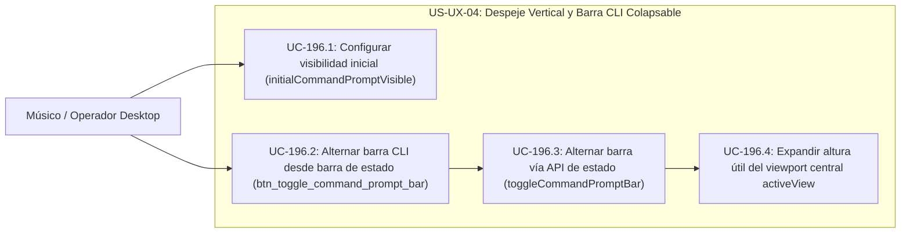
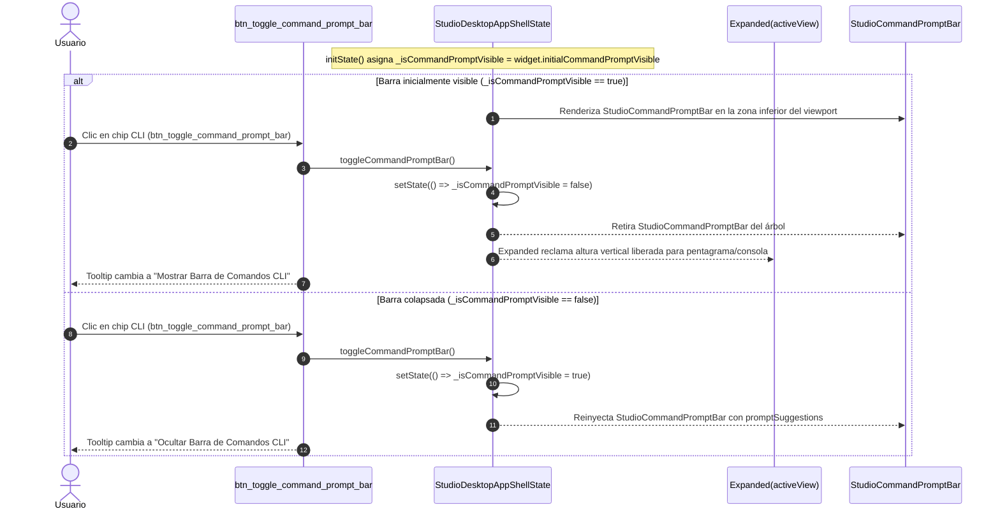

# Caso de Uso 196: Despeje Ergonómico Vertical del Shell de Escritorio y Barra de Comandos CLI Colapsable (US-UX-04)

---

## Metadatos del Documento

- **ID del Documento:** `DOC-UI-2026-196`
- **ID del Caso de Uso:** `UC-196`
- **Historia de Usuario Asociada:** `US-UX-04`
- **Título Oficial:** `Barra de Comandos CLI Colapsable en StudioDesktopAppShell y Recuperación de Espacio Vertical`
- **Estado:** `Approved`
- **Fecha de Creación:** `2026-11-24`
- **Última Modificación:** `2026-11-24`
- **Fase Asociada:** `Fase 2 / Sistema de Diseño y Ergonomía Desktop`
- **Autor / Revisor Principal:** `Nicolás León`
- **ADR Relacionado:** [ADR 0188: Despeje Ergonómico Vertical del Shell de Escritorio y Barra de Comandos CLI Colapsable](../04_adrs/0188_ergonomic_desktop_shell_and_collapsible_command_bar.md)

---

## 1. Resumen Ejecutivo (Executive Summary)

Este caso de uso especifica el comportamiento ergonómico del shell de escritorio `StudioDesktopAppShell` para permitir ocultar o restaurar en tiempo real la barra inferior de comandos CLI (`StudioCommandPromptBar`). Mediante el parámetro de inicialización `initialCommandPromptVisible`, el método público `StudioDesktopAppShellState.toggleCommandPromptBar()` y el botón persistente `btn_toggle_command_prompt_bar` situado en la barra de estado inferior, el usuario recupera espacio vertical inmediato para el lienzo del pentagrama SMuFL, el afinador estroboscópico y la consola DJ sin perder acceso al intérprete DSL cuando lo necesite.

---

## 2. Diagramas Canónicos (Mermaid)

### 2.1 Diagrama de Casos de Uso

### 2.2 Diagrama de Secuencia Detallado

---

## 3. Precondiciones, Postcondiciones y Flujos

### 3.1 Precondiciones
1. La aplicación se ejecuta en modo escritorio montando `StudioDesktopAppShell` dentro de `MainAppShell` o de un entorno de pruebas con `StudioThemeScope`.
2. La barra de estado inferior (`Bottom Status Bar`, altura `24.0 px`) se encuentra renderizada en el borde inferior del shell.

### 3.2 Postcondiciones
1. Al iniciar con `initialCommandPromptVisible: false`, `StudioCommandPromptBar` no se renderiza hasta que el usuario active `btn_toggle_command_prompt_bar` o invoque `toggleCommandPromptBar()`.
2. Al iniciar con `initialCommandPromptVisible: true`, la barra CLI es visible y colapsable en 1 clic mediante `Key('btn_toggle_command_prompt_bar')`.
3. El colapso de la barra incrementa de forma medible la altura asignada por el `LayoutBuilder` al viewport central (`widget.activeView` y `widget.secondaryView`).
4. `StudioDesktopAppShellState.isCommandPromptVisible` refleja de manera exacta y sincrónica el estado de visibilidad actual.

### 3.3 Flujo Principal
1. `StudioDesktopAppShellState.initState()` inicializa `_isCommandPromptVisible` con el valor de `widget.initialCommandPromptVisible`.
2. El usuario observa la interfaz de escritorio con el viewport central (`activeView`) y la barra de estado inferior donde figura el botón `Key('btn_toggle_command_prompt_bar')` etiquetado `CLI`.
3. Cuando el usuario necesita mayor espacio vertical para leer partituras o manipular la consola, pulsa `btn_toggle_command_prompt_bar`.
4. `toggleCommandPromptBar()` invierte `_isCommandPromptVisible` dentro de `setState()`, removiendo `StudioCommandPromptBar` y expandiendo automáticamente el contenedor `Expanded` del área de trabajo central.
5. Para volver a emitir comandos DSL en el prompt inferior, el usuario vuelve a pulsar `btn_toggle_command_prompt_bar`, restaurando `StudioCommandPromptBar` sin perder el estado de la vista musical activa.

### 3.4 Flujos Alternativos y Condiciones de Error
- **Vista Dividida Dual activa (`_isDualSplitActive == true`):** Al alternar la barra de comandos CLI, tanto `widget.activeView` como `widget.secondaryView` recuperan o ceden altura de manera simétrica sin alterar `_dualSplitRatio`.
- **Ancho reducido en la barra de estado inferior:** Los indicadores de latencia (`bufferLatencyLabel`) utilizan `Flexible` con `TextOverflow.ellipsis` para garantizar que `btn_toggle_command_prompt_bar` permanezca siempre accesible y sin desbordamientos horizontales.

---

## 4. Trazabilidad Arquitectónica y Pruebas Automatizadas

- **ADR Relacionado:** [ADR 0188: Despeje Ergonómico Vertical del Shell de Escritorio y Barra de Comandos CLI Colapsable](../04_adrs/0188_ergonomic_desktop_shell_and_collapsible_command_bar.md).
- **Archivos de Código Fuente:**
  - [studio_desktop_app_shell.dart](file:///home/nicomania11/Proyectos~/Escritorio/TUNER/tunner/lib/core/design_system/organisms/studio_desktop_app_shell.dart)
  - [main_app_shell.dart](file:///home/nicomania11/Proyectos~/Escritorio/TUNER/tunner/lib/features/navigation/presentation/main_app_shell.dart)
- **Suite de Pruebas Automatizadas (`US-UX-04`):**
  - `test/core/design_system/us_ux_04_collapsible_command_bar_shell_test.dart`
