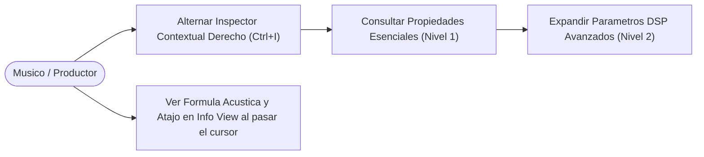
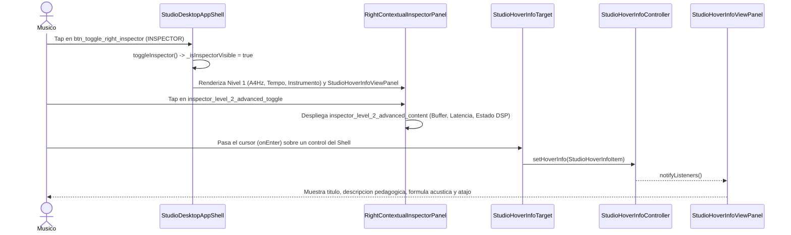

# Caso de Uso 197: Inspector Contextual Derecho y Panel Info View por Hover (US-UX-05)

## Metadatos del Documento

- **ID del Documento:** `DOC-UI-2026-197`
- **ID del Caso de Uso:** `UC-197`
- **Historia de Usuario Asociada:** `US-UX-05`
- **Titulo Oficial:** Inspector Contextual Derecho de Revelacion Progresiva y Panel de Ayuda Ambiental Info View por Hover
- **Estado:** `Approved`
- **Fecha de Creacion:** `2026-11-25`
- **Ultima Modificacion:** `2026-11-25`
- **Fase Asociada:** `Fase 2 / Global UX Wave 5`
- **Autor / Revisor Principal:** `Nicolas Leon`
- **ADR Relacionado:** [ADR 0189](../04_adrs/0189_contextual_right_inspector_and_hover_info_view.md)

---

## 1. Resumen Ejecutivo (Executive Summary)

Este caso de uso formaliza la interaccion del musico con el Inspector Contextual Derecho (`Ctrl+I`) y el panel acoplado `StudioHoverInfoViewPanel` (inspirado en *Essential Sound* de Adobe Audition e *Info View* de Ableton Live 12), permitiendo consultar propiedades esenciales de la sesion (Nivel 1), parametros tecnicos del motor DSP (Nivel 2) y explicaciones acusticas instantaneas al pasar el cursor sobre cualquier control sin abrir modales bloqueantes.

---

## 2. Diagramas Canonicos (Mermaid)

### 2.1 Diagrama de Casos de Uso

### 2.2 Diagrama de Secuencia Detallado

---

## 3. Precondiciones, Postcondiciones y Flujos

### 3.1 Precondiciones
- `StudioDesktopAppShell` se encuentra montado en modo escritorio (`width >= 900 px`).

### 3.2 Postcondiciones
- El panel `studio_right_contextual_inspector_panel` se despliega o colapsa sin alterar el estado del motor de audio ni reiniciar la vista central activa.
- `StudioHoverInfoViewPanel` refleja en tiempo real la metainformacion del ultimo control inspeccionado.

### 3.3 Flujo Principal
1. El usuario pulsa el chip `INSPECTOR` (`Key('btn_toggle_right_inspector')`) en la barra de estado inferior.
2. El sistema despliega el panel derecho de `280 px` mostrando la seccion `NIVEL 1 · PROPIEDADES ESENCIALES`.
3. El usuario pulsa el encabezado `PARAMETROS DSP & MOTOR AVANZADO` (`Key('inspector_level_2_advanced_toggle')`) para revelar los detalles tecnicos de buffer y latencia.
4. El usuario desplaza el puntero sobre cualquier accion de la barra superior o inferior; el panel `INFO VIEW` actualiza instantaneamente el titulo, la formula matematica y el atajo de teclado.

### 3.4 Flujos Alternativos y Condiciones de Error
- **Colapso para Maximizar el Lienzo:** Si el usuario pulsa el icono de cierre (`Key('btn_close_right_inspector')`) o vuelve a pulsar `INSPECTOR`, el panel se desmonta y devuelve los `280 px` horizontales al lienzo primario.

---

## 4. Trazabilidad Arquitectonica y Pruebas Automatizadas

- **Componentes:** `lib/core/design_system/molecules/studio_hover_info_view.dart`, `lib/core/design_system/organisms/studio_desktop_app_shell.dart`.
- **Suite de Verificacion:** `test/core/design_system/us_ux_05_right_inspector_and_hover_info_test.dart` (`3/3 PASS`).
