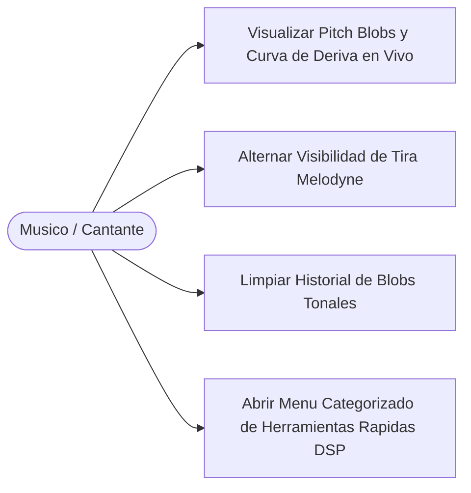
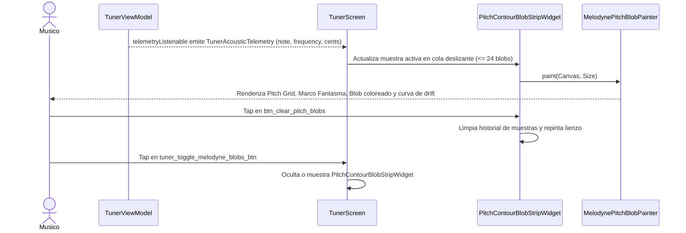

# Caso de Uso 198: Contorno Tonal por Blobs estilo Melodyne y Barra Ergonomica en Afinador Pro (US-UX-06)

## Metadatos del Documento

- **ID del Documento:** `DOC-UI-2026-198`
- **ID del Caso de Uso:** `UC-198`
- **Historia de Usuario Asociada:** `US-UX-06`
- **Titulo Oficial:** Visualizacion de Contorno Tonal por Pitch Blobs estilo Celemony Melodyne y Agrupacion Ergonomica de Herramientas DSP
- **Estado:** `Approved`
- **Fecha de Creacion:** `2026-11-25`
- **Ultima Modificacion:** `2026-11-25`
- **Fase Asociada:** `Fase 2 / Global UX Wave 5`
- **Autor / Revisor Principal:** `Nicolas Leon`
- **ADR Relacionado:** [ADR 0190](../04_adrs/0190_focused_tuner_toolbar_and_melodyne_pitch_blobs.md)

---

## 1. Resumen Ejecutivo (Executive Summary)

Este caso de uso describe como el musico visualiza la evolucion temporal de su afinacion mediante una tira de *Pitch Blobs* con curva interna de deriva y vibrato (al estilo **Celemony Melodyne 5**) en `TunerScreen`, y como accede a las utilidades secundarias a traves de un menu categorizado de baja entropia (`tuner_ergonomic_quick_tools_menu_btn`).

---

## 2. Diagramas Canonicos (Mermaid)

### 2.1 Diagrama de Casos de Uso

### 2.2 Diagrama de Secuencia Detallado

---

## 3. Precondiciones, Postcondiciones y Flujos

### 3.1 Precondiciones
- `TunerScreen` se encuentra en `AppDisplayMode.conservatoryPro`.

### 3.2 Postcondiciones
- Cada muestra acustica valida se representa como un blob sobre la cuadricula tonal con codigo cromatico semantico ($|\Delta c| \le 15$ verde, $15 < |\Delta c| \le 35$ ambar, $> 35$ rojo).

### 3.3 Flujo Principal
1. El usuario emite una nota frente al microfono o consulta la vista Pro del afinador.
2. `PitchContourBlobStripWidget` (`Key('melodyne_pitch_contour_blob_strip')`) dibuja el blob tonal sobre el marco fantasma de $0	ext{ cents}$ junto con su curva interna de micro-entonacion.
3. Si el usuario desea reiniciar el trazo visual, pulsa `Key('btn_clear_pitch_blobs')`.
4. Si desea acceder a herramientas secundarias sin escanear 19 botones individuales, abre `Key('tuner_ergonomic_quick_tools_menu_btn')`.

### 3.4 Flujos Alternativos y Condiciones de Error
- **Silencio o Senal Sin Frecuencia ($f \le 0	ext{ Hz}$):** El widget muestra el estado de espera en la cuadricula tonal sin insertar blobs espurios.

---

## 4. Trazabilidad Arquitectonica y Pruebas Automatizadas

- **Componentes:** `lib/features/tuner/presentation/widgets/pitch_contour_blob_strip_widget.dart`, `lib/features/tuner/presentation/tuner_screen.dart`.
- **Suite de Verificacion:** `test/features/tuner/us_ux_06_focused_tuner_and_melodyne_blobs_test.dart` (`3/3 PASS`).
