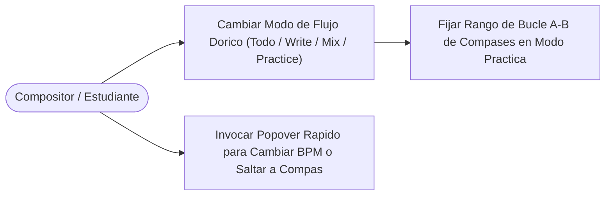
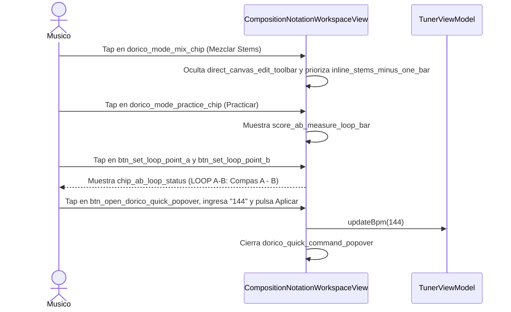

# Caso de Uso 199: Modos de Flujo Musical estilo Steinberg Dorico y Popover Rapido en Partitura (US-UX-07)

## Metadatos del Documento

- **ID del Documento:** `DOC-UI-2026-199`
- **ID del Caso de Uso:** `UC-199`
- **Historia de Usuario Asociada:** `US-UX-07`
- **Titulo Oficial:** Conmutacion de Modos de Flujo Musical (Escribir, Mezclar Stems, Practicar) y Popover Rapido de Tempo y Compas en Partitura
- **Estado:** `Approved`
- **Fecha de Creacion:** `2026-11-25`
- **Ultima Modificacion:** `2026-11-25`
- **Fase Asociada:** `Fase 2 / Global UX Wave 5`
- **Autor / Revisor Principal:** `Nicolas Leon`
- **ADR Relacionado:** [ADR 0191](../04_adrs/0191_dorico_score_task_modes_and_quick_popover.md)

---

## 1. Resumen Ejecutivo (Executive Summary)

Este caso de uso especifica la organizacion del espacio de trabajo de partituras (`CompositionNotationWorkspaceView`) en modos de flujo orientados a la tarea (inspirados en **Steinberg Dorico 5**), permitiendo ocultar las barras no pertinentes a la actividad actual para maximizar el pentagrama SMuFL, fijar puntos de bucle A-B y ejecutar cambios rapidos de tempo o compas mediante un *Popover* de comando directo.

---

## 2. Diagramas Canonicos (Mermaid)

### 2.1 Diagrama de Casos de Uso

### 2.2 Diagrama de Secuencia Detallado

---

## 3. Precondiciones, Postcondiciones y Flujos

### 3.1 Precondiciones
- El usuario se encuentra en el espacio de trabajo de Composicion y Partituras (`CompositionNotationWorkspaceView`).

### 3.2 Postcondiciones
- El espacio vertical del pentagrama se adapta dinamicamente al modo de flujo seleccionado.
- El tempo o compas activo en `TunerViewModel` se actualiza de forma determinista al aplicar el comando del Popover.

### 3.3 Flujo Principal
1. El usuario selecciona el modo `Mezclar Stems (Mix)` o `Practicar (Practice)` en `Key('dorico_score_task_mode_selector')`.
2. El sistema oculta la barra de dibujo de notas (`direct_canvas_edit_toolbar`) para despejar el lienzo SMuFL.
3. En modo `Practicar`, el usuario marca el inicio y fin de un pasaje con `Fijar A` y `Fijar B`.
4. Para cambiar rapidamente el tempo a `144 BPM`, el usuario abre `Key('btn_open_dorico_quick_popover')`, escribe `144` y pulsa `Aplicar`.

### 3.4 Flujos Alternativos y Condiciones de Error
- **Entrada Invalida en Popover:** Si el texto ingresado no coincide con un numero de BPM ni con un selector de compas (`m<N>` / `compas <N>`), el popover ignora la entrada sin lanzar excepciones ni corromper el estado.

---

## 4. Trazabilidad Arquitectonica y Pruebas Automatizadas

- **Componentes:** `lib/features/workspaces/presentation/composition_notation_workspace_view.dart`.
- **Suite de Verificacion:** `test/features/workspaces/us_ux_07_dorico_task_modes_and_popover_test.dart` (`3/3 PASS`).
