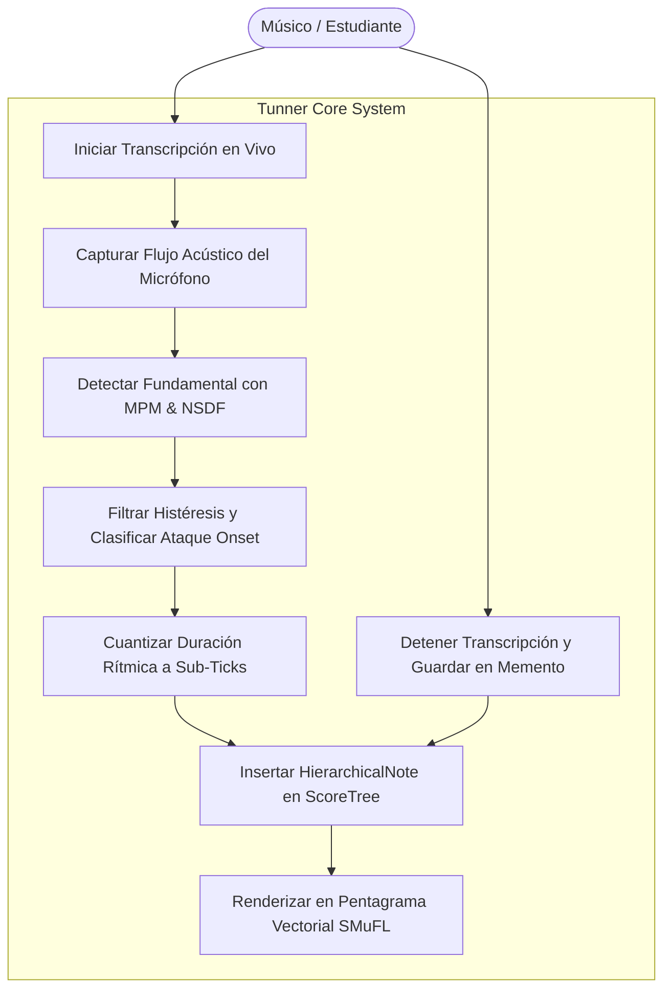
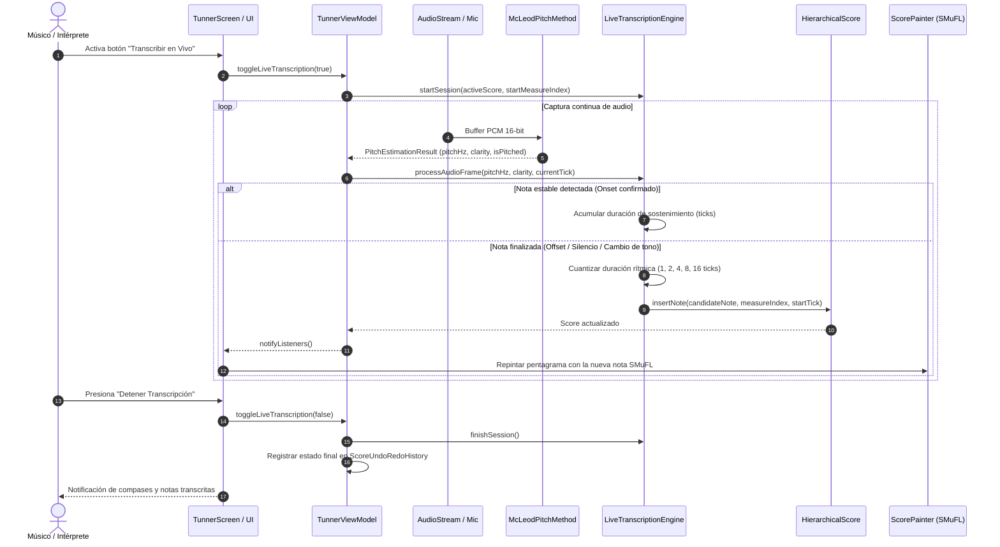

# Caso de Uso 19: Transcripción de Micrófono a Partitura en Tiempo Real (Live Mic-to-Score Transcription)

Este documento describe la especificación formal, flujos de eventos y diagramas de interacción para la funcionalidad de captura y transcripción de notas acústicas directamente a la partitura vectorial en tiempo real de **Tunner**.

---

## 1. Diagrama de Caso de Uso (Mermaid)

---

## 2. Diagrama de Secuencia y Flujo Detallado (Mermaid)

---

## 3. Especificación Formal del Caso de Uso

### 3.1 Actores
* **Actor Principal:** Músico, compositor o estudiante instrumental.
* **Actor Secundario:** Sistema de audio nativo del dispositivo (micrófono).

### 3.2 Precondiciones
1. Permiso de micrófono concedido en el sistema operativo.
2. Una partitura activa cargada en el sistema.
3. El motor de afinación configurado con la afinación de concierto deseada ($A_4$).

### 3.3 Postcondiciones
1. Las notas ejecutadas quedan escritas con su altura exacta y figura rítmica cuantizada en el compás correspondiente.
2. El pentagrama vectorial refleja visualmente todas las notas agregadas.
3. El estado de la partitura queda respaldado en el historial Memento para permitir deshacer (*undo*).

### 3.4 Flujo Principal (Happy Path)
1. El usuario activa el modo de transcripción en vivo pulsando el botón dedicado en la pantalla principal.
2. El sistema sincroniza el temporizador de reloj con el cuantizador rítmico.
3. El músico interpreta una frase melódica en su instrumento acústico.
4. En cada frame, el estimador de tono calcula la frecuencia fundamental y la claridad de la onda.
5. El motor de transcripción detecta el inicio del tono y acumula el tiempo que el intérprete sostiene la nota.
6. Al cesar la nota o cambiar de altura, el cuantizador ajusta la duración a la figura más cercana (redonda, blanca, negra, corchea o semicorchea) y genera la nota en el compás activo.
7. El pentagrama SMuFL se actualiza inmediatamente a 60 FPS.
8. El usuario detiene la transcripción; la partitura final queda lista para reproducción, edición o exportación.

### 3.5 Flujos Alternativos y Excepciones
* **FA-1 (Cambio de compás por capacidad):** Si una nota excede los 16 ticks del compás actual en $4/4$, el motor genera automáticamente un nuevo compás e inserta la nota en el siguiente compás.
* **FA-2 (Ruido o aire sin tono):** Si la claridad de la señal es inferior a $0.85$, el frame es descartado y no se crea ninguna nota espuria.
* **FE-1 (Corte repentino del micrófono):** El motor finaliza la última nota pendiente y detiene la sesión de transcripción de forma segura sin corromper la memoria.
