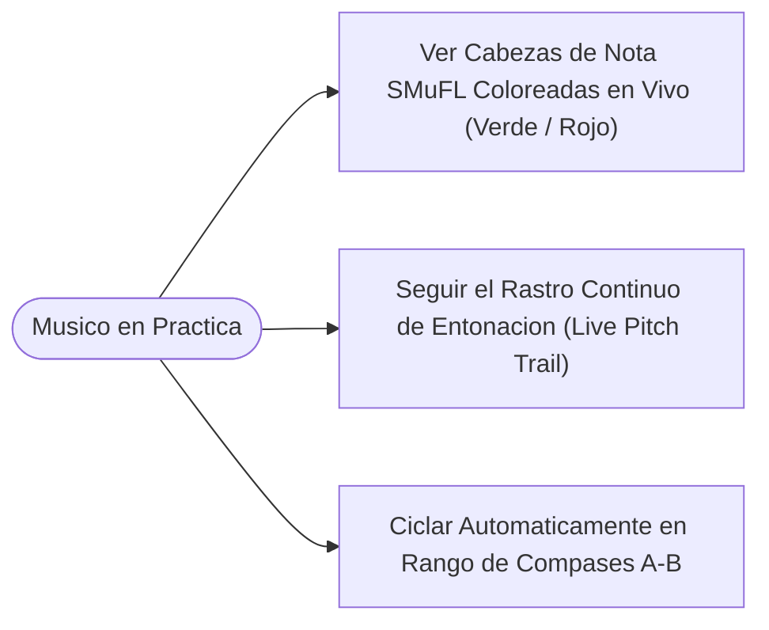
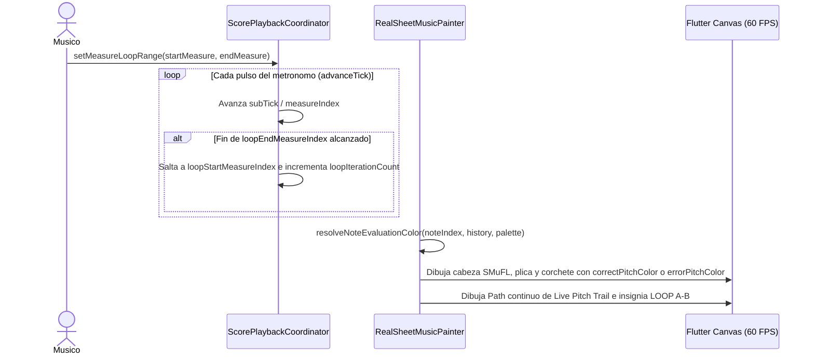

# Caso de Uso 200: Coloracion Semantica de Notas SMuFL en Vivo, Live Pitch Trail y Bucle A-B (US-UX-08)

## Metadatos del Documento

- **ID del Documento:** `DOC-UI-2026-200`
- **ID del Caso de Uso:** `UC-200`
- **Historia de Usuario Asociada:** `US-UX-08`
- **Titulo Oficial:** Retroalimentacion Cromatica por Nota SMuFL en Tiempo Real, Rastro Continuo de Entonacion y Bucle A-B en ScorePlaybackCoordinator
- **Estado:** `Approved`
- **Fecha de Creacion:** `2026-11-25`
- **Ultima Modificacion:** `2026-11-25`
- **Fase Asociada:** `Fase 2 / Global UX Wave 5`
- **Autor / Revisor Principal:** `Nicolas Leon`
- **ADR Relacionado:** [ADR 0192](../04_adrs/0192_yousician_live_note_coloring_and_ab_measure_loop.md)

---

## 1. Resumen Ejecutivo (Executive Summary)

Este caso de uso define el comportamiento en tiempo real del motor de reproduccion (`ScorePlaybackCoordinator`) y del renderizador vectorial de partituras (`RealSheetMusicPainter`) para colorear cada nota SMuFL ejecutada segun su precision acustica (al estilo **Yousician / SmartMusic**), trazar el *Live Pitch Trail* sobre el pentagrama y ciclar automaticamente entre dos compases `[A..B]` (al estilo **Moises.ai**).

---

## 2. Diagramas Canonicos (Mermaid)

### 2.1 Diagrama de Casos de Uso

### 2.2 Diagrama de Secuencia Detallado

---

## 3. Precondiciones, Postcondiciones y Flujos

### 3.1 Precondiciones
- Existe una partitura activa cargada en `ScorePlaybackCoordinator` y `RealSheetMusicPainter`.

### 3.2 Postcondiciones
- Las notas evaluadas en `history` muestran coloracion semantica directa sobre sus glifos SMuFL.
- Si `isMeasureLoopActive == true`, el cabezal de reproduccion nunca abandona el intervalo `[loopStartMeasureIndex .. loopEndMeasureIndex]`.

### 3.3 Flujo Principal
1. El usuario activa un rango de bucle entre el compas `A` y el compas `B` mediante `setMeasureLoopRange(A, B)`.
2. A medida que avanza el reloj y el usuario ejecuta las notas, `history` registra los aciertos (`true`) o desviaciones (`false`) en cada sub-tick.
3. `RealSheetMusicPainter` evalua `resolveNoteEvaluationColor` para cada nota y pinta el glifo SMuFL en verde (`correctPitchColor`) o rojo (`errorPitchColor`), uniendo los puntos evaluados con el *Live Pitch Trail*.
4. Al terminar el compas `B`, `ScorePlaybackCoordinator` regresa instantaneamente al inicio del compas `A` e incrementa `loopIterationCount`.

### 3.4 Flujos Alternativos y Condiciones de Error
- **Silencios Musicales (`note.isRest == true`):** Los silencios conservan siempre `palette.musicalSymbolsColor` sin colorearse como error de afinacion.
- **Limpieza de Bucle (`clearMeasureLoop()`):** Restaura el avance lineal hasta el final de la obra.

---

## 4. Trazabilidad Arquitectonica y Pruebas Automatizadas

- **Componentes:** `lib/features/sheet_music/domain/score_playback_coordinator.dart`, `lib/features/sheet_music/presentation/real_sheet_music_painter.dart`.
- **Suite de Verificacion:** `test/features/sheet_music/us_ux_08_live_note_coloring_and_ab_loop_test.dart` (`3/3 PASS`, y `41/41 PASS` en toda la suite `sheet_music`).
