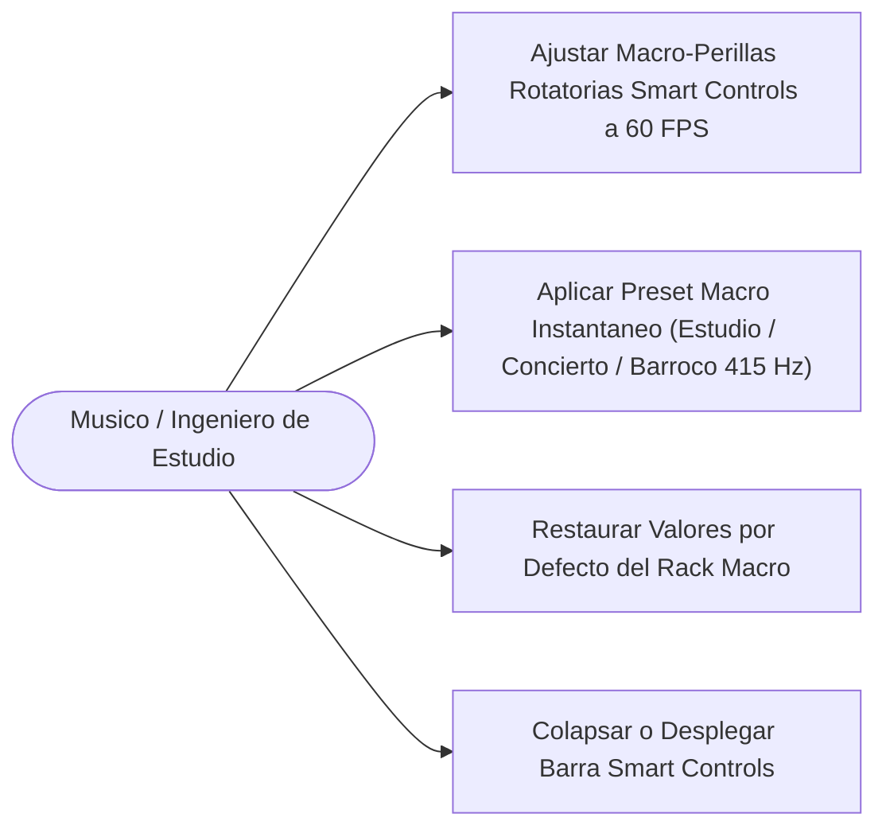
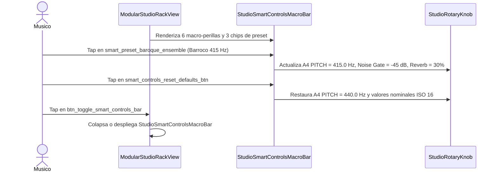

# Caso de Uso 201: Barra de Macro-Perillas Smart Controls estilo Apple Logic Pro en el Rack Modular (US-UX-09)

## Metadatos del Documento

- **ID del Documento:** `DOC-UI-2026-201`
- **ID del Caso de Uso:** `UC-201`
- **Historia de Usuario Asociada:** `US-UX-09`
- **Titulo Oficial:** Operacion de Macro-Perillas Smart Controls y Presets Acusticos Instantaneos en el Rack Modular de Estudio
- **Estado:** `Approved`
- **Fecha de Creacion:** `2026-11-25`
- **Ultima Modificacion:** `2026-11-25`
- **Fase Asociada:** `Fase 2 / Global UX Wave 5`
- **Autor / Revisor Principal:** `Nicolas Leon`
- **ADR Relacionado:** [ADR 0193](../04_adrs/0193_logic_pro_smart_controls_macro_bar_in_rack.md)

---

## 1. Resumen Ejecutivo (Executive Summary)

Este caso de uso formaliza el control unificado de los 6 parametros acusticos maestros del estudio (`A4 PITCH`, `MASTER TEMPO`, `NOISE GATE`, `DRONE MIX`, `RETUNE SPEED`, `ROOM REVERB`) mediante la barra `StudioSmartControlsMacroBar` (inspirada en **Apple Logic Pro Smart Controls**) en la cabecera de `ModularStudioRackView`.

---

## 2. Diagramas Canonicos (Mermaid)

### 2.1 Diagrama de Casos de Uso

### 2.2 Diagrama de Secuencia Detallado

---

## 3. Precondiciones, Postcondiciones y Flujos

### 3.1 Precondiciones
- El usuario navega a la pestana `Rack Modular` (`ModularStudioRackView`).

### 3.2 Postcondiciones
- Los ajustes realizados sobre las macro-perillas o presets actualizan de inmediato los parametros acusticos del rack sin abrir modales secundarios.

### 3.3 Flujo Principal
1. Al abrir `ModularStudioRackView`, el sistema muestra `StudioSmartControlsMacroBar` (`Key('studio_smart_controls_macro_bar')`) con las 6 macro-perillas rotatorias.
2. El usuario selecciona el preset `Barroco 415 Hz` (`Key('smart_preset_baroque_ensemble')`) o arrastra verticalmente cualquiera de las perillas `StudioRotaryKnob`.
3. La telemetria numerica refleja instantaneamente los nuevos valores (`415.0 Hz`, `-45.0 dB`, `30%`).
4. Al pulsar `Reset` (`Key('smart_controls_reset_defaults_btn')`), los 6 parametros vuelven a su calibracion estandar (`440.0 Hz`, `120 BPM`).

### 3.4 Flujos Alternativos y Condiciones de Error
- **Colapso de Consola Macro:** Si el usuario necesita mayor altura vertical para reordenar tarjetas del rack, pulsa `Key('btn_toggle_smart_controls_bar')` para ocultar temporalmente la barra macro.

---

## 4. Trazabilidad Arquitectonica y Pruebas Automatizadas

- **Componentes:** `lib/features/modular_rack/presentation/studio_smart_controls_macro_bar.dart`, `lib/features/modular_rack/presentation/modular_studio_rack_view.dart`.
- **Suite de Verificacion:** `test/features/modular_rack/us_ux_09_smart_controls_macro_bar_test.dart` (`3/3 PASS`).
