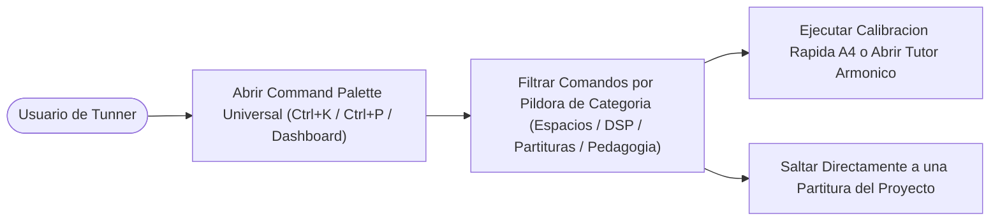
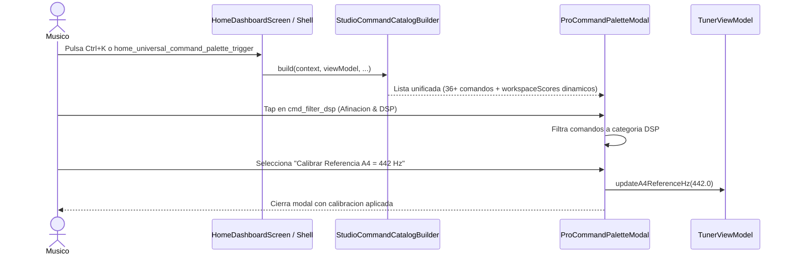

# Caso de Uso 202: Command Palette Universal con Filtros por Categoria e Indexacion Dinamica (US-UX-10)

## Metadatos del Documento

- **ID del Documento:** `DOC-UI-2026-202`
- **ID del Caso de Uso:** `UC-202`
- **Historia de Usuario Asociada:** `US-UX-10`
- **Titulo Oficial:** Busqueda y Ejecucion Instantanea en Command Palette Universal con Pildoras de Filtro Semantico e Indexacion de Partituras
- **Estado:** `Approved`
- **Fecha de Creacion:** `2026-11-25`
- **Ultima Modificacion:** `2026-11-25`
- **Fase Asociada:** `Fase 2 / Global UX Wave 5`
- **Autor / Revisor Principal:** `Nicolas Leon`
- **ADR Relacionado:** [ADR 0194](../04_adrs/0194_unified_universal_command_palette_and_category_filters.md)

---

## 1. Resumen Ejecutivo (Executive Summary)

Este caso de uso describe la operacion de la **Command Palette Universal (`Ctrl+K` / `Ctrl+P`)** inspirada en **Autodesk Fusion 360** y **VS Code**, que unifica el descubrimiento de espacios de trabajo, calibraciones DSP (`A4 = 432/440/442 Hz`), herramientas pedagogicas (`Tutor Armonico`) y partituras cargadas en el proyecto mediante pildoras de filtro por categoria y busqueda difusa instantanea.

---

## 2. Diagramas Canonicos (Mermaid)

### 2.1 Diagrama de Casos de Uso

### 2.2 Diagrama de Secuencia Detallado

---

## 3. Precondiciones, Postcondiciones y Flujos

### 3.1 Precondiciones
- La aplicacion se encuentra activa en cualquier pestaña o en `HomeDashboardScreen`.

### 3.2 Postcondiciones
- El comando seleccionado se ejecuta en $< 16	ext{ ms}$ y el modal se cierra devolviendo el foco al espacio de trabajo.

### 3.3 Flujo Principal
1. El usuario invoca la Command Palette Universal mediante `Ctrl+K`, el icono de busqueda superior o el boton `CTRL+K` en `HomeDashboardScreen` (`Key('home_universal_command_palette_trigger')`).
2. `ProCommandPaletteModal` muestra el campo de busqueda, el badge `CTRL+K / CTRL+P` y la barra de filtros por categoria (`Key('command_palette_category_filter_bar')`).
3. El usuario pulsa la pildora `Afinacion & DSP` (`Key('cmd_filter_dsp')`) o `Pedagogia` (`Key('cmd_filter_pedagogy')`) para acotar los resultados.
4. El usuario hace clic o presiona `Enter` sobre el comando deseado (`Calibrar Referencia A4 = 442 Hz`, `Abrir Tutor Armonico` o una partitura del proyecto).

### 3.4 Flujos Alternativos y Condiciones de Error
- **Sin Coincidencias:** Si la combinacion de categoria y texto de busqueda no arroja resultados, el modal muestra un mensaje informativo limpio permitiendo cambiar a la pildora `Todos` (`Key('cmd_filter_all')`) en 1 clic.

---

## 4. Trazabilidad Arquitectonica y Pruebas Automatizadas

- **Componentes:** `lib/features/navigation/presentation/studio_command_catalog_builder.dart`, `lib/features/navigation/presentation/pro_command_palette_modal.dart`, `lib/features/navigation/presentation/home_dashboard_screen.dart`.
- **Suite de Verificacion:** `test/features/navigation/us_ux_10_universal_command_palette_test.dart` (`2/2 PASS`).
