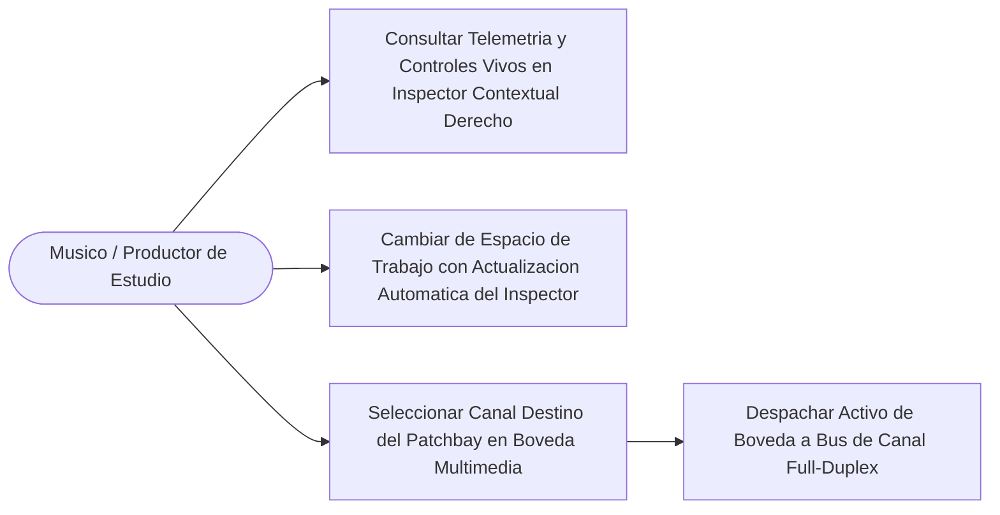
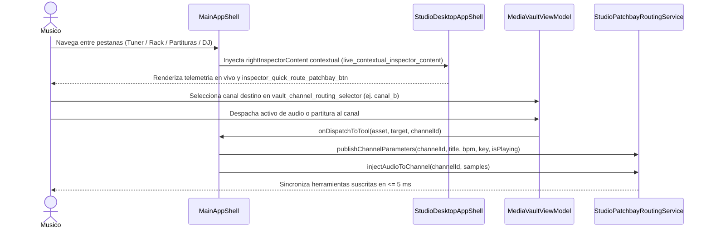

# Caso de Uso 203: Inspector Contextual Vivo en MainAppShell y Enrutamiento por Canal desde Boveda Multimedia (US-HC-01)

## Metadatos del Documento

- **ID del Documento:** `DOC-ARCH-2026-203`
- **ID del Caso de Uso:** `UC-203`
- **Historia de Usuario Asociada:** `US-HC-01`
- **Titulo Oficial:** Inyeccion Contextual del Inspector Derecho por Espacio de Trabajo y Enrutamiento de Activos desde Boveda Multimedia al Patchbay
- **Estado:** `Draft`
- **Fecha de Creacion:** `2026-11-26`
- **Ultima Modificacion:** `2026-11-26`
- **Fase Asociada:** `Fase 2 / Ola 6 Hiperconectividad Pro-Studio`
- **Autor / Revisor Principal:** `Nicolas Leon`
- **ADR Relacionado:** [ADR 0195](../04_adrs/0195_live_contextual_inspector_and_vault_channel_routing.md)

---

## 1. Resumen Ejecutivo (Executive Summary)

Este caso de uso define la activacion real del slot `rightInspectorContent` de `StudioDesktopAppShell` desde `MainAppShell` segun la pestana activa, asi como la conexion de `MediaVaultViewModel` con `StudioPatchbayRoutingService` para enrutar activos de audio y partitura hacia cualquier canal nombrable del estudio (`canal_a`..`canal_d` o canales personalizados) en lugar de redirigirlos de forma fija a DJ Deck A.

---

## 2. Diagramas Canonicos (Mermaid)

### 2.1 Diagrama de Casos de Uso

### 2.2 Diagrama de Secuencia Detallado

---

## 3. Precondiciones, Postcondiciones y Flujos

### 3.1 Precondiciones
- La aplicacion se ejecuta en `MainAppShell` con `StudioDesktopAppShell` en modo escritorio o con `MediaVaultWorkspaceModal` abierto.
- Existe al menos un activo cargado o importado en `MediaVaultViewModel`.

### 3.2 Postcondiciones
- El panel `studio_right_contextual_inspector_panel` muestra controles y telemetria especificos de la pestana activa (`Key('live_contextual_inspector_content')`).
- El activo despachado desde `MediaVaultViewModel` actualiza `StudioChannelBus` (`activeTrackTitle`, `activeBpm`, `activeCamelotKey`, `livePcmBuffer`) y notifica a todos los receptores conectados al canal en $\le 5\text{ ms}$.

### 3.3 Flujo Principal
1. El usuario abre el Inspector Derecho mediante `Key('btn_toggle_right_inspector')`.
2. `MainAppShell` evalua `_currentIndex` y construye `rightInspectorContent` con telemetria viva (afinacion actual y rigor en Tuner; compas y estado A-B en Partituras; buses activos en Rack/DJ) y el boton rapido `Key('inspector_quick_route_patchbay_btn')`.
3. Desde la Boveda Multimedia, el usuario elige el canal objetivo en `Key('vault_channel_routing_selector')` (`canal_a`, `canal_b`, `canal_c`, `canal_d` o canal personalizado).
4. Al confirmar el envio, `MainAppShell` invoca `StudioPatchbayRoutingService.publishChannelParameters` e inyecta los samples PCM en el canal seleccionado.

### 3.4 Flujos Alternativos y Condiciones de Error
- **Canal Personalizado Eliminado Previamente:** Si el canal seleccionado ya no existe en `StudioPatchbayRoutingService.channels`, el despachador realiza respaldo determinista hacia `canal_a` y muestra una notificacion informativa no bloqueante.
- **Activo Sin Samples PCM Decodificados:** Si el activo es una partitura sin PCM renderizado, el servicio publica sus metadatos (`title`, `bpm`, `key`) sin inyectar un buffer vacio de audio.

---

## 4. Trazabilidad Arquitectonica y Pruebas Automatizadas

- **Componentes:** `lib/features/navigation/presentation/main_app_shell.dart`, `lib/core/design_system/organisms/studio_desktop_app_shell.dart`, `lib/features/media_vault/domain/media_synergy_target.dart`, `lib/features/media_vault/presentation/media_vault_viewmodel.dart`, `lib/core/channels/domain/studio_patchbay_routing_service.dart`.
- **Suite Planificada:** `test/core/navigation/us_hc_01_live_contextual_inspector_and_vault_routing_test.dart`.
