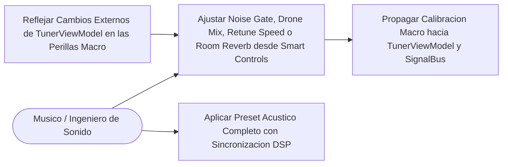
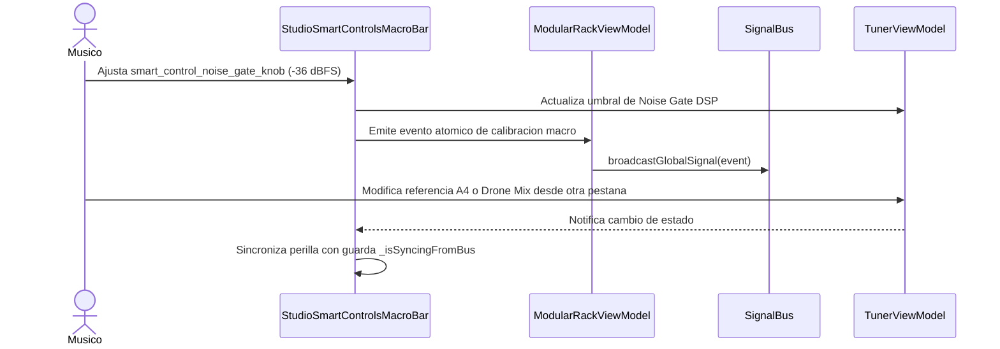

# Caso de Uso 204: Vinculacion Bidireccional de Smart Controls con DSP y SignalBus (US-HC-02)

## Metadatos del Documento

- **ID del Documento:** `DOC-ARCH-2026-204`
- **ID del Caso de Uso:** `UC-204`
- **Historia de Usuario Asociada:** `US-HC-02`
- **Titulo Oficial:** Enlace Bidireccional de las 6 Macro-Perillas Smart Controls del Rack Modular con los Parametros DSP de TunerViewModel y el Bus de Senales
- **Estado:** `Draft`
- **Fecha de Creacion:** `2026-11-26`
- **Ultima Modificacion:** `2026-11-26`
- **Fase Asociada:** `Fase 2 / Ola 6 Hiperconectividad Pro-Studio`
- **Autor / Revisor Principal:** `Nicolas Leon`
- **ADR Relacionado:** [ADR 0196](../04_adrs/0196_bidirectional_smart_controls_dsp_and_signal_bus_binding.md)

---

## 1. Resumen Ejecutivo (Executive Summary)

Este caso de uso garantiza que las 6 macro-perillas de `StudioSmartControlsMacroBar` (`A4 PITCH`, `MASTER TEMPO`, `NOISE GATE`, `DRONE MIX`, `RETUNE SPEED` y `ROOM REVERB`) operen de manera bidireccional con `TunerViewModel` y `ModularRackViewModel.signalBus`, eliminando el estado aislado de UI en las cuatro ultimas perillas y sincronizando cambios externos hacia la barra macro sin bucles de retroalimentacion.

---

## 2. Diagramas Canonicos (Mermaid)

### 2.1 Diagrama de Casos de Uso

### 2.2 Diagrama de Secuencia Detallado

---

## 3. Precondiciones, Postcondiciones y Flujos

### 3.1 Precondiciones
- El usuario accede a `ModularStudioRackView` con `StudioSmartControlsMacroBar` visible (`Key('studio_smart_controls_macro_bar')`).

### 3.2 Postcondiciones
- Cualquier ajuste en `NOISE GATE` (`[-70, -10]` dBFS), `DRONE MIX` (`[0, 100]`%), `RETUNE SPEED` (`[0, 100]` ms) o `ROOM REVERB` (`[0, 100]`%) modifica el parametro real correspondiente en `TunerViewModel` y se difunde por `SignalBus`.
- Si `TunerViewModel` cambia alguno de estos parametros desde otra pantalla, las perillas de `StudioSmartControlsMacroBar` reflejan el valor actualizado automaticamente.

### 3.3 Flujo Principal
1. Al montarse `StudioSmartControlsMacroBar`, inicializa los 6 diales leyendo los valores actuales de `TunerViewModel` y `ModularRackViewModel`.
2. El usuario gira una perilla macro (por ejemplo `Key('smart_control_noise_gate_knob')` o `Key('smart_control_drone_mix_knob')`).
3. El controlador normaliza y acota el valor fisico, actualiza `TunerViewModel` y difunde el evento correspondiente en `ModularRackViewModel.signalBus`.
4. Si otro modulo o pestana modifica `A4`, `Tempo`, `Noise Gate` o `Drone`, el listener de `StudioSmartControlsMacroBar` actualiza las perillas bajo la guarda `_isSyncingFromBus` sin re-emitir eventos redundantes.

### 3.4 Flujos Alternativos y Condiciones de Error
- **Montaje Aislado sin `Provider`:** Si `StudioSmartControlsMacroBar` se renderiza de forma aislada en pruebas unitarias sin `TunerViewModel` ni `ModularRackViewModel`, ejecuta sus callbacks locales (`onNoiseGateChanged`, `onDroneMixChanged`, `onRetuneSpeedChanged`, `onRoomReverbChanged`) sin fallar.
- **Valores Fuera de Rango:** Cualquier valor externo fuera de los limites fisicos de cada parametro se recorta deterministicamente con `.clamp(min, max)`.

---

## 4. Trazabilidad Arquitectonica y Pruebas Automatizadas

- **Componentes:** `lib/features/modular_rack/presentation/studio_smart_controls_macro_bar.dart`, `lib/features/modular_rack/presentation/modular_rack_viewmodel.dart`, `lib/features/tuner/presentation/tuner_viewmodel.dart`, `lib/features/modular_rack/domain/`.
- **Suite Planificada:** `test/features/modular_rack/us_hc_02_bidirectional_smart_controls_dsp_binding_test.dart`.
