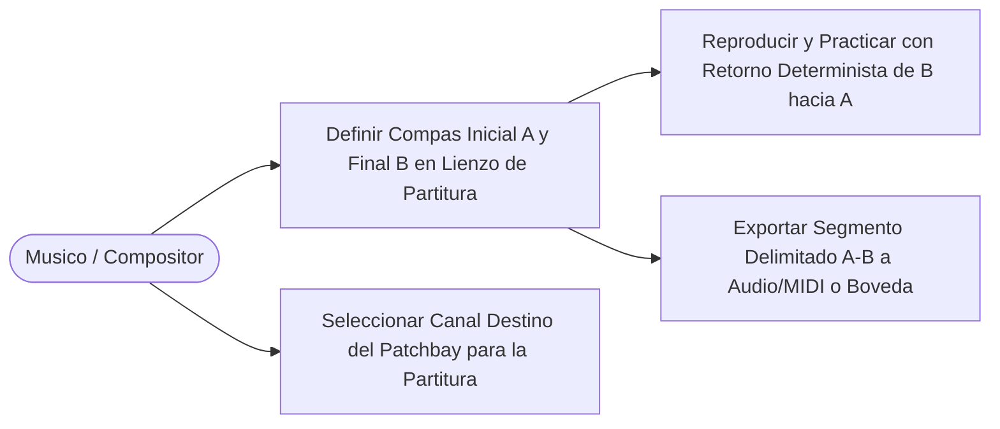
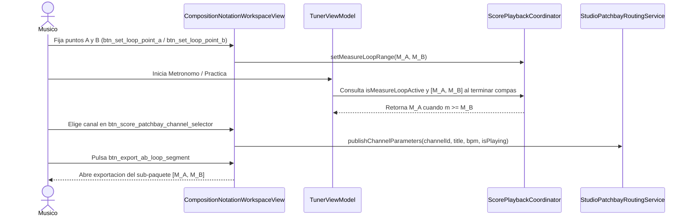

# Caso de Uso 205: Coordinador Unificado de Bucle A-B en Partitura y Puente Multi-Canal Patchbay (US-HC-03)

## Metadatos del Documento

- **ID del Documento:** `DOC-ARCH-2026-205`
- **ID del Caso de Uso:** `UC-205`
- **Historia de Usuario Asociada:** `US-HC-03`
- **Titulo Oficial:** Sincronizacion Efectiva del Bucle de Compases A-B en el Secuenciador de TunerViewModel y Exportacion Multi-Canal al Patchbay
- **Estado:** `Draft`
- **Fecha de Creacion:** `2026-11-26`
- **Ultima Modificacion:** `2026-11-26`
- **Fase Asociada:** `Fase 2 / Ola 6 Hiperconectividad Pro-Studio`
- **Autor / Revisor Principal:** `Nicolas Leon`
- **ADR Relacionado:** [ADR 0197](../04_adrs/0197_score_ab_loop_coordinator_and_patchbay_export_bridge.md)

---

## 1. Resumen Ejecutivo (Executive Summary)

Este caso de uso resuelve la desincronizacion entre `ScorePlaybackCoordinator` y el bucle principal de compases de `TunerViewModel`, asegurando que el avance metrico respete realmente el rango `[M_A, M_B]` configurado desde `CompositionNotationWorkspaceView`. Ademas, reemplaza el envio rigido al Canal A por un puente multi-canal hacia `StudioPatchbayRoutingService` y anade exportacion directa del segmento en bucle.

---

## 2. Diagramas Canonicos (Mermaid)

### 2.1 Diagrama de Casos de Uso

### 2.2 Diagrama de Secuencia Detallado

---

## 3. Precondiciones, Postcondiciones y Flujos

### 3.1 Precondiciones
- Existe una partitura activa en `TunerViewModel.activePackage` con al menos 1 compas (`totalMeasures >= 1`).
- El usuario se encuentra en `CompositionNotationWorkspaceView`.

### 3.2 Postcondiciones
- Al alcanzar el final del compas $M_B$ con el bucle A-B activo, el siguiente compas en `TunerViewModel` es exactamente $M_A$.
- El canal seleccionado en `StudioPatchbayRoutingService` recibe los parametros actualizados de la partitura activa.

### 3.3 Flujo Principal
1. El usuario posiciona el cursor en el compas inicial deseado y pulsa `Key('btn_set_loop_point_a')`.
2. Navega al compas final deseado y pulsa `Key('btn_set_loop_point_b')`, activando `ScorePlaybackCoordinator.setMeasureLoopRange(M_A, M_B)` y mostrando `Key('chip_ab_loop_status')`.
3. Al reproducir o practicar, cuando `TunerViewModel` completa `M_B`, verifica `scorePlaybackCoordinator.isMeasureLoopActive` y salta a `M_A`.
4. Para compartir la partitura con otras herramientas, el usuario selecciona el canal destino en `Key('btn_score_patchbay_channel_selector')` y publica en `StudioPatchbayRoutingService`, o pulsa `Key('btn_export_ab_loop_segment')` para exportar unicamente los compases `[M_A, M_B]`.

### 3.4 Flujos Alternativos y Condiciones de Error
- **Cambio a Partitura Mas Corta:** Si el usuario carga otra partitura con menos compases mientras el bucle A-B estaba activo, los limites `[M_A, M_B]` se recortan automaticamente a `[0, totalMeasures - 1]` o se desactiva el bucle si excede el rango valido.
- **Desactivacion de Bucle:** Al pulsar `Key('btn_clear_ab_loop')`, `ScorePlaybackCoordinator.clearMeasureLoop()` desactiva la restriccion y `TunerViewModel` reanuda la secuencia completa `0 .. totalMeasures - 1`.

---

## 4. Trazabilidad Arquitectonica y Pruebas Automatizadas

- **Componentes:** `lib/features/tuner/presentation/tuner_viewmodel.dart`, `lib/features/sheet_music/domain/score_playback_coordinator.dart`, `lib/features/workspaces/presentation/composition_notation_workspace_view.dart`, `lib/core/channels/domain/studio_patchbay_routing_service.dart`.
- **Suite Planificada:** `test/features/workspaces/us_hc_03_score_ab_loop_coordinator_and_patchbay_bridge_test.dart`.
