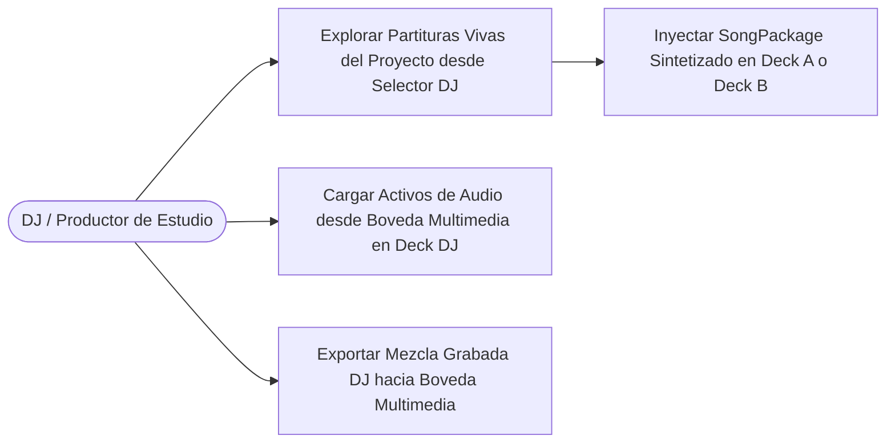
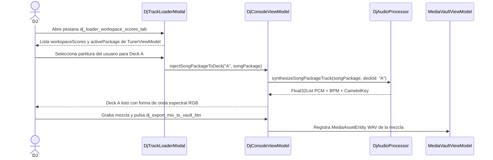

# Caso de Uso 206: Inyeccion en Vivo de SongPackage en Consola DJ y Retorno a Boveda Multimedia (US-HC-04)

## Metadatos del Documento

- **ID del Documento:** `DOC-ARCH-2026-206`
- **ID del Caso de Uso:** `UC-206`
- **Historia de Usuario Asociada:** `US-HC-04`
- **Titulo Oficial:** Carga Directa de Partituras Activas del Proyecto y Activos de Boveda en los Decks DJ con Exportacion Directa de Mezclas a Boveda
- **Estado:** `Draft`
- **Fecha de Creacion:** `2026-11-26`
- **Ultima Modificacion:** `2026-11-26`
- **Fase Asociada:** `Fase 2 / Ola 6 Hiperconectividad Pro-Studio`
- **Autor / Revisor Principal:** `Nicolas Leon`
- **ADR Relacionado:** [ADR 0198](../04_adrs/0198_dj_workstation_live_score_package_injection_and_vault.md)

---

## 1. Resumen Ejecutivo (Executive Summary)

Este caso de uso conecta la Consola DJ (`DjConsoleViewModel`, `DjTrackLoaderModal` y `DjStudioWorkstationView`) en doble sentido con `TunerViewModel.workspaceScores` y `MediaVaultViewModel`, permitiendo inyectar partituras vivas del usuario en los Decks A/B mediante sintesis polifonica y devolver sesiones de mezcla DJ grabadas hacia la Boveda Multimedia en 1 clic.

---

## 2. Diagramas Canonicos (Mermaid)

### 2.1 Diagrama de Casos de Uso

### 2.2 Diagrama de Secuencia Detallado

---

## 3. Precondiciones, Postcondiciones y Flujos

### 3.1 Precondiciones
- El usuario accede a `DjStudioWorkstationView` o `DjConsoleModal`.
- Existen obras en `TunerViewModel.workspaceScores` o activos en `MediaVaultViewModel`, o una mezcla grabada en `DjConsoleViewModel`.

### 3.2 Postcondiciones
- El deck destino queda cargado con titulo, compositor, BPM detectado, codigo Camelot y buffer PCM sintetizado del `SongPackage` vivo.
- Al exportar una mezcla DJ, `MediaVaultViewModel` incluye el nuevo `MediaAssetEntity` disponible inmediatamente para linea de tiempo o despacho a otras herramientas.

### 3.3 Flujo Principal
1. El usuario abre `DjTrackLoaderModal` desde el boton de carga de Deck A o Deck B.
2. Selecciona la pestana `Key('dj_loader_workspace_scores_tab')` o `Key('dj_loader_media_vault_tab')`.
3. Al elegir un `SongPackage`, `DjConsoleViewModel.injectSongPackageToDeck` sintetiza los stems polifonicos, calcula el beat-tracking y carga el deck correspondiente.
4. Tras grabar una sesion en la consola DJ, el usuario pulsa `Key('dj_export_mix_to_vault_btn')` para enviar el WAV capturado a `MediaVaultViewModel`.

### 3.4 Flujos Alternativos y Condiciones de Error
- **Sin Mezcla Grabada Previa:** Si el usuario pulsa `dj_export_mix_to_vault_btn` antes de grabar una sesion DJ (`_lastRecordedWavBytes == null`), el sistema informa de manera no intrusiva que debe grabarse primero una toma en el grabador de mezcla DJ.
- **`workspaceScores` Vacio:** La pestana `dj_loader_workspace_scores_tab` muestra un mensaje guia invitando a crear o importar una partitura, manteniendo accesible `activePackage`.

---

## 4. Trazabilidad Arquitectonica y Pruebas Automatizadas

- **Componentes:** `lib/features/dj_console/presentation/dj_console_view_model.dart`, `lib/features/dj_console/presentation/dj_track_loader_modal.dart`, `lib/features/dj_console/presentation/dj_studio_workstation_view.dart`, `lib/features/media_vault/presentation/media_vault_viewmodel.dart`.
- **Suite Planificada:** `test/features/dj_console/us_hc_04_dj_live_score_injection_and_vault_export_test.dart`.
