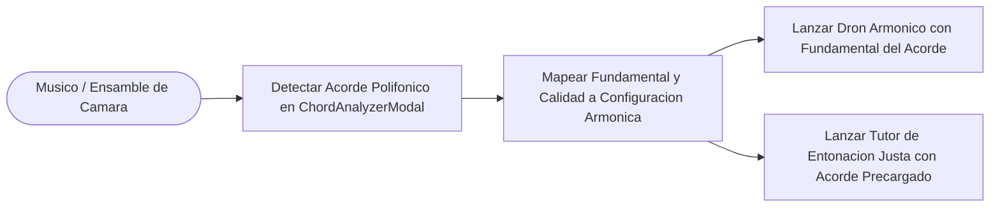
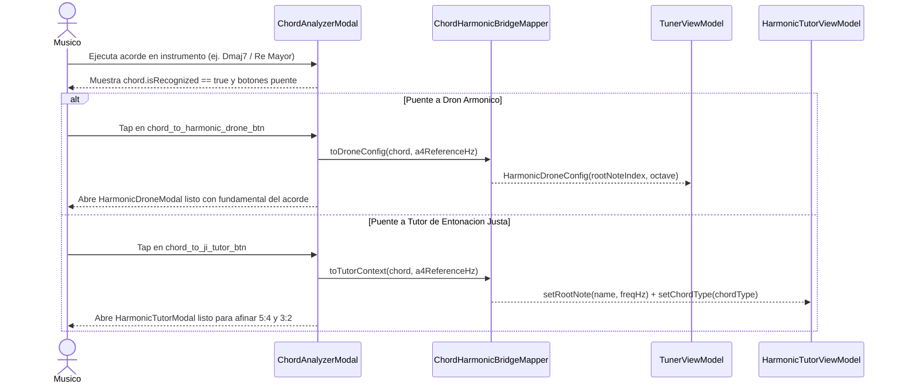

# Caso de Uso 207: Puente de Analizador de Acordes hacia Dron Armonico y Tutor de Entonacion Justa (US-HC-05)

## Metadatos del Documento

- **ID del Documento:** `DOC-ARCH-2026-207`
- **ID del Caso de Uso:** `UC-207`
- **Historia de Usuario Asociada:** `US-HC-05`
- **Titulo Oficial:** Transferencia en 1 Clic del Acorde Reconocido hacia el Generador de Dron Armonico y el Tutor de Entonacion Justa
- **Estado:** `Draft`
- **Fecha de Creacion:** `2026-11-26`
- **Ultima Modificacion:** `2026-11-26`
- **Fase Asociada:** `Fase 2 / Ola 6 Hiperconectividad Pro-Studio`
- **Autor / Revisor Principal:** `Nicolas Leon`
- **ADR Relacionado:** [ADR 0199](../04_adrs/0199_chord_analyzer_to_harmonic_drone_and_ji_tutor_bridge.md)

---

## 1. Resumen Ejecutivo (Executive Summary)

Este caso de uso enlaza `ChordAnalyzerModal` con `HarmonicDroneModal` y `HarmonicTutorModal` mediante un mapeador determinista en dominio (`ChordHarmonicBridgeMapper`), permitiendo que un acorde polifonico detectado en vivo configure instantaneamente la fundamental del Dron Armonico o la sesion completa del Tutor de Entonacion Justa en 1 clic.

---

## 2. Diagramas Canonicos (Mermaid)

### 2.1 Diagrama de Casos de Uso

### 2.2 Diagrama de Secuencia Detallado

---

## 3. Precondiciones, Postcondiciones y Flujos

### 3.1 Precondiciones
- `ChordAnalyzerModal` esta abierto y `viewModel.recognizedChord.isRecognized` es `true`.

### 3.2 Postcondiciones
- Si el usuario activa el puente a Dron Armonico, `HarmonicDroneConfig.rootNoteIndex` coincide exactamente con la fundamental del acorde detectado.
- Si activa el puente a Tutor de Entonacion Justa, `HarmonicTutorViewModel.session` refleja la fundamental (`rootNoteName`, `rootFrequency`) y el `HarmonicChordType` correspondiente.

### 3.3 Flujo Principal
1. El musico toca un acorde frente al microfono o entrada de linea en `ChordAnalyzerModal`.
2. Al reconocerse el acorde (`chord.isRecognized == true`), la tarjeta activa muestra `Key('chord_to_harmonic_drone_btn')` y `Key('chord_to_ji_tutor_btn')`.
3. Al pulsar cualquiera de los dos botones, `ChordHarmonicBridgeMapper` traduce el simbolo y notas del acorde en parametros fisicos de frecuencia respecto a `viewModel.referencePitch`.
4. El sistema abre el modal destino preconfigurado sin requerir seleccion manual adicional.

### 3.4 Flujos Alternativos y Condiciones de Error
- **Ningun Acorde Reconocido (`!chord.isRecognized`):** Los botones puente permanecen ocultos o deshabilitados en el estado placeholder (`--`).
- **Acorde con Tensiones No Estandar:** Si el acorde incluye extensiones fuera del catalogo de `HarmonicChordType`, el mapeador proyecta deterministicamente hacia triada mayor o menor segun la tercera presente, manteniendo la fundamental exacta.

---

## 4. Trazabilidad Arquitectonica y Pruebas Automatizadas

- **Componentes:** `lib/features/chord_analyzer/domain/`, `lib/features/chord_analyzer/presentation/chord_analyzer_modal.dart`, `lib/features/drone/domain/harmonic_drone_config.dart`, `lib/features/harmonic_tutor/presentation/harmonic_tutor_view_model.dart`.
- **Suite Planificada:** `test/features/chord_analyzer/us_hc_05_chord_to_harmonic_drone_and_ji_tutor_bridge_test.dart`.
