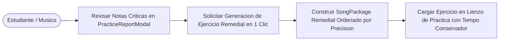
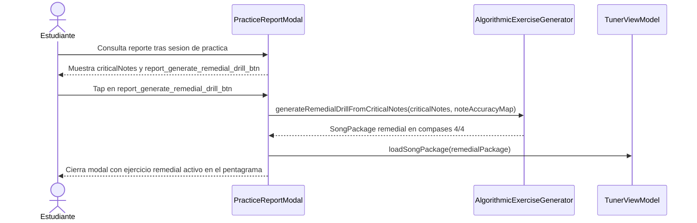

# Caso de Uso 208: Generacion de Ejercicios Remediales desde Notas Criticas del Reporte de Practica (US-HC-06)

## Metadatos del Documento

- **ID del Documento:** `DOC-ARCH-2026-208`
- **ID del Caso de Uso:** `UC-208`
- **Historia de Usuario Asociada:** `US-HC-06`
- **Titulo Oficial:** Creacion Automatica de Ejercicios Remediales en AlgorithmicExerciseGenerator desde criticalNotes de PracticeReportModal
- **Estado:** `Draft`
- **Fecha de Creacion:** `2026-11-26`
- **Ultima Modificacion:** `2026-11-26`
- **Fase Asociada:** `Fase 2 / Ola 6 Hiperconectividad Pro-Studio`
- **Autor / Revisor Principal:** `Nicolas Leon`
- **ADR Relacionado:** [ADR 0200](../04_adrs/0200_remedial_drill_generation_from_practice_report_critical_notes.md)

---

## 1. Resumen Ejecutivo (Executive Summary)

Este caso de uso cierra el ciclo pedagogico entre evaluacion y practica correctiva: a partir de `report.criticalNotes` y `report.noteAccuracyMap` mostrados en `PracticeReportModal`, el usuario puede generar en 1 clic un `SongPackage` remedial determinista mediante `AlgorithmicExerciseGenerator` y cargarlo de inmediato en `TunerViewModel` para corregir afinacion y digitacion.

---

## 2. Diagramas Canonicos (Mermaid)

### 2.1 Diagrama de Casos de Uso

### 2.2 Diagrama de Secuencia Detallado

---

## 3. Precondiciones, Postcondiciones y Flujos

### 3.1 Precondiciones
- Se ha generado una instancia de `PracticeReportEntity` y `PracticeReportModal` esta abierto.
- `report.criticalNotes` contiene al menos una nota con precision deficiente.

### 3.2 Postcondiciones
- `TunerViewModel.activePackage` contiene el `SongPackage` remedial enfocado en las notas de `report.criticalNotes`, priorizadas de menor a mayor porcentaje en `report.noteAccuracyMap`.
- Todos los compases generados cumplen la metrica canonica de 16 ticks en $4/4$ sin huecos ni notas invalidas.

### 3.3 Flujo Principal
1. Al finalizar una pasada evaluada, `PracticeReportModal` despliega los chips de notas dominadas y criticas.
2. Al detectar `report.criticalNotes.isNotEmpty`, el modal muestra el boton `Key('report_generate_remedial_drill_btn')`.
3. El estudiante pulsa el boton; `AlgorithmicExerciseGenerator.generateRemedialDrillFromCriticalNotes` ordena las notas criticas por urgencia y genera compases de notas largas y aproximaciones vecinales.
4. El paquete remedial se carga en `TunerViewModel` y el modal se cierra dejando listo el estudio correctivo.

### 3.4 Flujos Alternativos y Condiciones de Error
- **Cero Notas Criticas (`report.criticalNotes.isEmpty`):** El boton `report_generate_remedial_drill_btn` no se renderiza, manteniendo unicamente las opciones de cierre y repeticion.
- **Nombres de Nota con Ortografia Enarmonica Mixta:** `CanonicalPitchNotationCodec.parseOrDefault` normaliza cualquier formato valido (por ejemplo `Fa#4`, `F#4`, `Solb4`) antes de construir el `HierarchicalScore`.

---

## 4. Trazabilidad Arquitectonica y Pruebas Automatizadas

- **Componentes:** `lib/features/exercise_generator/domain/algorithmic_exercise_generator.dart`, `lib/features/practice_evaluator/presentation/practice_report_modal.dart`, `lib/features/practice_evaluator/domain/practice_report_entity.dart`, `lib/features/tuner/presentation/tuner_viewmodel.dart`.
- **Suite Planificada:** `test/features/practice_evaluator/us_hc_06_remedial_drill_from_critical_notes_test.dart`.
