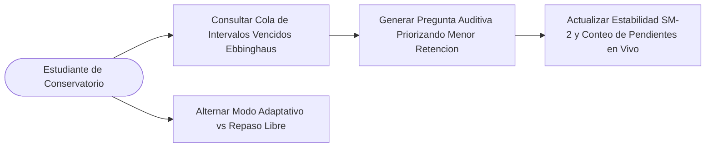
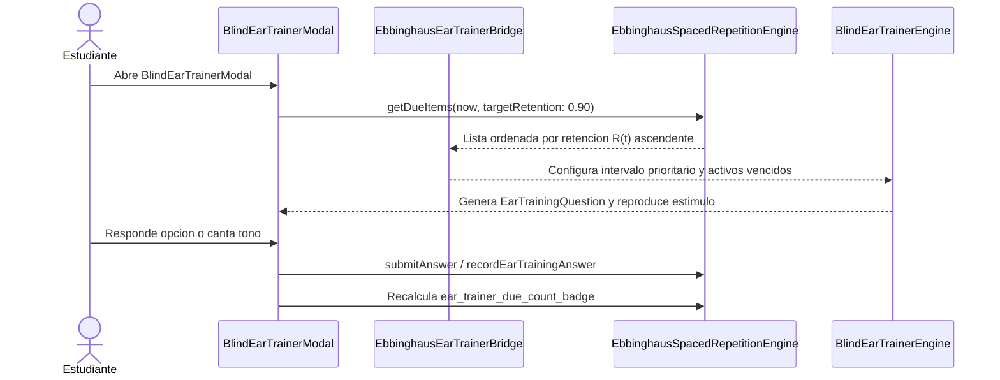

# Caso de Uso 209: Puente Adaptativo de Intervalos Vencidos Ebbinghaus en Entrenador Auditivo (US-HC-07)

## Metadatos del Documento

- **ID del Documento:** `DOC-ARCH-2026-209`
- **ID del Caso de Uso:** `UC-209`
- **Historia de Usuario Asociada:** `US-HC-07`
- **Titulo Oficial:** Priorizacion Adaptativa de Intervalos Vencidos desde EbbinghausSpacedRepetitionEngine hacia BlindEarTrainerModal
- **Estado:** `Draft`
- **Fecha de Creacion:** `2026-11-26`
- **Ultima Modificacion:** `2026-11-26`
- **Fase Asociada:** `Fase 2 / Ola 6 Hiperconectividad Pro-Studio`
- **Autor / Revisor Principal:** `Nicolas Leon`
- **ADR Relacionado:** [ADR 0201](../04_adrs/0201_ebbinghaus_adaptive_ear_trainer_due_intervals_bridge.md)

---

## 1. Resumen Ejecutivo (Executive Summary)

Este caso de uso conecta bidireccionalmente `TunerViewModel.ebbinghausEngine` con `BlindEarTrainerModal` y `BlindEarTrainerEngine`, de modo que las preguntas de entrenamiento auditivo prioricen los intervalos con menor retencion cognitiva $R(t) = \exp(-t / S)$ y actualicen en tiempo real la cola de repasos pendientes.

---

## 2. Diagramas Canonicos (Mermaid)

### 2.1 Diagrama de Casos de Uso

### 2.2 Diagrama de Secuencia Detallado

---

## 3. Precondiciones, Postcondiciones y Flujos

### 3.1 Precondiciones
- `TunerViewModel` posee inicializado `ebbinghausEngine` (`EbbinghausSpacedRepetitionEngine`) con el catalogo de intervalos canonicos.

### 3.2 Postcondiciones
- En modo adaptativo (`ear_trainer_ebbinghaus_adaptive_toggle` activo), cada nueva pregunta selecciona su intervalo objetivo entre los items vencidos de mayor urgencia en `ebbinghausEngine`.
- Tras responder correctamente con grado $q \ge 3$ y proyectar `nextReviewDate` al futuro, el contador `Key('ear_trainer_due_count_badge')` disminuye de inmediato.

### 3.3 Flujo Principal
1. Al abrir `BlindEarTrainerModal`, el adaptador consulta `viewModel.ebbinghausEngine.getDueItems()`.
2. El encabezado muestra la insignia `Key('ear_trainer_due_count_badge')` con el numero de intervalos vencidos y el conmutador `Key('ear_trainer_ebbinghaus_adaptive_toggle')`.
3. `BlindEarTrainerEngine` genera el estimulo auditivo priorizando el intervalo vencido con menor retencion $R(t)$.
4. El estudiante responde por boton, teclado (`1`-`4`) o voz cantada; `TunerViewModel.recordEarTrainingAnswer` actualiza la curva SM-2/Ebbinghaus y refresca la cola pendiente para la siguiente pregunta.

### 3.4 Flujos Alternativos y Condiciones de Error
- **Todos los Intervalos Consolidados (`dueItems.isEmpty`):** Cuando ningun intervalo requiere repaso inmediato, `ear_trainer_due_count_badge` indica `0 pendientes` y el adaptador selecciona los 3 intervalos de menor retencion actual para mantener la practica sin error.
- **Modo Libre Activado:** Si el usuario desactiva `ear_trainer_ebbinghaus_adaptive_toggle`, `BlindEarTrainerEngine` vuelve a muestrear uniformemente todos los intervalos activos configurados.

---

## 4. Trazabilidad Arquitectonica y Pruebas Automatizadas

- **Componentes:** `lib/features/pedagogy/domain/ebbinghaus_spaced_repetition_engine.dart`, `lib/features/ear_training/domain/blind_ear_trainer_engine.dart`, `lib/features/ear_training/presentation/blind_ear_trainer_modal.dart`, `lib/features/tuner/presentation/tuner_viewmodel.dart`.
- **Suite Planificada:** `test/features/ear_training/us_hc_07_ebbinghaus_adaptive_ear_trainer_bridge_test.dart`.
